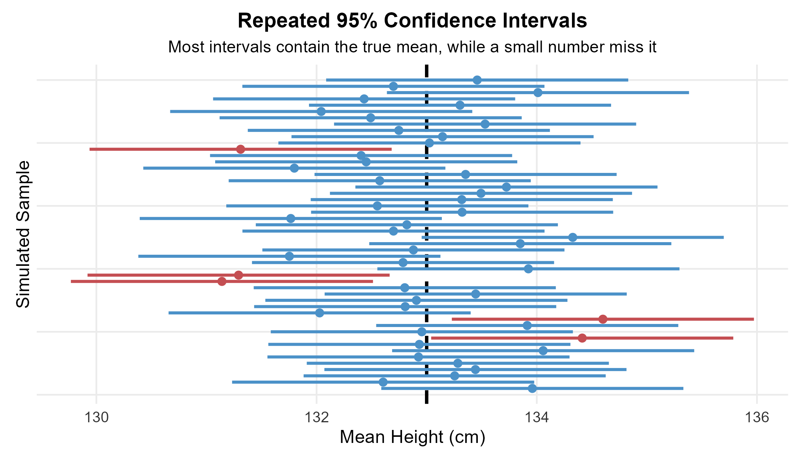
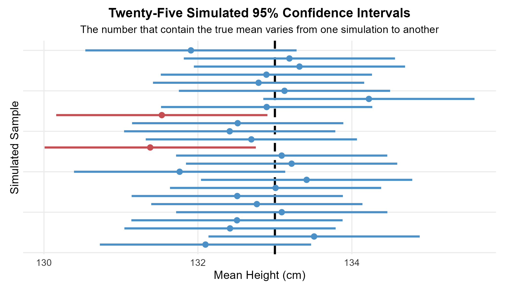
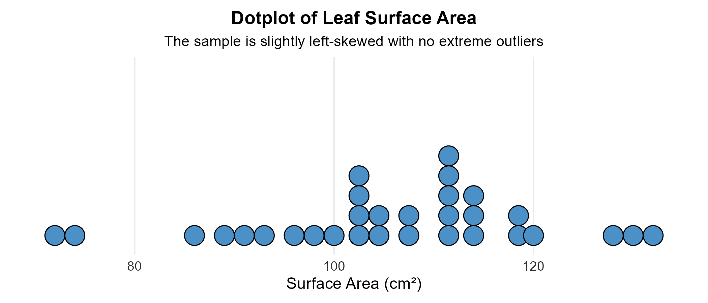

<style>
/* ============================================================
   CHAPTER 14 — PAGE + COLLAPSIBLE TABLE OF CONTENTS
   ============================================================ */

:root {
  --toc-width: 300px;
  --toc-collapsed-gutter: 72px;
  --chapter-width: 1100px;

  --ink: #23364a;
  --accent: #2c3e50;
  --line: #d8dee4;
  --soft: #f6f8fa;
  --toc-background: #f7f9fb;
}


/* ============================================================
   GENERAL PAGE
   ============================================================ */

html {
  scroll-behavior: smooth;
}

body {
  font-size: 17px;
  line-height: 1.65;
  color: var(--ink);
}

.main-container {
  max-width: var(--chapter-width) !important;
}


/* ============================================================
   HIDE DUMMY CHAPTER CONTENT
   ============================================================ */

/*
   Chapter 14 is the visible chapter heading. Pandoc applies a section-number offset of 13 so that its subsections begin at 14.1.

   Hide the visible "Chapter 14" H1 because the document title
   already says Chapter 14, but KEEP the section itself so that
   H2 headings are numbered 14.1, 14.2, 14.3, ...
*/
.section.chapter-root > h1 {
  display: none !important;
}


/* ============================================================
   HIDE EARLIER DUMMY CHAPTERS FROM THE TABLE OF CONTENTS
   ============================================================ */

/*
   R Markdown/tocify does not reliably expose the chapter names
   through data-unique, so select them through their generated
   href values instead.
*/

#TOC li:has(a[href="#chapter-1-dummy"]),
#TOC li:has(a[href="#chapter-2-dummy"]),
#TOC li:has(a[href="#chapter-3-dummy"]),
#TOC li:has(a[href="#chapter-4-dummy"]),
#TOC li:has(a[href="#chapter-5-dummy"]),
#TOC li:has(a[href="#chapter-6-dummy"]),
#TOC li:has(a[href="#chapter-7-dummy"]),
#TOC li:has(a[href="#chapter-8-dummy"]),
#TOC li:has(a[href="#chapter-9-dummy"]),
#TOC li:has(a[href="#chapter-10-dummy"]),
#TOC li:has(a[href="#chapter-11-dummy"]),
#TOC li:has(a[href="#chapter-12-dummy"]),
#TOC li:has(a[href="#chapter-13-dummy"]) {
  display: none !important;
}


/*
   The Chapter 14 parent entry is hidden so that only its numbered subsections appear in the floating table of contents.

   Its children — 14.1, 14.2, 14.3, ... — remain visible.
*/
#TOC li:has(> a[href="#chapter-14"]) > a[href="#chapter-14"] {
  display: none !important;
}


/*
   tocify may place the Chapter 14 subsections inside the same
   list item. Remove spacing belonging to the hidden parent.
*/
#TOC li:has(> a[href="#chapter-14"]) {
  margin-top: 0 !important;
}


/* ============================================================
   ACCESSIBILITY
   ============================================================ */

.sr-only {
  position: absolute;
  width: 1px;
  height: 1px;
  padding: 0;
  margin: -1px;
  overflow: hidden;
  clip: rect(0, 0, 0, 0);
  white-space: nowrap;
  border: 0;
}


/* ============================================================
   SIDEBAR TOGGLE BUTTON
   ============================================================ */

#toc-toggle {
  position: fixed;

  top: 16px;
  left: calc(var(--toc-width) + 14px);

  width: 42px;
  height: 42px;

  display: flex;
  align-items: center;
  justify-content: center;

  padding: 0;

  border: 1px solid #c7d0d9;
  border-radius: 8px;

  background: #ffffff;
  color: var(--ink);

  box-shadow: 0 2px 8px rgba(24, 39, 55, 0.13);

  cursor: pointer;

  font-size: 24px;
  line-height: 1;

  z-index: 1200;

  transition:
    left 0.25s ease,
    background-color 0.2s ease,
    box-shadow 0.2s ease,
    transform 0.2s ease;
}

#toc-toggle:hover {
  background: #eef3f7;
  box-shadow: 0 3px 10px rgba(24, 39, 55, 0.18);
}

#toc-toggle:focus-visible {
  outline: 3px solid rgba(44, 62, 80, 0.28);
  outline-offset: 2px;
}


/* Open/close icons */

#toc-toggle .menu-icon {
  display: none;
}

#toc-toggle .close-icon {
  display: inline;
}


/* Button position when sidebar is collapsed */

body.toc-collapsed #toc-toggle {
  left: 14px;
}

body.toc-collapsed #toc-toggle .menu-icon {
  display: inline;
}

body.toc-collapsed #toc-toggle .close-icon {
  display: none;
}


/* ============================================================
   DESKTOP LAYOUT
   ============================================================ */

@media screen and (min-width: 992px) {

  /*
     Make room for fixed sidebar.
  */
  .main-container {
    width: 100% !important;
    max-width: none !important;

    padding-left: calc(var(--toc-width) + 30px) !important;
    padding-right: 35px !important;

    box-sizing: border-box !important;

    transition: padding-left 0.25s ease;
  }


  /*
     When sidebar is collapsed, reclaim almost all of the space.
  */
  body.toc-collapsed .main-container {
    padding-left: var(--toc-collapsed-gutter) !important;
  }


  /*
     Bootstrap normally reserves a column for the TOC.
     The TOC is fixed now, so remove that reserved column.
  */
  .main-container > .row-fluid > .col-xs-12.col-sm-4.col-md-3,
  .main-container > .row > .col-xs-12.col-sm-4.col-md-3 {
    width: 0 !important;
    min-height: 0 !important;
    padding: 0 !important;
    margin: 0 !important;
  }


  /* ----------------------------------------------------------
     FLOATING TOC
     ---------------------------------------------------------- */

  #TOC,
  #TOC.tocify {
    position: fixed !important;

    top: 0 !important;
    bottom: 0 !important;
    left: 0 !important;

    width: var(--toc-width) !important;
    max-height: 100vh !important;

    box-sizing: border-box !important;

    overflow-y: auto !important;
    overflow-x: hidden !important;

    margin: 0 !important;
    padding: 72px 16px 28px 18px !important;

    background: var(--toc-background) !important;

    border: 0 !important;
    border-right: 1px solid var(--line) !important;
    border-radius: 0 !important;

    box-shadow: none !important;

    z-index: 1100 !important;

    transform: translateX(0);

    transition: transform 0.25s ease;
  }


  /*
     Completely slide sidebar off screen when collapsed.
  */
  body.toc-collapsed #TOC,
  body.toc-collapsed #TOC.tocify {
    transform: translateX(calc(-1 * var(--toc-width)));
  }


  /*
     Allow long section headings to wrap rather than getting
     clipped.
  */
  #TOC a {
    white-space: normal !important;
    overflow-wrap: break-word !important;
    word-break: normal !important;
  }


  /* ----------------------------------------------------------
     TOC TYPOGRAPHY
     ---------------------------------------------------------- */

  #TOC .tocify-item {
    border-radius: 4px;
  }

  #TOC .tocify-item a {
    color: var(--ink);
    text-decoration: none;
  }

  #TOC .tocify-item:hover {
    background: #e9eef3;
  }

  #TOC .tocify-item.active {
    background: var(--accent) !important;
  }

  #TOC .tocify-item.active a {
    color: #ffffff !important;
  }


  /* ----------------------------------------------------------
     MAIN CHAPTER CONTENT
     ---------------------------------------------------------- */

  .toc-content,
  .toc-content.col-xs-12.col-sm-8.col-md-9 {
    width: 100% !important;
    max-width: var(--chapter-width) !important;

    float: none !important;

    margin-left: auto !important;
    margin-right: auto !important;

    padding-left: 15px !important;
    padding-right: 15px !important;

    box-sizing: border-box !important;
  }


  /*
     Fallback for Pandoc output that does not use Bootstrap's
     normal R Markdown container structure.
  */
  body.standalone-pandoc {
    width: calc(100% - var(--toc-width)) !important;
    max-width: none !important;

    box-sizing: border-box !important;

    margin: 0 0 0 var(--toc-width) !important;
    padding: 50px 45px !important;

    transition:
      width 0.25s ease,
      margin-left 0.25s ease,
      padding-left 0.25s ease;
  }

  body.standalone-pandoc.toc-collapsed {
    width: 100% !important;

    margin-left: 0 !important;
    padding-left: var(--toc-collapsed-gutter) !important;
  }

  body.standalone-pandoc > header,
  body.standalone-pandoc > section {
    max-width: var(--chapter-width);

    margin-left: auto;
    margin-right: auto;
  }
}


/* ============================================================
   MOBILE / TABLET
   ============================================================ */

@media screen and (max-width: 991px) {

  .main-container {
    width: auto !important;
    max-width: var(--chapter-width) !important;

    margin-left: auto !important;
    margin-right: auto !important;

    padding: 70px 18px 24px !important;

    box-sizing: border-box !important;
  }


  /*
     Toggle remains at upper-left on mobile.
  */
  #toc-toggle,
  body.toc-collapsed #toc-toggle {
    left: 12px;
  }


  /*
     Mobile starts with menu icon.
  */
  #toc-toggle .menu-icon,
  body.toc-collapsed #toc-toggle .menu-icon {
    display: inline;
  }

  #toc-toggle .close-icon,
  body.toc-collapsed #toc-toggle .close-icon {
    display: none;
  }


  /*
     Show X while the mobile TOC is open.
  */
  body.toc-mobile-open #toc-toggle .menu-icon {
    display: none;
  }

  body.toc-mobile-open #toc-toggle .close-icon {
    display: inline;
  }


  /* ----------------------------------------------------------
     MOBILE TOC DRAWER
     ---------------------------------------------------------- */

  #TOC,
  #TOC.tocify {
    position: fixed !important;

    top: 0 !important;
    bottom: 0 !important;
    left: 0 !important;

    width: min(84vw, 320px) !important;
    max-height: 100vh !important;

    box-sizing: border-box !important;

    overflow-y: auto !important;
    overflow-x: hidden !important;

    margin: 0 !important;
    padding: 72px 18px 28px !important;

    background: var(--toc-background) !important;

    border: 0 !important;
    border-right: 1px solid var(--line) !important;
    border-radius: 0 !important;

    z-index: 1100 !important;

    transform: translateX(-105%);

    transition: transform 0.25s ease;
  }

  body.toc-mobile-open #TOC,
  body.toc-mobile-open #TOC.tocify {
    transform: translateX(0);

    box-shadow: 6px 0 18px rgba(24, 39, 55, 0.16);
  }


  /*
     Prevent long headings from being clipped.
  */
  #TOC a {
    white-space: normal !important;
    overflow-wrap: break-word !important;
    word-break: normal !important;
  }


  body.standalone-pandoc {
    width: auto !important;
    max-width: var(--chapter-width) !important;

    margin: 0 auto !important;
    padding: 70px 18px 24px !important;

    box-sizing: border-box !important;
  }
}


/* ============================================================
   SECTION HEADINGS
   ============================================================ */

h1,
h2,
h3,
h4,
h5 {
  margin-top: 1.6em;
}

h2 {
  border-bottom: 3px solid var(--accent);
  padding-bottom: 0.25em;
}

h3 {
  border-bottom: 1px solid var(--line);
  padding-bottom: 0.2em;
}


/* ============================================================
   BLOCKQUOTES / DEFINITION BOXES
   ============================================================ */

blockquote {
  border-left: 4px solid var(--accent);

  background: #f7f9fa;

  padding: 0.7em 1em;
  margin-top: 1.2em;
  margin-bottom: 1.2em;
}


/* ============================================================
   TABLES
   ============================================================ */

table {
  width: 100%;

  margin: 1.35em auto;

  border-collapse: separate !important;
  border-spacing: 0;

  background: #ffffff;

  border: 1px solid #d6dde5;
  border-radius: 8px;

  overflow: hidden;

  box-shadow: 0 2px 8px rgba(24, 39, 55, 0.06);
}

table thead th {
  padding: 0.72em 0.9em !important;

  background: var(--accent);
  color: #ffffff;

  border: 0 !important;
  border-bottom: 1px solid #1e2d3b !important;

  font-weight: 700;

  vertical-align: middle !important;
}

table tbody td {
  padding: 0.65em 0.9em !important;

  border: 0 !important;
  border-bottom: 1px solid #e5e9ee !important;

  vertical-align: middle !important;
}

table tbody tr:nth-child(even) td {
  background: #f7f9fb;
}

table tbody tr:hover td {
  background: #eef4f8;
}

table tbody tr:last-child td {
  border-bottom: 0 !important;
}


/* ============================================================
   IMAGES
   ============================================================ */

img {
  display: block;

  max-width: 100%;
  height: auto;

  margin: 1.4em auto;

  border: 1px solid #e1e4e8;
  border-radius: 7px;
}


/* ============================================================
   MATHEMATICS
   ============================================================ */

.math.display {
  overflow-x: auto;
}


/* ============================================================
   HIDE R MARKDOWN CODE-FOLDING UI
   ============================================================ */

.btn-code,
.code-folding-btn,
div.btn-group.pull-right {
  display: none !important;
}
</style>

<button id="toc-toggle"
        type="button"
        aria-label="Toggle table of contents"
        aria-expanded="true">
  <span class="menu-icon" aria-hidden="true">&#9776;</span>
  <span class="close-icon" aria-hidden="true">&times;</span>
  <span class="sr-only">Toggle table of contents</span>
</button>

<script>
document.addEventListener("DOMContentLoaded", function () {
  const button = document.getElementById("toc-toggle");

  if (!button) return;

  button.addEventListener("click", function () {
    if (window.innerWidth <= 991) {
      document.body.classList.toggle("toc-mobile-open");

      const isOpen =
        document.body.classList.contains("toc-mobile-open");

      button.setAttribute("aria-expanded", isOpen);
    } else {
      document.body.classList.toggle("toc-collapsed");

      const isOpen =
        !document.body.classList.contains("toc-collapsed");

      button.setAttribute("aria-expanded", isOpen);
    }
  });
});
</script>

```{r setup, include=FALSE, echo=FALSE, warning=FALSE, message=FALSE}
knitr::opts_chunk$set(
  echo = TRUE,
  warning = FALSE,
  message = FALSE,
  error = FALSE,
  fig.align = "center",
  fig.width = 6,
  fig.height = 4
)

# ggplot2 is used only to create the lecture figures that are saved as PNG files.
# The visible R examples later in the chapter use introductory R functions.
if (!requireNamespace("ggplot2", quietly = TRUE)) {
  stop("The ggplot2 package must be installed before this chapter is knitted.")
}

suppressPackageStartupMessages({
  library(ggplot2)
})

# A fixed seed makes all simulation figures reproducible.
set.seed(42)

# This theme keeps the lecture figures visually consistent.
lecture_chart_theme <- theme_minimal(base_size = 11) +
  theme(
    plot.title = element_text(size = 13, face = "bold", hjust = 0.5),
    plot.subtitle = element_text(size = 10.5, hjust = 0.5),
    axis.title = element_text(size = 11.5),
    axis.text = element_text(size = 9.5, colour = "#333333"),
    panel.grid.minor = element_blank(),
    plot.background = element_rect(fill = "white", colour = NA),
    panel.background = element_rect(fill = "white", colour = NA),
    plot.margin = margin(8, 10, 8, 10)
  )

# This helper saves every lecture figure with the same resolution and background.
save_plot <- function(filename, plot, width, height) {
  ggsave(
    filename = filename,
    plot = plot,
    width = width,
    height = height,
    units = "in",
    dpi = 300,
    bg = "white"
  )
}

# =============================================================
# Figure 1: Repeated 95% confidence intervals
# =============================================================

# The simulation uses a population mean of 133 cm.
mu_true <- 133

# The standard deviation of the sampling distribution is 0.7 cm.
sigma_xbar <- 0.7

# The exact 95% Normal critical value determines the interval half-width.
z_star_95 <- qnorm(0.975)
margin_95 <- z_star_95 * sigma_xbar

# Fifty independent sample means are generated from the sampling distribution.
n_intervals <- 50
sample_means <- rnorm(
  n_intervals,
  mean = mu_true,
  sd = sigma_xbar
)

# Each row contains one simulated confidence interval.
ci_data <- data.frame(
  sample_id = seq_len(n_intervals),
  xbar = sample_means,
  lower = sample_means - margin_95,
  upper = sample_means + margin_95
)

# The logical variable records whether each interval contains the true mean.
ci_data$captured <- (
  ci_data$lower <= mu_true &
  ci_data$upper >= mu_true
)

p_ci_simulation <- ggplot(
  ci_data,
  aes(y = sample_id, x = xbar, colour = captured)
) +
  geom_vline(
    xintercept = mu_true,
    linetype = "dashed",
    colour = "black",
    linewidth = 1
  ) +
  geom_segment(
    aes(
      x = lower,
      xend = upper,
      y = sample_id,
      yend = sample_id
    ),
    linewidth = 0.9
  ) +
  geom_point(size = 2) +
  scale_colour_manual(
    values = c(
      "FALSE" = "#C44E52",
      "TRUE" = "#4B91C8"
    )
  ) +
  labs(
    title = "Repeated 95% Confidence Intervals",
    subtitle = "Most intervals contain the true mean, while a small number miss it",
    x = "Mean Height (cm)",
    y = "Simulated Sample"
  ) +
  lecture_chart_theme +
  theme(
    legend.position = "none",
    axis.text.y = element_blank(),
    axis.ticks.y = element_blank()
  )

save_plot(
  "fig_ch14_sampling_dist.png",
  p_ci_simulation,
  width = 7,
  height = 4
)

# =============================================================
# Figure 2: A smaller repeated-confidence-interval simulation
# =============================================================

# A second seed creates a different set of samples for this separate figure.
set.seed(314)

n_intervals_small <- 25
sample_means_small <- rnorm(
  n_intervals_small,
  mean = mu_true,
  sd = sigma_xbar
)

ci_small <- data.frame(
  sample_id = seq_len(n_intervals_small),
  xbar = sample_means_small,
  lower = sample_means_small - margin_95,
  upper = sample_means_small + margin_95
)

ci_small$captured <- (
  ci_small$lower <= mu_true &
  ci_small$upper >= mu_true
)

p_ci_small <- ggplot(
  ci_small,
  aes(y = sample_id, x = xbar, colour = captured)
) +
  geom_vline(
    xintercept = mu_true,
    linetype = "dashed",
    colour = "black",
    linewidth = 1
  ) +
  geom_segment(
    aes(
      x = lower,
      xend = upper,
      y = sample_id,
      yend = sample_id
    ),
    linewidth = 1
  ) +
  geom_point(size = 2.3) +
  scale_colour_manual(
    values = c(
      "FALSE" = "#C44E52",
      "TRUE" = "#4B91C8"
    )
  ) +
  labs(
    title = "Twenty-Five Simulated 95% Confidence Intervals",
    subtitle = "The number that contain the true mean varies from one simulation to another",
    x = "Mean Height (cm)",
    y = "Simulated Sample"
  ) +
  lecture_chart_theme +
  theme(
    legend.position = "none",
    axis.text.y = element_blank(),
    axis.ticks.y = element_blank()
  )

save_plot(
  "fig_ch14_25_intervals.png",
  p_ci_small,
  width = 7,
  height = 4
)

# =============================================================
# Figure 3: Leaf surface area example
# =============================================================

# These are the 31 leaf surface area measurements used in the worked example.
leaf_data <- c(
  114, 100, 104, 89, 102, 91, 114, 114,
  103, 105, 108, 130, 120, 132, 111, 128,
  118, 119, 86, 72, 111, 103, 74, 112,
  107, 103, 98, 96, 112, 112, 93
)

leaf_df <- data.frame(Area = leaf_data)

p_leaf_dotplot <- ggplot(leaf_df, aes(x = Area)) +
  geom_dotplot(
    binwidth = 2,
    fill = "#4B91C8",
    colour = "black",
    dotsize = 1
  ) +
  scale_y_continuous(NULL, breaks = NULL) +
  labs(
    title = "Dotplot of Leaf Surface Area",
    subtitle = "The sample is slightly left-skewed with no extreme outliers",
    x = "Surface Area (cm²)"
  ) +
  lecture_chart_theme

save_plot(
  "fig_ch14_leaf_dotplot.png",
  p_leaf_dotplot,
  width = 7,
  height = 3
)
```

# Chapter 14 {.chapter-root .unlisted}

## Introduction to Inference

Chapter 13 described how sample statistics vary from one random sample to another. A sample mean, sample proportion or other statistic will not usually equal the corresponding population parameter exactly because different random samples contain different individuals.

A sampling distribution describes this variation. Chapter 14 uses that distribution to address a new question:

> **Central question**
>
> What can sample data tell us about an unknown population parameter?

**Statistical inference** uses sample data to draw conclusions about a population while accounting for random sampling variation. It does not remove uncertainty. Instead, it provides a principled way to measure and communicate that uncertainty.

### Two Main Goals of Statistical Inference

This chapter introduces two closely related forms of inference.

1. **Estimation:** A confidence interval uses sample data to estimate an unknown population parameter. It gives a range of plausible values and describes the precision of the estimate.
2. **Testing a claim:** A hypothesis test evaluates how compatible the observed data are with a specific claim about a population parameter.

Both procedures rely on a sampling distribution.

- A confidence interval asks which parameter values are reasonably compatible with the observed statistic.
- A hypothesis test begins with one specified parameter value and asks whether the observed statistic would be unusual if that value were correct.

The quality of either conclusion depends on the study design. A correct formula cannot repair serious selection bias, nonresponse, poor measurement or dependence among observations.

### Why Begin with a Known Population Standard Deviation?

When making inferences about a population mean, the population standard deviation $\sigma$ is usually unknown. In this chapter, $\sigma$ is initially treated as known.

This simplifying assumption makes it possible to focus on the main logic of inference:

- how sampling distributions quantify uncertainty
- how confidence intervals are constructed and interpreted
- how evidence against a population claim is evaluated
- how sample size and confidence level affect precision

When $\sigma$ is unknown, it must be estimated using the sample standard deviation $s$. This leads to methods based on Student's $t$ distribution, which will be introduced in Chapter 17.

---

## Statistical Estimation

A sample statistic can be used to estimate an unknown population parameter.

For a population mean $\mu$, the natural point estimate is the sample mean

$$
\bar{x}
$$

A **point estimate** provides one numerical estimate. An **interval estimate** provides a range of plausible values for the parameter.

A confidence interval has the general form

$$
\text{point estimate}\ \pm\ \text{margin of error}
$$

The point estimate identifies the centre of the interval. The margin of error describes uncertainty caused by random sampling variation.

### Examples 14.1 and 14.2: Mean Height

**Question**

A health survey selects a random sample of $n=217$ eight-year-old boys from the population of interest. The sample mean height is $\bar{x}=132.5$ cm.

For this introductory example, assume that the population standard deviation is known to be $\sigma=10$ cm.

How can the sample be used to estimate the unknown population mean height $\mu$ while accounting for random sampling variation?

**Point estimate**

The sample mean provides the point estimate

$$
\bar{x}=132.5\text{ cm}
$$

The point estimate alone does not describe how much the sample mean would vary across repeated random samples.

**Standard error**

For random samples of size $n$, the sampling distribution of $\bar{x}$ has centre

$$
\mu_{\bar{x}}=\mu
$$

and standard deviation

$$
\sigma_{\bar{x}}
=
\frac{\sigma}{\sqrt{n}}
$$

This standard deviation describes the typical variation among sample means. In this setting, it is called the **standard error of the sample mean**.

For the height data,

$$
\operatorname{SE}(\bar{x})
=
\frac{10}{\sqrt{217}}
\approx0.679\text{ cm}
$$

Sample means from repeated random samples of $217$ boys would typically vary by about $0.679$ cm around $\mu$.

**Approximate margin of error**

Because the sampling distribution is approximately Normal, the 68--95--99.7 rule implies that approximately $95\%$ of sample means lie within two standard errors of $\mu$.

The approximate margin of error is

$$
m
=
2\operatorname{SE}(\bar{x})
=
2(0.679)
\approx1.36\text{ cm}
$$

The value $2$ is an approximate $95\%$ critical value. The more precise Standard Normal critical value is $1.960$.

**Confidence interval**

Using the approximate two-standard-error method gives

$$
132.5\pm1.36
$$

The endpoints are

$$
132.5-1.36=131.14
$$

and

$$
132.5+1.36=133.86
$$

After rounding, the approximate $95\%$ confidence interval is

$$
(131.1,\ 133.9)\text{ cm}
$$

A suitable interpretation is:

> Using this confidence-interval procedure, we are approximately $95\%$ confident that the population mean height of eight-year-old boys in the population of interest is between $131.1$ cm and $133.9$ cm.

The confidence level describes the reliability of the procedure, not the proportion of individual boys whose heights lie between the endpoints.

### Repeated Confidence Intervals

The repeated-sampling meaning of confidence is illustrated below.



Each horizontal line is an interval constructed from a different random sample.

- The population mean remains fixed.
- The sample mean and interval change from sample to sample.
- Most intervals contain the population mean.
- A small proportion fail to contain it.

A $95\%$ confidence procedure has a **long-run coverage rate of approximately $95\%$** when its assumptions are satisfied. If the sampling process were repeated many times and an interval were constructed from each sample, approximately $95\%$ of those intervals would contain the true population parameter.

A small simulation does not need to show exactly $95\%$ coverage. The coverage statement describes the long-run behaviour of the method.

---

## Margin of Error and Confidence Level

### Anatomy of a Confidence Interval

Most confidence intervals have the form

$$
\text{estimate}\ \pm\ \text{margin of error}
$$

The margin of error can be separated into two components:

$$
\text{margin of error}
=
\text{critical value}\times\text{standard error}
$$

Therefore, the general structure is

$$
\boxed{
\text{confidence interval}
=
\text{estimate}
\pm
(\text{critical value})(\text{standard error})
}
$$

Three quantities determine the interval:

1. The **estimate** determines the centre.
2. The **standard error** describes sampling variability.
3. The **confidence level** determines the critical value required for the desired long-run coverage.

### The Estimate

When estimating a population mean $\mu$, the natural point estimate is $\bar{x}$. A confidence interval for $\mu$ is therefore centred at the sample mean.

For the height example,

$$
\bar{x}=132.5\text{ cm}
$$

Under the random-sampling model, the sample mean is an **unbiased estimator** of the population mean:

$$
E(\bar{X})=\mu
$$

Unbiasedness is a repeated-sampling property. It means that the sampling distribution of $\bar{X}$ is centred at $\mu$. It does not guarantee that one particular sample mean will be close to $\mu$.

### The Standard Error

When the population standard deviation $\sigma$ is known, the standard error of the sample mean is

$$
\operatorname{SE}(\bar{x})
=
\frac{\sigma}{\sqrt{n}}
$$

The standard error describes how much the sample mean would typically vary from one random sample to another.

- A smaller standard error means that sample means tend to fall closer to $\mu$.
- A larger standard error means that sample means vary more across samples.
- A larger random sample produces a smaller standard error.

The standard error measures random sampling variation. It does not measure selection bias or problems with data quality.

### The Confidence Level and Critical Value

The **confidence level** is the intended long-run coverage rate of the confidence-interval procedure.

For a confidence level $C$, the Standard Normal critical value $z^*$ satisfies

$$
P(-z^*<Z<z^*)=C
$$

If

$$
\alpha=1-C
$$

then the area outside the central region is $\alpha$, with $\alpha/2$ in each tail.

| Confidence level $C$ | Area in each tail | Critical value $z^*$ |
|:--|--:|--:|
| $90\%$ | $0.050$ | $1.645$ |
| $95\%$ | $0.025$ | $1.960$ |
| $99\%$ | $0.005$ | $2.576$ |

A higher confidence level requires a larger critical value.

### The Margin of Error

For a confidence interval for a population mean with known $\sigma$, the margin of error is

$$
m
=
z^*\operatorname{SE}(\bar{x})
=
z^*\frac{\sigma}{\sqrt{n}}
$$

The confidence interval is therefore

$$
\boxed{
\bar{x}
\pm
z^*\frac{\sigma}{\sqrt{n}}
}
$$

Using the exact $95\%$ critical value for the height example gives

$$
m
=
1.960
\left(
\frac{10}{\sqrt{217}}
\right)
\approx1.331\text{ cm}
$$

The exact Normal interval is

$$
132.5\pm1.331
$$

which is approximately

$$
(131.2,\ 133.8)\text{ cm}
$$

This interval is very close to the earlier approximate interval obtained using $z^*\approx2$.

### Precision, Confidence and Interval Width

The total width of a confidence interval is twice its margin of error:

$$
\text{interval width}
=
2m
=
2z^*\frac{\sigma}{\sqrt{n}}
$$

The formula shows three important relationships.

- Increasing $n$ reduces the standard error and produces a narrower interval.
- Increasing the confidence level increases $z^*$ and produces a wider interval.
- Greater population variability $\sigma$ produces a wider interval.

For fixed $\sigma$ and confidence level, multiplying the sample size by $4$ reduces the margin of error by one-half because

$$
\sqrt{4n}=2\sqrt{n}
$$

There is a trade-off between confidence and precision. For the same data, greater confidence requires a wider interval. A narrower interval provides greater precision, but without additional data it must use a lower confidence level.

The reported margin of error does not automatically include nonresponse, measurement error, selection bias or other weaknesses in the study design.

---

## Interpreting Confidence Intervals

A complete interpretation should identify:

- the confidence level
- the population parameter
- the population of interest
- the lower and upper endpoints
- the relevant units

> **Suitable interpretation**
>
> We are $95\%$ confident that the unknown population parameter lies between the reported endpoints.
>
> The confidence comes from using a procedure that captures the true parameter in approximately $95\%$ of repeated random samples when the required conditions are satisfied.

The population parameter is fixed. The interval changes from sample to sample. Consequently, the frequentist confidence level applies to the method rather than assigning a probability to the fixed parameter after one interval has been calculated.

A $95\%$ confidence interval does not mean that:

- there is a $95\%$ probability that the fixed parameter lies in this particular interval
- $95\%$ of individual observations lie between the endpoints
- $95\%$ of future observations will lie between the endpoints

### Twenty-Five Simulated Confidence Intervals



Each interval is constructed from a different random sample using the same $95\%$ confidence procedure.

An interval contains the population parameter when it crosses the vertical reference line. An interval that does not cross the line misses the parameter.

A $95\%$ procedure does not need to capture the parameter in exactly $95\%$ of a small collection of $25$ intervals. Across many repetitions, the proportion that capture the parameter approaches the stated confidence level when the model assumptions are satisfied.

---

## Confidence Intervals for the Mean $\mu$

### Conditions for the One-Sample $z$ Interval

The one-sample $z$ confidence interval for a population mean is appropriate when the following conditions are reasonably satisfied.

1. **Random sampling:** The data should come from a random sample or another sampling process that reasonably represents the population of interest.
2. **Independence:** The observations should be independent. When sampling without replacement, the sample size should generally be no more than $10\%$ of the population:

   $$
   n\leq0.10N
   $$

3. **Approximately Normal sampling distribution:** The population should be approximately Normal, or the sample size should be sufficiently large for the Central Limit Theorem to apply. Strong skewness and extreme outliers require additional caution.
4. **Known population standard deviation:** The introductory $z$ procedure treats $\sigma$ as known.

When the conditions are satisfied, a level $C$ confidence interval is

$$
\bar{x}
\pm
z^*\frac{\sigma}{\sqrt{n}}
$$

### Four-Step Process for Confidence Intervals

A consistent process keeps the statistical calculation connected to the scientific question.

1. **STATE:** Identify the population, the parameter being estimated and the desired confidence level.
2. **PLAN:** Select the appropriate confidence-interval procedure and assess whether its conditions are reasonably satisfied.
3. **SOLVE:** Calculate the estimate, standard error, critical value, margin of error and interval.
4. **CONCLUDE:** Interpret the interval in the context of the population and acknowledge important limitations.

### Example 14.3: Leaf Surface Area

**Question**

A botanist wants to estimate the mean surface area of mature common bean leaves in a greenhouse containing more than $310$ mature leaves.

A simple random sample of $31$ leaves is selected. Their surface areas, in cm², are

|  |  |  |  |  |  |  |  |
|--:|--:|--:|--:|--:|--:|--:|--:|
| $114$ | $100$ | $104$ | $89$ | $102$ | $91$ | $114$ | $114$ |
| $103$ | $105$ | $108$ | $130$ | $120$ | $132$ | $111$ | $128$ |
| $118$ | $119$ | $86$ | $72$ | $111$ | $103$ | $74$ | $112$ |
| $107$ | $103$ | $98$ | $96$ | $112$ | $112$ | $93$ |  |

For this introductory analysis, the population standard deviation is treated as known at

$$
\sigma=15\text{ cm}^2
$$

What is a $95\%$ confidence interval for the population mean leaf surface area?

**STATE**

Let $\mu$ represent the mean surface area, in cm², of all mature common bean leaves in this greenhouse population.

**PLAN**

A one-sample $z$ confidence interval for $\mu$ will be used.

- The leaves were selected using a simple random sample.
- The greenhouse contains more than $310$ mature leaves, so the sample contains less than $10\%$ of the population.
- The dotplot is somewhat left-skewed but contains no extreme outliers.
- With $n=31$, the Central Limit Theorem provides reasonable support for an approximately Normal sampling distribution of $\bar{x}$.
- The population standard deviation is treated as known.



The conditions appear to be reasonably satisfied.

**SOLVE**

The sample mean is

$$
\bar{x}
=
\frac{3281}{31}
\approx105.84\text{ cm}^2
$$

The standard error is

$$
\operatorname{SE}(\bar{x})
=
\frac{15}{\sqrt{31}}
\approx2.694\text{ cm}^2
$$

For a $95\%$ confidence interval,

$$
z^*=1.960
$$

The margin of error is

$$
m
=
1.960(2.694)
\approx5.28\text{ cm}^2
$$

The interval is

$$
105.84\pm5.28
$$

Therefore,

$$
\boxed{(100.56,\ 111.12)\text{ cm}^2}
$$

or, after rounding,

$$
\boxed{(100.6,\ 111.1)\text{ cm}^2}
$$

**CONCLUDE**

We are $95\%$ confident that the mean surface area of all mature common bean leaves in this greenhouse population is between approximately $100.6$ cm² and $111.1$ cm².

The conclusion applies to the greenhouse population from which the random sample was selected. It should not automatically be generalized to common bean plants grown under different environmental conditions.

The calculation can be checked in R.

```{r leaf_confidence_interval}
# Observed leaf surface areas in square centimetres
leaf_area <- c(
  114, 100, 104, 89, 102, 91, 114, 114,
  103, 105, 108, 130, 120, 132, 111, 128,
  118, 119, 86, 72, 111, 103, 74, 112,
  107, 103, 98, 96, 112, 112, 93
)

# Population standard deviation
sigma <- 15

# Sample information
x_bar <- mean(leaf_area)
n <- length(leaf_area)
standard_error <- sigma / sqrt(n)

# Critical value and margin of error
z_star <- qnorm(0.975)
margin_error <- z_star * standard_error

# Calculate and display the confidence interval
confidence_interval <- c(
  lower = x_bar - margin_error,
  upper = x_bar + margin_error
)

round(confidence_interval, 2)
```

### Looking Beyond the Simple Conditions

The assumption that $\sigma$ is known is mainly a teaching device. In most studies, the population standard deviation is unknown.

Chapter 17 replaces $\sigma$ with the sample standard deviation $s$ and uses Student's $t$ distribution. The central reasoning remains the same:

- the sample statistic estimates the parameter
- the standard error describes sampling variability
- the critical value determines the desired coverage
- the conclusion must respect the study design and model conditions

---

## Hypothesis Testing

### From Estimation to Testing a Claim

A confidence interval begins with an unknown parameter and asks which values are plausible.

A hypothesis test begins with a specific claim about a population parameter and asks whether the observed sample data are compatible with that claim.

> **Central question**
>
> If the population claim were true, how unusual would the observed sample result be?

A result that would be very unusual under the stated claim provides evidence against it. A result that is not unusual does not provide strong evidence against it.

### The Null and Alternative Hypotheses

A hypothesis test compares two competing statements about a population parameter.

> **Null hypothesis**
>
> The null hypothesis, denoted by $H_0$, gives the specific population value or model being evaluated.

For a population mean, it commonly has the form

$$
H_0:\mu=\mu_0
$$

> **Alternative hypothesis**
>
> The alternative hypothesis, denoted by $H_a$, describes the competing population claim for which evidence is being sought.

The test begins by temporarily assuming that $H_0$ is true. The observed data are then compared with what would be expected under that assumption.

Hypotheses describe population parameters such as $\mu$ or $p$. They do not describe sample statistics such as $\bar{x}$ or $\hat{p}$.

### One-Sided and Two-Sided Alternatives

The scientific question determines the form of the alternative hypothesis.

| Scientific question | Alternative hypothesis | Type of test |
|:--|:--:|:--|
| Is the population mean below the reference value? | $H_a:\mu<\mu_0$ | Lower-tail |
| Is the population mean above the reference value? | $H_a:\mu>\mu_0$ | Upper-tail |
| Is the population mean different from the reference value? | $H_a:\mu\ne\mu_0$ | Two-sided |

The direction must be selected from the research question before examining the sample result. Choosing a one-sided alternative only after observing the direction of the sample difference can exaggerate the evidence.

### Type I and Type II Errors

Because a hypothesis test uses sample data, an incorrect decision is possible.

| Testing decision | $H_0$ is true | $H_0$ is false |
|:--|:--:|:--:|
| Reject $H_0$ | Type I error | Correct decision |
| Fail to reject $H_0$ | Correct decision | Type II error |

A **Type I error** occurs when a true null hypothesis is rejected. Its probability is denoted by $\alpha$:

$$
\alpha
=
P(\text{reject }H_0\mid H_0\text{ is true})
$$

A **Type II error** occurs when a false null hypothesis is not rejected. Its probability is denoted by $\beta$:

$$
\beta
=
P(\text{fail to reject }H_0\mid H_0\text{ is false})
$$

The consequences of the two errors depend on the scientific context. It is important to say **fail to reject $H_0$**, rather than **accept $H_0$**, because the data may simply provide insufficient evidence against it.

The probability of correctly rejecting a false null hypothesis is called the **power** of the test:

$$
\text{power}=1-\beta
$$

Power generally increases when the sample size is larger, the true parameter is farther from the null value or the measurements are less variable.

### Examples 14.4 and 14.5: Phosphorus Levels

**Question**

Blood phosphorus levels in the general adult population are modelled as Normal with mean $1.2$ mmol/L and standard deviation $0.1$ mmol/L.

Researchers suspect that the population mean may be lower among adults aged $75$ to $79$. They randomly select $12$ patient records from a large health-system population in this age group and record one phosphorus measurement from each patient.

For this introductory analysis, assume that the population standard deviation remains $\sigma=0.1$ mmol/L.

|  |  |  |  |  |  |
|--:|--:|--:|--:|--:|--:|
| $1.26$ | $1.39$ | $1.00$ | $1.00$ | $1.00$ | $1.10$ |
| $0.87$ | $1.23$ | $1.19$ | $1.29$ | $1.03$ | $1.18$ |

Does the sample provide evidence that the population mean phosphorus level for this older group is below $1.2$ mmol/L?

The sample mean is

$$
\bar{x}
=
\frac{13.54}{12}
\approx1.1283\text{ mmol/L}
$$

The observed difference from the reference value is

$$
\bar{x}-\mu_0
=
1.1283-1.2
=
-0.0717\text{ mmol/L}
$$

The sample mean is below $1.2$ mmol/L, but random sampling variation can produce a difference between $\bar{x}$ and $\mu$ even when the population mean equals $1.2$ mmol/L.

Let $\mu$ represent the population mean phosphorus level among adults aged $75$ to $79$ in the health-system population. The hypotheses are

$$
H_0:\mu=1.2\text{ mmol/L}
$$

and

$$
H_a:\mu<1.2\text{ mmol/L}
$$

This is a lower-tail test because only values below $1.2$ mmol/L support the alternative. The direction comes from the original research question, not from the observed sample mean.

### Example 14.6: Aspirin Tablet Manufacturing

A pharmaceutical manufacturing process is designed to produce aspirin tablets with a population mean active-ingredient amount of $325$ mg.

Underfilling may reduce the effectiveness of a tablet. Overfilling may increase the risk of adverse effects and may violate manufacturing specifications. Because departures in either direction are relevant, the hypotheses are

$$
H_0:\mu=325\text{ mg}
$$

and

$$
H_a:\mu\ne325\text{ mg}
$$

This is a two-sided test. The hypotheses refer to the population mean $\mu$, not the observed sample mean $\bar{x}$.

---

## P-Values and Statistical Significance

### The Logic of a Hypothesis Test

A hypothesis test evaluates the observed data under the temporary assumption that the null hypothesis is true.

The reasoning follows a consistent sequence:

1. Assume that $H_0$ is true.
2. Determine the sampling distribution expected under $H_0$.
3. Compare the observed statistic with the null distribution.
4. Calculate the probability of obtaining a result at least as extreme as the observed result.
5. Use this probability to evaluate the evidence against $H_0$.

A result that would be unusual when $H_0$ is true provides evidence against $H_0$.

### The Test Statistic

For a one-sample $z$ test of a population mean with known $\sigma$, the test statistic is

$$
z
=
\frac{\bar{x}-\mu_0}{\sigma/\sqrt{n}}
$$

The numerator is the observed difference from the null value. The denominator is the standard error expected from random sampling under $H_0$.

The resulting statistic measures how many standard errors the observed sample mean is above or below the null value.

- A positive $z$ indicates that $\bar{x}>\mu_0$.
- A negative $z$ indicates that $\bar{x}<\mu_0$.
- A value far from $0$ represents stronger disagreement with $H_0$.

### The P-Value

> **P-value**
>
> The P-value is the probability, calculated under the assumption that the null hypothesis and model conditions are true, of obtaining a test statistic at least as extreme as the observed statistic in the direction or directions specified by the alternative hypothesis.

The phrase **at least as extreme** includes the observed result and results that would provide even stronger evidence against $H_0$.

The P-value answers the conditional question:

> How unusual is the observed result if the null hypothesis is true?

It does not give the probability that the null hypothesis is true.

### The Alternative Determines the Tail

The alternative hypothesis determines which area of the null distribution is included in the P-value.

| Alternative hypothesis | Type of test | P-value |
|:--|:--|:--|
| $H_a:\mu<\mu_0$ | Lower-tail | $P(Z\leq z_{\mathrm{obs}})$ |
| $H_a:\mu>\mu_0$ | Upper-tail | $P(Z\geq z_{\mathrm{obs}})$ |
| $H_a:\mu\ne\mu_0$ | Two-sided | $P(|Z|\geq|z_{\mathrm{obs}}|)$ |

For a symmetric Standard Normal distribution, the two-sided P-value is

$$
2P(Z\geq|z_{\mathrm{obs}}|)
$$

The choice of tail must follow the alternative hypothesis established before examining the data.

### Interpreting P-Values

A small P-value indicates that the observed result would be unusual if $H_0$ were true. It therefore provides stronger evidence against $H_0$.

A large P-value indicates that the observed result remains reasonably compatible with $H_0$. It does not prove that $H_0$ is true. A study may have insufficient information to distinguish the null value from nearby alternatives.

A P-value is not:

- the probability that $H_0$ is true
- the probability that $H_a$ is true
- the probability that the observed result occurred only because of chance
- a measure of the practical, clinical or biological importance of an effect

### Example 14.7: One-Sided Phosphorus Test

For the phosphorus study,

$$
H_0:\mu=1.2\text{ mmol/L}
$$

$$
H_a:\mu<1.2\text{ mmol/L}
$$

The sample information is

$$
n=12
\qquad
\bar{x}\approx1.1283\text{ mmol/L}
\qquad
\sigma=0.1\text{ mmol/L}
$$

Under $H_0$, the sampling distribution of $\bar{x}$ is centred at

$$
\mu_{\bar{x}}=\mu_0=1.2\text{ mmol/L}
$$

The standard error is

$$
\operatorname{SE}(\bar{x})
=
\frac{0.1}{\sqrt{12}}
\approx0.0289\text{ mmol/L}
$$

The test statistic is

$$
z_{\mathrm{obs}}
=
\frac{1.1283-1.2}{0.1/\sqrt{12}}
\approx-2.48
$$

The observed sample mean is approximately $2.48$ standard errors below the mean specified by $H_0$.

Because the alternative is lower-tailed, the P-value is

$$
P(Z\leq-2.48)
\approx0.0065
$$

If the population mean phosphorus level were $1.2$ mmol/L, the probability of obtaining a sample mean of approximately $1.1283$ mmol/L or lower from a random sample of $12$ patients would be about $0.0065$, or $0.65\%$.

The observed result would be unusual under the null model. The data provide strong evidence against $H_0$ and support the conclusion that the population mean phosphorus level among adults aged $75$ to $79$ in the health-system population is below $1.2$ mmol/L, provided that the model conditions are reasonably satisfied.

The calculation can be checked in R.

```{r phosphorus_test}
# Observed phosphorus measurements in mmol/L
phosphorus <- c(
  1.26, 1.39, 1.00, 1.00, 1.00, 1.10,
  0.87, 1.23, 1.19, 1.29, 1.03, 1.18
)

# Null value and known population standard deviation
mu_0 <- 1.2
sigma <- 0.1

# Sample information
x_bar <- mean(phosphorus)
n <- length(phosphorus)
standard_error <- sigma / sqrt(n)

# Test statistic and lower-tail P-value
z_observed <- (x_bar - mu_0) / standard_error
p_value <- pnorm(z_observed)

results <- c(
  sample_mean = x_bar,
  standard_error = standard_error,
  z_statistic = z_observed,
  p_value = p_value
)

round(results, 4)
```

### Example 14.8: Two-Sided Aspirin Test

A manufacturing process targets a population mean active-ingredient amount of $325$ mg. The population standard deviation is treated as known at $\sigma=5$ mg. A random sample of $n=10$ tablets has sample mean $\bar{x}=326.9$ mg.

The hypotheses are

$$
H_0:\mu=325\text{ mg}
$$

and

$$
H_a:\mu\ne325\text{ mg}
$$

The standard error is

$$
\operatorname{SE}(\bar{x})
=
\frac{5}{\sqrt{10}}
\approx1.581\text{ mg}
$$

The test statistic is

$$
z_{\mathrm{obs}}
=
\frac{326.9-325}{1.581}
\approx1.202
$$

The sample mean is approximately $1.202$ standard errors above the target value. Because the alternative is two-sided, equally extreme results above and below the null value must be included.

The P-value is

$$
P(|Z|\geq1.202)
=
P(Z\leq-1.202)+P(Z\geq1.202)
$$

By symmetry,

$$
P(|Z|\geq1.202)
=
2P(Z\geq1.202)
\approx0.2295
$$

If the population mean active-ingredient amount were $325$ mg, there would be approximately a $22.95\%$ probability of obtaining a sample mean at least as far from $325$ mg as $326.9$ mg in either direction.

At the $\alpha=0.05$ significance level,

$$
0.2295>0.05
$$

We fail to reject $H_0$. The sample does not provide sufficient evidence that the population mean active-ingredient amount differs from $325$ mg. This conclusion does not prove that the process mean is exactly $325$ mg.

```{r aspirin_test}
# Null value and known population standard deviation
mu_0 <- 325
sigma <- 5

# Sample information
n <- 10
x_bar <- 326.9

# Standard error and test statistic
standard_error <- sigma / sqrt(n)
z_observed <- (x_bar - mu_0) / standard_error

# Two-sided P-value
upper_tail <- 1 - pnorm(abs(z_observed))
p_value <- 2 * upper_tail

results <- c(
  standard_error = standard_error,
  z_statistic = z_observed,
  p_value = p_value
)

round(results, 4)
```

---

## Significance Levels and One-Sample Tests

### The Significance Level $\alpha$

The **significance level**, denoted by $\alpha$, is a decision threshold selected before examining the sample results.

The decision rule is:

- If $P\leq\alpha$, reject $H_0$. The result is statistically significant at level $\alpha$.
- If $P>\alpha$, fail to reject $H_0$. The result is not statistically significant at level $\alpha$.

Common choices include

$$
\alpha=0.05
$$

and

$$
\alpha=0.01
$$

The value should reflect the context and the consequences of a Type I error. It should not be chosen after seeing the P-value.

For a correctly calibrated test,

$$
\alpha
=
P(\text{reject }H_0\mid H_0\text{ is true})
$$

Thus, $\alpha=0.05$ means that over many repetitions in which $H_0$ is true, approximately $5\%$ of tests would incorrectly reject it.

It does not mean that there is a $5\%$ probability that $H_0$ is true or that the current conclusion has a $5\%$ probability of being wrong.

Using a smaller $\alpha$ reduces the probability of a Type I error, but for a fixed sample size it can make a genuine departure from $H_0$ more difficult to detect.

### The One-Sample $z$ Test for a Mean

The one-sample $z$ test is appropriate under the same introductory conditions used for the confidence interval:

1. The data come from a random or reasonably representative sample.
2. The observations are independent.
3. The sampling distribution of $\bar{x}$ is Normal or approximately Normal.
4. The population standard deviation $\sigma$ is treated as known.

To test

$$
H_0:\mu=\mu_0
$$

the test statistic is

$$
z
=
\frac{\bar{x}-\mu_0}{\sigma/\sqrt{n}}
$$

The alternative hypothesis determines the tail or tails used for the P-value.

### Four-Step Process for a Hypothesis Test

1. **STATE:** Define the population parameter, state $H_0$ and $H_a$, and identify the significance level $\alpha$.
2. **PLAN:** Select the testing procedure and assess whether its conditions are reasonably satisfied.
3. **SOLVE:** Calculate the standard error, test statistic and P-value.
4. **CONCLUDE:** Compare the P-value with $\alpha$, state the decision about $H_0$ and interpret the evidence in context.

A complete conclusion should distinguish statistical significance from the practical, clinical or biological importance of the observed effect.

### Example 14.9: Body Temperature

**Question**

An historical reference value for mean human body temperature is $98.6^\circ$F.

A later study records one oral temperature from each of $n=130$ healthy adult volunteers. The sample mean is

$$
\bar{x}=98.25^\circ\text{F}
$$

For this introductory analysis, assume that the observations are independent and reasonably representative of the population of interest. Also assume that the population standard deviation is known to be

$$
\sigma=0.6^\circ\text{F}
$$

At the $\alpha=0.05$ significance level, do the data provide evidence that the population mean body temperature differs from $98.6^\circ$F?

**STATE**

Let $\mu$ represent the population mean oral temperature of healthy adults in the population of interest.

The hypotheses are

$$
H_0:\mu=98.6^\circ\text{F}
$$

and

$$
H_a:\mu\ne98.6^\circ\text{F}
$$

The significance level is $\alpha=0.05$.

**PLAN**

A two-sided one-sample $z$ test for a population mean will be used. The observations are assumed to be independent and representative, the sample size is large and the population standard deviation is treated as known.

**SOLVE**

The standard error is

$$
\operatorname{SE}(\bar{x})
=
\frac{0.6}{\sqrt{130}}
\approx0.0526^\circ\text{F}
$$

The observed difference from the null mean is

$$
\bar{x}-\mu_0
=
98.25-98.6
=
-0.35^\circ\text{F}
$$

The test statistic is

$$
z_{\mathrm{obs}}
=
\frac{98.25-98.6}{0.6/\sqrt{130}}
\approx-6.65
$$

Because the alternative is two-sided, the P-value is

$$
P
=
2P(Z\leq-6.65)
\approx2.9\times10^{-11}
$$

The P-value is much smaller than $\alpha=0.05$, so $H_0$ is rejected.

**CONCLUDE**

The data provide extremely strong evidence that the population mean oral temperature of healthy adults in the population of interest differs from $98.6^\circ$F. The sample result suggests that the population mean is lower than the historical reference value.

The estimated difference is $0.35^\circ$F. Statistical significance alone does not determine whether this difference is clinically important. The strength of the population conclusion also depends on how well the volunteers represent the intended population.

The calculation can be checked in R.

```{r body_temperature_test}
# Null value and known population standard deviation
mu_0 <- 98.6
sigma <- 0.6

# Sample information
x_bar <- 98.25
n <- 130

# Standard error and test statistic
standard_error <- sigma / sqrt(n)
z_observed <- (x_bar - mu_0) / standard_error

# Two-sided P-value
p_value <- 2 * pnorm(-abs(z_observed))

results <- c(
  standard_error = standard_error,
  z_statistic = z_observed,
  p_value = p_value
)

signif(results, 4)
```

---

## Tests from Confidence Intervals

Two-sided confidence intervals and two-sided hypothesis tests are closely connected when they use the same data, model and standard error.

A two-sided test with significance level $\alpha$ corresponds to a confidence interval with confidence level

$$
C=1-\alpha
$$

| Significance level $\alpha$ | Corresponding confidence level $C$ |
|:--|--:|
| $0.10$ | $90\%$ |
| $0.05$ | $95\%$ |
| $0.01$ | $99\%$ |

For a two-sided test of

$$
H_0:\mu=\mu_0
$$

the corresponding confidence interval leads to the same decision.

| Location of $\mu_0$ | Test decision | Relationship between $P$ and $\alpha$ |
|:--|:--|:--:|
| Inside the interval | Fail to reject $H_0$ | $P>\alpha$ |
| Outside the interval | Reject $H_0$ | $P<\alpha$ |

The confidence interval contains the parameter values that would not be rejected by the corresponding two-sided test.

This direct equivalence requires the same data, model, standard error and two-sided significance level. A one-sided test requires a corresponding one-sided confidence bound.

### Example 14.10: Body Temperature Confidence Interval

Using

$$
\bar{x}=98.25^\circ\text{F}
\qquad
n=130
\qquad
\sigma=0.6^\circ\text{F}
$$

the $95\%$ confidence interval for the population mean is calculated using

$$
z^*=1.960
$$

and

$$
\operatorname{SE}(\bar{x})
=
\frac{0.6}{\sqrt{130}}
\approx0.0526^\circ\text{F}
$$

The margin of error is

$$
m
=
1.960(0.0526)
\approx0.1031^\circ\text{F}
$$

The interval is

$$
98.25\pm0.1031
$$

Therefore,

$$
\boxed{(98.15,\ 98.35)^\circ\text{F}}
$$

We are $95\%$ confident that the population mean oral temperature of healthy adults in the population of interest is between approximately $98.15^\circ$F and $98.35^\circ$F.

The null value lies outside the interval because

$$
98.6>98.35
$$

Therefore, the corresponding two-sided test rejects $H_0:\mu=98.6^\circ\text{F}$ at $\alpha=0.05$. The interval and test lead to the same statistical conclusion.

The confidence interval also communicates the estimated magnitude and precision of the effect, which a reject-or-fail-to-reject decision alone does not provide.

```{r body_temperature_confidence_interval}
# Sample information
x_bar <- 98.25
n <- 130

# Known population standard deviation
sigma <- 0.6

# Standard error and 95% critical value
standard_error <- sigma / sqrt(n)
z_star <- qnorm(0.975)

# Margin of error
margin_error <- z_star * standard_error

# Confidence interval
confidence_interval <- c(
  lower = x_bar - margin_error,
  upper = x_bar + margin_error
)

round(confidence_interval, 2)
```

---

## Chapter Summary

Statistical inference connects sample evidence to population conclusions while accounting for random sampling variation.

A **confidence interval** estimates an unknown parameter using a procedure with a stated long-run coverage rate. For a population mean with known $\sigma$,

$$
\bar{x}
\pm
z^*\frac{\sigma}{\sqrt{n}}
$$

The margin of error is

$$
m
=
z^*\frac{\sigma}{\sqrt{n}}
$$

Larger samples reduce the standard error and generally produce narrower intervals. Higher confidence levels require larger critical values and produce wider intervals.

A confidence level describes the long-run success rate of the interval-building method. It does not describe the probability that a fixed parameter lies in one already calculated interval.

A **hypothesis test** begins with a null hypothesis and evaluates how unusual the observed result would be if that hypothesis were true.

For a one-sample $z$ test,

$$
z
=
\frac{\bar{x}-\mu_0}{\sigma/\sqrt{n}}
$$

The alternative hypothesis determines whether the P-value uses the left tail, right tail or both tails.

A small P-value provides stronger evidence against $H_0$. A large P-value does not prove $H_0$.

The significance level $\alpha$ is selected before the analysis and controls the long-run probability of a Type I error. A Type II error occurs when a false null hypothesis is not rejected.

Two-sided confidence intervals and two-sided hypothesis tests are equivalent when they use the same model, standard error and significance level.

### A Consistent Inference Workflow

The following sequence applies throughout introductory inference:

1. Identify the population, parameter and scientific question.
2. Assess the study design and the conditions required by the procedure.
3. Identify the appropriate sampling distribution and standard error.
4. Calculate the confidence interval or test statistic and P-value.
5. Interpret the numerical result in the context of the population.
6. Distinguish statistical evidence from practical importance.
7. State conclusions within the limits of the study design.

The goal of inference is not merely to produce a numerical result. It is to connect sample evidence to a population question while communicating uncertainty honestly.


