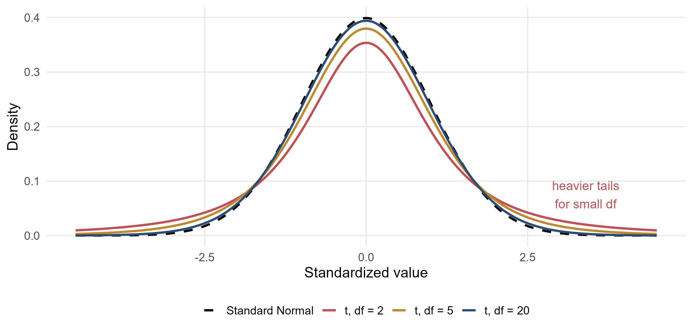
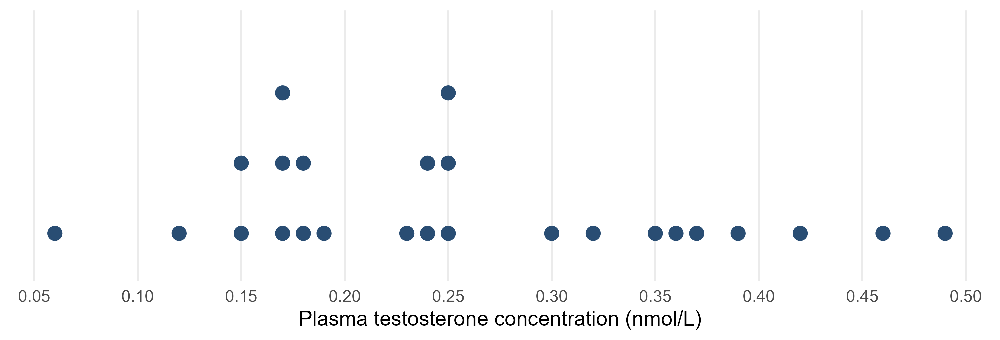
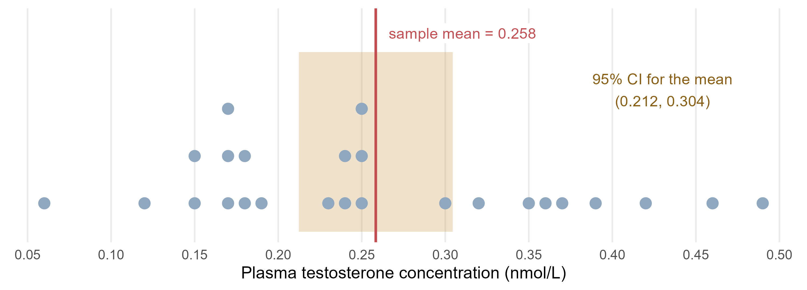
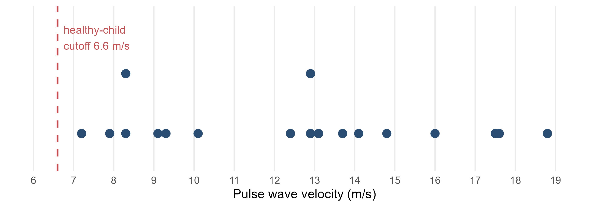

<style>
:root {
  --toc-width: 300px;
  --toc-collapsed-gutter: 72px;
  --chapter-width: 1100px;
  --ink: #23364a;
  --accent: #2c3e50;
  --line: #d8dee4;
  --toc-background: #f7f9fb;
}

html { scroll-behavior: smooth; }

body {
  font-size: 17px;
  line-height: 1.65;
  color: var(--ink);
}

.main-container { max-width: var(--chapter-width) !important; }
.section.chapter-root > h1 { display: none !important; }

#TOC li:has(> a[href="#chapter-17"]) > a[href="#chapter-17"] {
  display: none !important;
}

#TOC li:has(> a[href="#chapter-17"]) { margin-top: 0 !important; }

.sr-only {
  position: absolute;
  width: 1px;
  height: 1px;
  padding: 0;
  margin: -1px;
  overflow: hidden;
  clip: rect(0, 0, 0, 0);
  white-space: nowrap;
  border: 0;
}

#toc-toggle {
  position: fixed;
  top: 16px;
  left: calc(var(--toc-width) + 14px);
  width: 42px;
  height: 42px;
  display: flex;
  align-items: center;
  justify-content: center;
  padding: 0;
  border: 1px solid #c7d0d9;
  border-radius: 8px;
  background: #ffffff;
  color: var(--ink);
  box-shadow: 0 2px 8px rgba(24, 39, 55, 0.13);
  cursor: pointer;
  font-size: 24px;
  line-height: 1;
  z-index: 1200;
  transition: left 0.25s ease, background-color 0.2s ease;
}

#toc-toggle:hover { background: #eef3f7; }
#toc-toggle .menu-icon { display: none; }
#toc-toggle .close-icon { display: inline; }
body.toc-collapsed #toc-toggle { left: 14px; }
body.toc-collapsed #toc-toggle .menu-icon { display: inline; }
body.toc-collapsed #toc-toggle .close-icon { display: none; }

@media screen and (min-width: 992px) {
  .main-container {
    width: 100% !important;
    max-width: none !important;
    padding-left: calc(var(--toc-width) + 30px) !important;
    padding-right: 35px !important;
    box-sizing: border-box !important;
    transition: padding-left 0.25s ease;
  }

  body.toc-collapsed .main-container {
    padding-left: var(--toc-collapsed-gutter) !important;
  }

  .main-container > .row-fluid > .col-xs-12.col-sm-4.col-md-3,
  .main-container > .row > .col-xs-12.col-sm-4.col-md-3 {
    width: 0 !important;
    min-height: 0 !important;
    padding: 0 !important;
    margin: 0 !important;
  }

  #TOC,
  #TOC.tocify {
    position: fixed !important;
    top: 0 !important;
    bottom: 0 !important;
    left: 0 !important;
    width: var(--toc-width) !important;
    max-height: 100vh !important;
    overflow-y: auto !important;
    overflow-x: hidden !important;
    box-sizing: border-box !important;
    margin: 0 !important;
    padding: 72px 16px 28px 18px !important;
    background: var(--toc-background) !important;
    border: 0 !important;
    border-right: 1px solid var(--line) !important;
    border-radius: 0 !important;
    z-index: 1100 !important;
    transform: translateX(0);
    transition: transform 0.25s ease;
  }

  body.toc-collapsed #TOC,
  body.toc-collapsed #TOC.tocify {
    transform: translateX(calc(-1 * var(--toc-width)));
  }

  #TOC a {
    white-space: normal !important;
    overflow-wrap: break-word !important;
  }

  #TOC .tocify-item { border-radius: 4px; }
  #TOC .tocify-item a { color: var(--ink); text-decoration: none; }
  #TOC .tocify-item:hover { background: #e9eef3; }
  #TOC .tocify-item.active { background: var(--accent) !important; }
  #TOC .tocify-item.active a { color: #ffffff !important; }

  .toc-content,
  .toc-content.col-xs-12.col-sm-8.col-md-9 {
    width: 100% !important;
    max-width: var(--chapter-width) !important;
    float: none !important;
    margin-left: auto !important;
    margin-right: auto !important;
    padding-left: 15px !important;
    padding-right: 15px !important;
    box-sizing: border-box !important;
  }
}

@media screen and (max-width: 991px) {
  .main-container {
    width: auto !important;
    max-width: var(--chapter-width) !important;
    margin-left: auto !important;
    margin-right: auto !important;
    padding: 70px 18px 24px !important;
    box-sizing: border-box !important;
  }

  #toc-toggle,
  body.toc-collapsed #toc-toggle { left: 12px; }

  #toc-toggle .menu-icon,
  body.toc-collapsed #toc-toggle .menu-icon { display: inline; }

  #toc-toggle .close-icon,
  body.toc-collapsed #toc-toggle .close-icon { display: none; }

  body.toc-mobile-open #toc-toggle .menu-icon { display: none; }
  body.toc-mobile-open #toc-toggle .close-icon { display: inline; }

  #TOC,
  #TOC.tocify {
    position: fixed !important;
    top: 0 !important;
    bottom: 0 !important;
    left: 0 !important;
    width: min(84vw, 320px) !important;
    max-height: 100vh !important;
    overflow-y: auto !important;
    overflow-x: hidden !important;
    box-sizing: border-box !important;
    margin: 0 !important;
    padding: 72px 18px 28px !important;
    background: var(--toc-background) !important;
    border: 0 !important;
    border-right: 1px solid var(--line) !important;
    border-radius: 0 !important;
    z-index: 1100 !important;
    transform: translateX(-105%);
    transition: transform 0.25s ease;
  }

  body.toc-mobile-open #TOC,
  body.toc-mobile-open #TOC.tocify {
    transform: translateX(0);
    box-shadow: 6px 0 18px rgba(24, 39, 55, 0.16);
  }
}

h1, h2, h3, h4, h5 { margin-top: 1.6em; }
h2 { border-bottom: 3px solid var(--accent); padding-bottom: 0.25em; }
h3 { border-bottom: 1px solid var(--line); padding-bottom: 0.2em; }

blockquote {
  border-left: 4px solid var(--accent);
  background: #f7f9fa;
  padding: 0.7em 1em;
  margin: 1.2em 0;
}

table {
  width: 100%;
  margin: 1.35em auto;
  border-collapse: separate !important;
  border-spacing: 0;
  background: #ffffff;
  border: 1px solid #d6dde5;
  border-radius: 8px;
  overflow: hidden;
  box-shadow: 0 2px 8px rgba(24, 39, 55, 0.06);
}

table thead th {
  padding: 0.72em 0.9em !important;
  background: var(--accent);
  color: #ffffff;
  border: 0 !important;
  font-weight: 700;
}

table tbody td {
  padding: 0.65em 0.9em !important;
  border: 0 !important;
  border-bottom: 1px solid #e5e9ee !important;
}

table tbody tr:nth-child(even) td { background: #f7f9fb; }
table tbody tr:hover td { background: #eef4f8; }
table tbody tr:last-child td { border-bottom: 0 !important; }

img {
  display: block;
  max-width: 100%;
  height: auto;
  margin: 1.4em auto;
  border: 1px solid #e1e4e8;
  border-radius: 7px;
}

.math.display { overflow-x: auto; }

.btn-code,
.code-folding-btn,
div.btn-group.pull-right {
  display: none !important;
}
</style>

<button id="toc-toggle"
        type="button"
        aria-label="Toggle table of contents"
        aria-expanded="true">
  <span class="menu-icon" aria-hidden="true">&#9776;</span>
  <span class="close-icon" aria-hidden="true">&times;</span>
  <span class="sr-only">Toggle table of contents</span>
</button>

<script>
document.addEventListener("DOMContentLoaded", function () {
  const button = document.getElementById("toc-toggle");
  if (!button) return;

  button.addEventListener("click", function () {
    if (window.innerWidth <= 991) {
      document.body.classList.toggle("toc-mobile-open");
      button.setAttribute(
        "aria-expanded",
        document.body.classList.contains("toc-mobile-open")
      );
    } else {
      document.body.classList.toggle("toc-collapsed");
      button.setAttribute(
        "aria-expanded",
        !document.body.classList.contains("toc-collapsed")
      );
    }
  });
});
</script>

```{r setup, include=FALSE, echo=FALSE, warning=FALSE, message=FALSE}
knitr::opts_chunk$set(
  echo = TRUE,
  warning = FALSE,
  message = FALSE,
  error = FALSE,
  fig.align = "center",
  out.width = "92%"
)

if (!requireNamespace("ggplot2", quietly = TRUE)) {
  stop("The ggplot2 package must be installed before this chapter is knitted.")
}

suppressPackageStartupMessages({
  library(ggplot2)
})

# -------------------------------------------------------------
# All figures are created here with ggsave() and saved as
# slide_ch17_*.png. The same files are used by chapter-17-beamer.tex,
# so knit this document before compiling the slides.
# -------------------------------------------------------------

course_blue  <- "#294D73"
course_red   <- "#C44E52"
course_green <- "#3F7D58"
course_gold  <- "#BE892D"
course_grey  <- "#8FA8BF"

slide_theme <- theme_minimal(base_size = 15) +
  theme(
    plot.title = element_text(face = "bold", hjust = 0.5),
    plot.subtitle = element_text(hjust = 0.5, colour = "#444444"),
    panel.grid.minor = element_blank(),
    plot.background = element_rect(fill = "white", colour = NA),
    legend.position = "bottom"
  )

save_plot <- function(name, plot, width = 10, height = 5) {
  ggsave(name, plot, width = width, height = height, dpi = 300, bg = "white")
}

# Stacked dot plot positions: tied values stack upward
stack_y <- function(x) ave(seq_along(x), x, FUN = seq_along)

# ---- Data ---------------------------------------------------
testosterone <- c(0.30, 0.24, 0.19, 0.17, 0.18, 0.23, 0.24, 0.06, 0.15,
                  0.17, 0.18, 0.17, 0.15, 0.12, 0.25, 0.25, 0.25, 0.32,
                  0.35, 0.37, 0.39, 0.46, 0.49, 0.42, 0.36)
pwv <- c(18.8, 17.6, 17.5, 16.0, 14.8, 14.1, 13.7, 13.1, 12.9,
         12.9, 12.4, 10.1, 9.3, 9.1, 8.3, 8.3, 7.9, 7.2)
before <- c(18.8, 17.6, 17.5, 16.0, 14.8, 14.1, 13.7, 13.1, 12.9,
            12.9, 12.4, 10.1, 9.3, 9.1, 8.3, 7.9, 8.3, 7.2)
after  <- c(12.6, 10.8, 10.1, 10.1, 9.2, 7.6, 10.8, 7.7, 6.8,
            7.5, 9.4, 6.4, 9.0, 6.2, 7.2, 7.3, 5.7, 9.1)
difference <- after - before

# ---- 1. t family vs Standard Normal -------------------------
grid <- seq(-4.5, 4.5, length.out = 1200)
dens <- rbind(
  data.frame(x = grid, y = dnorm(grid),       dist = "Standard Normal"),
  data.frame(x = grid, y = dt(grid, df = 2),  dist = "t, df = 2"),
  data.frame(x = grid, y = dt(grid, df = 5),  dist = "t, df = 5"),
  data.frame(x = grid, y = dt(grid, df = 20), dist = "t, df = 20")
)
dens$dist <- factor(dens$dist, levels = unique(dens$dist))
p1 <- ggplot(dens, aes(x, y, colour = dist, linetype = dist)) +
  geom_line(linewidth = 1.1) +
  scale_colour_manual(values = c("black", course_red, course_gold, course_blue)) +
  scale_linetype_manual(values = c("dashed", "solid", "solid", "solid")) +
  annotate("text", x = 3.4, y = 0.075, label = "heavier tails\nfor small df",
           colour = course_red, size = 4.6) +
  labs(x = "Standardized value", y = "Density", colour = NULL, linetype = NULL) +
  slide_theme
save_plot("slide_ch17_t_distributions.png", p1, height = 4.8)

# ---- 2. Example 17.1 areas under t(10) ----------------------
g <- seq(-4.5, 4.5, length.out = 900)
areas <- rbind(
  data.frame(x = g, y = dt(g, 10), panel = "Area to the left of -3",
             shade = g <= -3),
  data.frame(x = g, y = dt(g, 10), panel = "Point with 0.05 to its right",
             shade = g >= qt(0.95, 10))
)
areas$panel <- factor(areas$panel, levels = unique(areas$panel))
labs_df <- data.frame(
  panel = factor(levels(areas$panel), levels = levels(areas$panel)),
  x = c(-3.4, 2.9), y = c(0.06, 0.12),
  lab = c("area = 0.0067", "area = 0.05\nt* = 1.812")
)
p2 <- ggplot(areas, aes(x, y)) +
  geom_area(data = subset(areas, shade), fill = course_red, alpha = 0.65) +
  geom_line(linewidth = 1, colour = course_blue) +
  geom_text(data = labs_df, aes(label = lab), size = 4.6, colour = course_red) +
  facet_wrap(~ panel) +
  labs(x = "t (10 degrees of freedom)", y = "Density") +
  slide_theme +
  theme(strip.text = element_text(face = "bold", size = 14))
save_plot("slide_ch17_t_areas.png", p2, height = 4.2)

# ---- 3. Testosterone dot plot -------------------------------
dt_df <- data.frame(x = testosterone, y = stack_y(testosterone))
p3 <- ggplot(dt_df, aes(x, y)) +
  geom_point(size = 4.2, colour = course_blue) +
  scale_y_continuous(NULL, breaks = NULL, limits = c(0.5, 4)) +
  scale_x_continuous(breaks = seq(0.05, 0.50, 0.05)) +
  labs(x = "Plasma testosterone concentration (nmol/L)") +
  slide_theme
save_plot("slide_ch17_testosterone_dotplot.png", p3, height = 3.4)

# ---- 4. Testosterone 95% CI ---------------------------------
ci <- t.test(testosterone)$conf.int
p4 <- ggplot(dt_df, aes(x, y)) +
  annotate("rect", xmin = ci[1], xmax = ci[2], ymin = 0.4, ymax = 4.2,
           fill = course_gold, alpha = 0.25) +
  geom_point(size = 4.2, colour = course_grey) +
  geom_vline(xintercept = mean(testosterone), colour = course_red,
             linewidth = 1.1) +
  annotate("label", x = mean(testosterone) + 0.005, y = 4.6, hjust = 0,
           label = "sample mean = 0.258", colour = course_red, size = 4.8,
           fill = "white", linewidth = 0) +
  annotate("text", x = 0.43, y = 3.4,
           label = "95% CI for the mean\n(0.212, 0.304)",
           colour = "#8A5E12", size = 4.8) +
  scale_y_continuous(NULL, breaks = NULL, limits = c(0.4, 4.9)) +
  scale_x_continuous(breaks = seq(0.05, 0.50, 0.05)) +
  labs(x = "Plasma testosterone concentration (nmol/L)") +
  slide_theme
save_plot("slide_ch17_testosterone_ci.png", p4, height = 3.6)

# ---- 5. PWV dot plot with reference value -------------------
dp <- data.frame(x = pwv, y = stack_y(pwv))
p5 <- ggplot(dp, aes(x, y)) +
  geom_vline(xintercept = 6.6, linetype = "dashed", colour = course_red,
             linewidth = 1) +
  annotate("text", x = 6.75, y = 2.6, label = "healthy-child\ncutoff 6.6 m/s",
           hjust = 0, colour = course_red, size = 4.6) +
  geom_point(size = 4.2, colour = course_blue) +
  scale_y_continuous(NULL, breaks = NULL, limits = c(0.5, 3)) +
  scale_x_continuous(limits = c(6, 19.5), breaks = seq(6, 19, 1)) +
  labs(x = "Pulse wave velocity (m/s)") +
  slide_theme
save_plot("slide_ch17_pwv_dotplot.png", p5, height = 3.4)

# ---- 6. Paired measurements (one line per child) ------------
long <- data.frame(
  child = rep(seq_along(before), 2),
  time = factor(rep(c("Before", "After"), each = length(before)),
                levels = c("Before", "After")),
  pwv = c(before, after)
)
long$went_up <- rep(after > before, 2)
p6 <- ggplot(long, aes(time, pwv, group = child)) +
  geom_line(aes(colour = went_up), linewidth = 0.9, alpha = 0.85) +
  geom_point(size = 2.8, colour = course_blue) +
  scale_colour_manual(values = c(`FALSE` = course_grey, `TRUE` = course_red),
                      labels = c("decreased", "increased")) +
  labs(x = NULL, y = "Pulse wave velocity (m/s)", colour = NULL,
       title = "Each line is one child") +
  slide_theme
save_plot("slide_ch17_before_after.png", p6, width = 5.6, height = 5)

# ---- 7. Paired differences ----------------------------------
# bin to the nearest 0.5 m/s so nearby values stack instead of overlapping
d_bin <- round(difference * 2) / 2
dd <- data.frame(x = d_bin, y = stack_y(d_bin))
p7 <- ggplot(dd, aes(x, y)) +
  geom_vline(xintercept = 0, linetype = "dashed", colour = course_red,
             linewidth = 1) +
  geom_point(size = 5, colour = course_green) +
  scale_y_continuous(NULL, breaks = NULL, limits = c(0.5, 5)) +
  scale_x_continuous(limits = c(-8, 2.5), breaks = seq(-8, 2, 2)) +
  labs(x = "d = after - before (m/s, nearest 0.5)", title = "The 18 differences") +
  slide_theme
save_plot("slide_ch17_differences.png", p7, width = 5.6, height = 5)

# ---- 8. Robustness: three illustrative shapes ---------------
set.seed(1210)
rob <- rbind(
  data.frame(value = c(3.4, 3.7, 3.9, 4.0, 4.1, 4.2, 4.3, 4.5, 4.6, 4.8, 11.7),
             sample = "n = 11: one outlier"),
  data.frame(value = c(5.2, 5.5, 5.7, 5.8, 5.9, 6.0, 6.1, 6.2, 6.4, 6.5,
                       6.7, 6.9, 7.2, 7.6, 8.1),
             sample = "n = 15: mild right skew"),
  data.frame(value = rgamma(120, shape = 2.2, scale = 1.2),
             sample = "n = 120: strong right skew")
)
rob$sample <- factor(rob$sample, levels = unique(rob$sample))
verdict <- data.frame(
  sample = factor(levels(rob$sample), levels = levels(rob$sample)),
  lab = c("t not reliable", "t reasonable", "t reasonable"),
  col = c("bad", "ok", "ok")
)
p8 <- ggplot(rob, aes(value)) +
  geom_histogram(bins = 14, fill = course_grey, colour = "white") +
  geom_label(data = verdict, aes(x = Inf, y = Inf, label = lab, fill = col),
             hjust = 1.05, vjust = 1.2, colour = "white", size = 4.6,
             fontface = "bold", linewidth = 0) +
  scale_fill_manual(values = c(bad = course_red, ok = course_green),
                    guide = "none") +
  facet_wrap(~ sample, scales = "free", nrow = 1) +
  labs(x = "Observed value", y = "Frequency") +
  slide_theme +
  theme(strip.text = element_text(face = "bold", size = 14))
save_plot("slide_ch17_robustness.png", p8, width = 11, height = 4.2)
```

# Chapter 17 {.chapter-root .unlisted}

## From the $z$ Procedures to the $t$ Procedures

Chapter 14 introduced confidence intervals and hypothesis tests for a population mean $\mu$ when the population standard deviation $\sigma$ was known. In most applications, however, $\sigma$ is unknown and must be estimated from the sample by the sample standard deviation $s$. Replacing $\sigma$ by $s$ adds uncertainty, and the correct reference distribution becomes a **Student's $t$ distribution**.

| | Chapter 14: $\sigma$ known | Chapter 17: $\sigma$ unknown |
|:--|:--|:--|
| Standard error | $\sigma/\sqrt{n}$ | $s/\sqrt{n}$ |
| Standardized statistic | $z$ | $t$ |
| Reference distribution | $N(0,1)$ | $t(n-1)$ |

> **Main transition**
>
> The logic of confidence intervals and hypothesis tests stays the same. The standard error is estimated from the sample, the reference distribution changes from $z$ to $t$, and the degrees of freedom must be identified.

### Roadmap

1. **Standard error:** how precisely does $\bar{x}$ estimate $\mu$?
2. **The $t$ distributions:** the new reference model, degrees of freedom and the $t$-table
3. **One-sample $t$ interval:** estimating $\mu$ (testosterone example)
4. **One-sample $t$ test:** testing a claim about $\mu$ (progeria PWV example)
5. **Matched pairs:** two measurements become one sample of differences (lonafarnib example)
6. **Robustness:** how much non-Normality can the procedures handle?

Every example follows four steps: **STATE**, **PLAN**, **SOLVE** and **CONCLUDE**.

### Learning Goals

After studying this chapter, you should be able to

1. Distinguish the sample standard deviation from the standard error
2. Explain why a $t$ distribution is used when $\sigma$ is unknown, and why $\operatorname{df}=n-1$
3. Read probabilities and critical values from a $t$-table and with R
4. Construct and interpret a one-sample $t$ confidence interval
5. Conduct and interpret one-sided and two-sided one-sample $t$ tests
6. Connect two-sided tests with confidence intervals
7. Analyze paired measurements through their within-pair differences
8. Assess whether a $t$ procedure is reasonably robust for a given sample

---

## Standard Deviation vs. Standard Error

The sample standard deviation and the standard error answer different questions.

| Quantity | What varies? | What it describes |
|:--|:--|:--|
| $s$ | Individual observations | Spread of values in the sample |
| $SE_{\bar{x}}$ | Sample means | Spread of $\bar{x}$ from sample to sample |

The two formulas are

$$
s=\sqrt{\frac{\sum_{i=1}^{n}(x_i-\bar{x})^2}{n-1}}
\qquad\qquad
\widehat{SE}_{\bar{x}}=\frac{s}{\sqrt{n}}
$$

The standard error measures how precisely $\bar{x}$ estimates $\mu$. For the same $s$, a larger sample gives a smaller standard error:

$$
\frac{s}{\sqrt{4n}}=\frac{1}{2}\cdot\frac{s}{\sqrt{n}}
$$

**Multiplying $n$ by $4$ only halves the standard error.** Much more precision needs a much larger sample.

> **A frequent mistake**
>
> The standard error is **not** $s$, and it is **not** $s/n$. It divides by the square root of the sample size.

---

## The $t$ Distributions

### From $z$ to $t$

If $\sigma$ were known, the standardized sample mean would be

$$
z=\frac{\bar{x}-\mu}{\sigma/\sqrt{n}}\sim N(0,1)
$$

When $\sigma$ is unknown, it is replaced by $s$:

$$
t=\frac{\bar{x}-\mu}{s/\sqrt{n}}\sim t(n-1)
$$

Both statistics count how many standard errors $\bar{x}$ lies from $\mu$.

### Why a New Distribution?

The denominator $s/\sqrt{n}$ is random, because $s$ changes from sample to sample. So $t$ varies more than $z$. The $t$ distribution has heavier tails to allow for $s$ under- or over-estimating $\sigma$. As a result, intervals are wider and $P$-values are larger for the same absolute test statistic.

### The Family of $t$ Distributions

```{r t-distribution-plot, echo=FALSE}

```

- Every $t$ distribution is symmetric about $0$ and bell-shaped
- Smaller degrees of freedom mean heavier tails
- As the degrees of freedom grow, $t(\operatorname{df})\to N(0,1)$

**Student's $t$:** W. S. Gosset developed the $t$ distribution at the Guinness brewery for small samples and published under the name "Student."

---

## Degrees of Freedom

### Why $n-1$?

When calculating the sample standard deviation, we first estimate the population mean using $\bar{x}$. The deviations from the sample mean must sum to zero:

$$
\sum_{i=1}^{n}(x_i-\bar{x})=0
$$

Once $n-1$ deviations are known, the final deviation is determined automatically.

**Example.** Suppose $4$ observations have a sample mean of $10$. Three observations are $8$, $9$ and $11$. What must the fourth be?

$$
(8-10)+(9-10)+(11-10)+(x_4-10)=0
$$

$$
-2-1+1+(x_4-10)=0
\quad\Longrightarrow\quad
\boxed{x_4=12}
$$

Only $3$ deviations can vary freely; the fourth is constrained. So

$$
\boxed{\operatorname{df}=n-1=4-1=3}
$$

### Using the $t$-Table

The degrees of freedom determine which $t$ distribution to use. Suppose we have $n=11$ observations and want a $95\%$ confidence interval:

$$
\operatorname{df}=11-1=\boxed{10}
$$

| df | 90% | 95% | 99% |
|:--:|:--:|:--:|:--:|
| $5$ | $2.015$ | $2.571$ | $4.032$ |
| $\mathbf{10}$ | $1.812$ | $\boxed{\mathbf{2.228}}$ | $3.169$ |
| $20$ | $1.725$ | $2.086$ | $2.845$ |
| $50$ | $1.676$ | $2.009$ | $2.678$ |
| $\infty$ | $1.645$ | $1.960$ | $2.576$ |

**How to read the table:**

1. Find the row for $\operatorname{df}=10$
2. Find the column for a $95\%$ confidence level
3. The intersection gives the critical value $t^*=2.228$

The confidence interval is therefore

$$
\boxed{\bar{x}\pm2.228\,\frac{s}{\sqrt{11}}}
$$

The last row ($\infty$) gives the Standard Normal values. The cost of estimating $\sigma$ is large for small samples and small for large ones.

---

## Example 17.1: Reading $t$ Probabilities

Consider a $t$ distribution with $10$ degrees of freedom. Find (a) $P(T\geq1.812)$ and (b) $P(T\leq-3)$.

```{r t-areas-plot, echo=FALSE}
knitr::include_graphics("slide_ch17_t_areas.png")
```

Most $t$-tables list critical values for specific upper-tail probabilities.

| df | 0.10 | 0.05 | 0.025 | 0.01 | 0.005 |
|:--:|:--:|:--:|:--:|:--:|:--:|
| $5$ | $1.476$ | $2.015$ | $2.571$ | $3.365$ | $4.032$ |
| $\mathbf{10}$ | $\mathbf{1.372}$ | $\mathbf{1.812}$ | $\mathbf{2.228}$ | $\mathbf{2.764}$ | $\mathbf{3.169}$ |
| $20$ | $1.325$ | $1.725$ | $2.086$ | $2.528$ | $2.845$ |

### (a) Right-Tail Probability

In the $\operatorname{df}=10$ row, $t=1.812$ corresponds to an upper-tail probability of $0.05$:

$$
\boxed{P(T\geq1.812)\approx0.05}
$$

By symmetry, $P(T\leq-1.812)\approx0.05$ as well.

### (b) Left-Tail Probability

By symmetry, $P(T\leq-3)=P(T\geq3)$. In the $\operatorname{df}=10$ row,

$$
2.764<3<3.169
$$

Larger $t$-values have smaller upper-tail probabilities, so

$$
\boxed{0.005<P(T\leq-3)<0.010}
$$

The $t$-table gives a range rather than an exact probability.

### $t$ Probabilities in R

R gives exact values. The functions mirror the Normal-distribution functions.

| Task | Normal | $t$ |
|:--|:--|:--|
| Left-tail area | `pnorm()` | `pt()` |
| Critical value | `qnorm()` | `qt()` |

```{r t-left-tail}
# Area question: left of t = -3
pt(q = -3, df = 10)

# Cutoff question: 0.95 to the left
qt(p = 0.95, df = 10)
```

- Every $t$ calculation needs `df`
- For a $95\%$ interval, put $0.025$ in each tail: `qt(0.975, df)`
- Right-tail area: `pt(t, df, lower.tail = FALSE)`

---

## The One-Sample $t$ Confidence Interval

A level $C$ confidence interval for $\mu$ is

$$
\boxed{
\bar{x}\pm t^*\frac{s}{\sqrt{n}}
}
$$

where $t^*$ comes from the $t(n-1)$ distribution with central area $C$.

- The margin of error is $m=t^*\,s/\sqrt{n}$
- The interval is **wider** with a higher confidence level, more variable data or a smaller $n$
- $C$ is the long-run success rate of the *method*. It is not the probability that this particular interval contains $\mu$

---

## Example 17.2: Testosterone in Obese Adolescent Males

Plasma testosterone (nmol/L) for $25$ obese adolescent males:

|  |  |  |  |  |
|--:|--:|--:|--:|--:|
| $0.30$ | $0.24$ | $0.19$ | $0.17$ | $0.18$ |
| $0.23$ | $0.24$ | $0.06$ | $0.15$ | $0.17$ |
| $0.18$ | $0.17$ | $0.15$ | $0.12$ | $0.25$ |
| $0.25$ | $0.25$ | $0.32$ | $0.35$ | $0.37$ |
| $0.39$ | $0.46$ | $0.49$ | $0.42$ | $0.36$ |

**STATE:** Estimate $\mu$, the mean testosterone for obese adolescent males like those in the study, with $95\%$ confidence.

**PLAN:** $\sigma$ is unknown, so use a one-sample $t$ interval.

### Check the Data

**SOLVE:** Before calculating anything, plot the data.

```{r testosterone-dotplot, echo=FALSE}

```

The distribution is single-peaked, with no extreme outliers or strong skewness. With $n=25$, a $t$ procedure is reasonable.

### Calculation

**Summary statistics**

$$
n=25,\qquad
\bar{x}=\frac{\sum_{i=1}^{25}x_i}{25}=\frac{6.46}{25}=0.2584
$$

**Sample standard deviation**

$$
s=\sqrt{\frac{\sum_{i=1}^{n}(x_i-\bar{x})^2}{n-1}}
=\sqrt{\frac{0.298536}{24}}
=\boxed{0.1115}
$$

**Standard error**

$$
SE=\frac{s}{\sqrt{n}}=\frac{0.1115}{\sqrt{25}}=\boxed{0.0223}
$$

**Critical value**, with $\operatorname{df}=25-1=24$

$$
t^*=2.064\qquad(\text{vs. } z^*=1.960)
$$

**Margin of error**

$$
m=2.064(0.0223)=0.0460
$$

**Confidence interval**

$$
\bar{x}\pm m=0.2584\pm0.0460
\quad\Longrightarrow\quad
\boxed{(0.212,\ 0.304)\text{ nmol/L}}
$$

The larger critical value ($2.064$ rather than $1.960$) makes the interval a little wider, to allow for estimating $\sigma$ with $s$.

### Conclusion

```{r testosterone-ci-plot, echo=FALSE}

```

**CONCLUDE:** We are $95\%$ confident that the mean plasma testosterone for obese adolescent males similar to those studied is between $0.212$ and $0.304$ nmol/L.

### What the Interval Does Not Tell Us

The males came from one medical centre, not from an SRS of all obese males. The conclusion applies most directly to **similar patients**.

The interval covers random sampling variation under the model. It does **not**

- give a range for *individual* males (most of the dots lie outside it)
- correct for selection bias or measurement error
- show that obesity *causes* low testosterone, because this is an observational study

### In R

**By hand:**

```{r testosterone-manual-calculation}
n  <- length(testosterone)
se <- sd(testosterone) / sqrt(n)
t_star <- qt(0.975, df = n - 1)
mean(testosterone) + c(-1, 1) * t_star * se
```

**Directly:**

```{r testosterone-t-test-confidence-interval}
t.test(testosterone, conf.level = 0.95)$conf.int
```

> **Reading software output**
>
> `t.test()` also reports a test of $\mu=0$ by default. Interpret only the parts of the output that answer your question.

---

## The One-Sample $t$ Test

To test $H_0:\mu=\mu_0$, compute

$$
\boxed{
t=\frac{\bar{x}-\mu_0}{s/\sqrt{n}}
},
\qquad \operatorname{df}=n-1
$$

| Alternative | $P$-value | R argument |
|:--|:--|:--|
| $H_a:\mu>\mu_0$ | $P(T\geq t)$ | `alternative = "greater"` |
| $H_a:\mu<\mu_0$ | $P(T\leq t)$ | `alternative = "less"` |
| $H_a:\mu\ne\mu_0$ | $2P(T\geq|t|)$ | `alternative = "two.sided"` |

The alternative comes from the research question, chosen **before** looking at the data. Picking the tail after seeing the data understates the $P$-value.

---

## Example 17.3: Pulse Wave Velocity and Progeria

Progeria is a rare genetic condition that causes accelerated aging. Pulse wave velocity (PWV) measures arterial stiffness. PWV (m/s) for $18$ children with progeria:

|  |  |  |  |  |  |
|--:|--:|--:|--:|--:|--:|
| $18.8$ | $17.6$ | $17.5$ | $16.0$ | $14.8$ | $14.1$ |
| $13.7$ | $13.1$ | $12.9$ | $12.9$ | $12.4$ | $10.1$ |
| $9.3$ | $9.1$ | $8.3$ | $8.3$ | $7.9$ | $7.2$ |

In healthy children, a PWV above $6.6$ m/s is considered abnormal. **Is the mean PWV of children with progeria greater than $6.6$ m/s?**

### Hypotheses

**STATE:** Let $\mu$ be the mean PWV for children with progeria like those in the study.

**PLAN:** One-sample $t$ test of

$$
H_0:\mu=6.6\text{ m/s}
\qquad
H_a:\mu>6.6\text{ m/s}
$$

The test is upper-tailed because the question asks "greater than."

> **Study scope**
>
> Progeria is rare, and the children were recruited worldwide rather than selected through an SRS. The conclusion applies most directly to comparable children with progeria.

### Check the Data

**SOLVE:** Plot the data and compare it with the reference value.

```{r pwv-dotplot, echo=FALSE}

```

There is no outlier and the distribution is roughly single-peaked, so a $t$ test is reasonable for $n=18$. Every child is above $6.6$.

### Test Statistic

**Summary statistics**

$$
n=18,\qquad \bar{x}=12.444
$$

**Sample standard deviation.** The sum of squared deviations from the sample mean is approximately $225.0$:

$$
s=\sqrt{\frac{\sum_{i=1}^{18}(x_i-12.444)^2}{17}}
\approx\sqrt{\frac{225.0}{17}}
=\boxed{3.638}
$$

**Standard error**

$$
SE=\frac{s}{\sqrt{n}}=\frac{3.638}{\sqrt{18}}=\boxed{0.857}
$$

**Test statistic**, with $\operatorname{df}=18-1=17$

$$
t=\frac{\bar{x}-\mu_0}{SE}=\frac{12.444-6.6}{0.857}=\boxed{6.82}
$$

### Finding the $P$-Value from a $t$-Table

Since $H_a:\mu>6.6$, we need the upper-tail probability $P(T_{17}\geq6.82)$.

**Step 1.** Find the row for $\operatorname{df}=17$:

| Upper tail | .25 | .20 | .15 | .10 | .05 | .025 | .01 | .005 | .0025 | .001 | **.0005** |
|:--:|--:|--:|--:|--:|--:|--:|--:|--:|--:|--:|--:|
| **17** | .689 | .863 | 1.069 | 1.333 | 1.740 | 2.110 | 2.567 | 2.898 | 3.222 | 3.646 | **3.965** |

**Step 2.** Compare the test statistic with the table values. Since $6.82>3.965$, which has an upper-tail probability of $0.0005$, our probability must be even smaller:

$$
\boxed{P(T_{17}\geq6.82)<0.0005}
$$

R gives the exact value:

```{r pwv-manual-p-value}
t_pwv <- (mean(pwv) - 6.6) / (sd(pwv) / sqrt(length(pwv)))
pt(q = t_pwv, df = 17, lower.tail = FALSE)
```

### Conclusion

**Decision:** Since $P<0.0005<\alpha=0.05$, we **reject $H_0$** at the $5\%$ significance level.

**CONCLUDE:** The data provide very strong statistical evidence that the mean PWV of comparable children with progeria is greater than $6.6$ m/s.

> **Significance is not size**
>
> The $P$-value measures evidence against $H_0$, not the size or clinical importance of the difference. The estimated difference is $\bar{x}-\mu_0=12.444-6.6=5.84$ m/s, and the $95\%$ confidence interval for $\mu$ is $(10.64,\ 14.25)$ m/s. Clinical importance requires medical judgment.

### In R

```{r pwv-direct-test}
t.test(pwv, mu = 6.6, alternative = "greater")
```

The `alternative` argument must match $H_a$. Software may print a tiny $P$-value as `0.000`. Report it as $P<0.001$, never as $P=0$.

### A Two-Sided Test

Suppose instead we want to know whether the mean PWV **differs** from $6.6$ m/s, rather than specifically being greater.

**STATE:** Let $\mu$ be the mean PWV for comparable children with progeria.

**PLAN:** Two-sided one-sample $t$ test:

$$
H_0:\mu=6.6
\qquad
H_a:\mu\neq6.6
$$

**SOLVE:** Using the same sample, $n=18$, $\bar{x}=12.444$, $s=3.638$, $SE=0.857$, $t=6.82$ and $\operatorname{df}=17$.

A two-sided test considers results at least as extreme as $t=6.82$ in **both tails**:

$$
P\text{-value}=P(T_{17}\leq-6.82)+P(T_{17}\geq6.82)=2P(T_{17}\geq6.82)
$$

**Step 1.** From the $\operatorname{df}=17$ row, $6.82>3.965$, so the upper-tail probability is less than $0.0005$.

**Step 2.** Multiply by $2$:

$$
P\text{-value}=2P(T_{17}\geq6.82)<2(0.0005)
\quad\Longrightarrow\quad
\boxed{P\text{-value}<0.001}
$$

**Decision:** Since $P<0.001<\alpha=0.05$, we reject $H_0$.

**CONCLUDE:** There is very strong statistical evidence that the mean PWV of comparable children with progeria **differs from** $6.6$ m/s.

```{r pwv-two-sided}
t.test(pwv, mu = 6.6, alternative = "two.sided")
```

### Connection to Confidence Intervals

For a two-sided $t$ test at significance level $\alpha$, the corresponding $(1-\alpha)$ $t$ confidence interval gives the same decision:

- If $\mu_0$ is **outside** the confidence interval, reject $H_0$
- If $\mu_0$ is **inside** the confidence interval, fail to reject $H_0$

For the PWV data, the $95\%$ interval is $(10.64,\ 14.25)$ m/s. Since $6.6$ lies outside it, a two-sided test at $\alpha=0.05$ rejects $H_0$.

```{r pwv-confidence-interval}
t.test(pwv, conf.level = 0.95)$conf.int
```

---

## Matched Pairs $t$ Procedures

A **matched-pairs design** compares two related measurements, either from the same individual or from two similar individuals. Pairing accounts for individual differences, so we can focus on the effect of interest.

Common paired designs:

- Before and after treatment on the same individual
- Both treatments given to each subject at different times
- Subjects matched on demographics

For each pair, compute **one difference**:

$$
d_i=\text{(condition 2)}-\text{(condition 1)}
$$

Then apply the one-sample $t$ procedures to $d_1,\ldots,d_n$. The parameter is $\mu_d$, and $\operatorname{df}=n-1$, where $n$ is the **number of pairs**, not the number of measurements.

### Choosing the Alternative Hypothesis

The alternative depends on **how the difference is defined** and what counts as an improvement. Suppose a treatment is intended to reduce PWV, so a lower PWV after treatment is an improvement.

| Definition | Improvement means | Alternative |
|:--|:--|:--|
| $d=\text{after}-\text{before}$ | Negative $d$ | $H_a:\mu_d<0$ |
| $d=\text{before}-\text{after}$ | Positive $d$ | $H_a:\mu_d>0$ |

**Why does the direction change?** Suppose PWV decreases from $12$ m/s to $8$ m/s. Then

$$
d=\text{after}-\text{before}=8-12=-4
$$

A reduction produces a negative difference, so we test

$$
H_0:\mu_d=0
\qquad
\boxed{H_a:\mu_d<0}
$$

Both definitions test the same treatment effect. Changing the order of subtraction reverses the sign of the differences and the direction of the alternative.

---

## Example 17.4: Does Lonafarnib Lower PWV?

The same $18$ children were treated with lonafarnib for two years. PWV was measured before and after.

| Child | Before | After | $d$ | Child | Before | After | $d$ |
|:--:|--:|--:|--:|:--:|--:|--:|--:|
| $1$ | $18.8$ | $12.6$ | $-6.2$ | $10$ | $12.9$ | $7.5$ | $-5.4$ |
| $2$ | $17.6$ | $10.8$ | $-6.8$ | $11$ | $12.4$ | $9.4$ | $-3.0$ |
| $3$ | $17.5$ | $10.1$ | $-7.4$ | $12$ | $10.1$ | $6.4$ | $-3.7$ |
| $4$ | $16.0$ | $10.1$ | $-5.9$ | $13$ | $9.3$ | $9.0$ | $-0.3$ |
| $5$ | $14.8$ | $9.2$ | $-5.6$ | $14$ | $9.1$ | $6.2$ | $-2.9$ |
| $6$ | $14.1$ | $7.6$ | $-6.5$ | $15$ | $8.3$ | $7.2$ | $-1.1$ |
| $7$ | $13.7$ | $10.8$ | $-2.9$ | $16$ | $7.9$ | $7.3$ | $-0.6$ |
| $8$ | $13.1$ | $7.7$ | $-5.4$ | $17$ | $8.3$ | $5.7$ | $-2.6$ |
| $9$ | $12.9$ | $6.8$ | $-6.1$ | $18$ | $7.2$ | $9.1$ | $1.9$ |

The sample is the $18$ differences, not the $36$ raw measurements.

### Hypotheses and Data Check

**PLAN:** Define $d=\text{after}-\text{before}$, so a reduction gives a negative $d$. Test

$$
H_0:\mu_d=0
\qquad
H_a:\mu_d<0
$$

```{r paired-plots, echo=FALSE, out.width="48%", fig.show="hold"}
knitr::include_graphics(c("slide_ch17_before_after.png", "slide_ch17_differences.png"))
```

PWV fell for $17$ of the $18$ children. The differences are mildly skewed with no extreme outlier, so a paired $t$ procedure is reasonable.

### Test Statistic and $P$-Value

**SOLVE:**

**Summary of the differences**

$$
n=18,\qquad \bar{d}=-3.917,\qquad s_d=2.644
$$

**Standard error**

$$
SE_{\bar{d}}=\frac{2.644}{\sqrt{18}}=0.623
$$

**Test statistic**, with $\operatorname{df}=17$

$$
t=\frac{-3.917-0}{0.623}=-6.29
$$

**$P$-value** (lower tail). By symmetry, and since $6.29>3.965$ in the $\operatorname{df}=17$ row,

$$
P(T_{17}\leq-6.29)=P(T_{17}\geq6.29)<0.0005
$$

**CONCLUDE:** Since the $P$-value is less than $0.05$, we reject $H_0:\mu_d=0$. There is very strong evidence that lonafarnib lowers mean PWV in comparable children with progeria.

### Confidence Interval for the Mean Change

**Step 1. Critical value.** For a $95\%$ interval, each tail contains $0.025$, and $\operatorname{df}=17$. From the $t$-table:

$$
\boxed{t^*=2.110}
$$

**Step 2. Margin of error**

$$
m=t^*\,SE_{\bar{d}}=2.110(0.623)=1.315
$$

**Step 3. Confidence interval**

$$
\bar{d}\pm m=-3.917\pm1.315
\quad\Longrightarrow\quad
\boxed{(-5.23,\ -2.60)\text{ m/s}}
$$

We are $95\%$ confident that the population mean difference (after $-$ before) is between $-5.23$ and $-2.60$ m/s. Equivalently, the estimated mean **reduction** is between $2.60$ and $5.23$ m/s.

### In R

```{r paired-direct-test}
t.test(after, before, paired = TRUE, alternative = "less")

t.test(after, before, paired = TRUE, conf.level = 0.95)$conf.int
```

The argument `paired = TRUE` is essential. It tells R to calculate the within-child differences, `after - before`, and then carry out the one-sample analysis on them.

---

## Robustness of the $t$ Procedures

The $t$ procedures assume the data come from a random sample (or a comparable design) and that the population is Normal. Real populations are rarely exactly Normal, so the practical question is whether the procedure is still reliable.

A procedure is **robust** if moderate violations of its conditions barely change its confidence level or $P$-values. The $t$ procedures are robust to non-Normality, but **not to outliers**, because both $\bar{x}$ and $s$ are sensitive to extreme observations.

| Sample size | Guideline |
|:--|:--|
| $n<15$ | Use $t$ only if the data are close to symmetric and single-peaked, with no outliers |
| $15\leq n<40$ | Mild skewness is fine. Strong skewness or outliers are a concern |
| $n\geq40$ | Even strong skewness is usually fine. Still investigate influential outliers |

These are guidelines, not automatic rules.

### Three Illustrations

```{r robustness-plot, echo=FALSE}
knitr::include_graphics("slide_ch17_robustness.png")
```

- **Small sample with an outlier:** the one extreme value pulls $\bar{x}$ and inflates $s$, so the $t$ procedure is not reliable
- **Moderate sample, mild skew:** acceptable
- **Large sample, strong skew:** by the Central Limit Theorem, $\bar{x}$ is still approximately Normal

---

## Common Errors

| Error | Correction |
|:--|:--|
| Using $z^*$ or $N(0,1)$ when $\sigma$ is unknown | Use $t$ with $\operatorname{df}=n-1$ |
| Using $s$ (or $s/n$) as the standard error | The standard error is $s/\sqrt{n}$ |
| Choosing the tail after seeing the data | Choose the alternative from the research question beforehand |
| Forgetting to double the one-tail area in a two-sided test | Two-sided $P$-value $=2P(T\geq|t|)$ |
| Reporting $P=0$ from software output | Report $P<0.001$ |
| Treating a small $P$-value as a large effect | Report the estimate and a confidence interval |
| Using $2n$ measurements for paired data | Analyze the $n$ differences, with $\operatorname{df}=n-1$ |
| Interpreting the CI as a range for individuals | The CI estimates the population *mean* |

---

## Chapter Summary

- The standard error $s/\sqrt{n}$ measures how precisely $\bar{x}$ estimates $\mu$. Multiplying $n$ by $4$ halves it
- When $\sigma$ is unknown, $t=(\bar{x}-\mu)/(s/\sqrt{n})$ has a $t(n-1)$ distribution, with heavier tails than $N(0,1)$
- $\operatorname{df}=n-1$ because the deviations from $\bar{x}$ must sum to zero
- **Interval:** $\bar{x}\pm t^*s/\sqrt{n}$
- **Test:** $t=(\bar{x}-\mu_0)/(s/\sqrt{n})$, with the tail(s) set by $H_a$. A two-sided test at level $\alpha$ agrees with the $(1-\alpha)$ confidence interval
- **Matched pairs:** compute one difference per pair and apply the one-sample procedures to the differences. The order of subtraction sets the sign of $\bar{d}$ and the direction of $H_a$
- **Robustness:** $t$ procedures tolerate non-Normality, especially for larger $n$, but not outliers

### R Functions

| Purpose | R command |
|:--|:--|
| Left-tail $t$ probability | `pt(t, df)` |
| Right-tail $t$ probability | `pt(t, df, lower.tail = FALSE)` |
| $t$ critical value | `qt(probability, df)` |
| One-sample interval | `t.test(x, conf.level = C)` |
| One-sample test | `t.test(x, mu = mu0, alternative = "greater")` |
| Paired test | `t.test(after, before, paired = TRUE)` |
