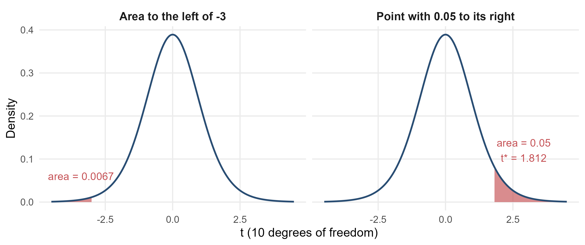
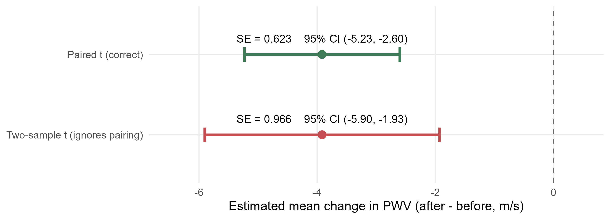
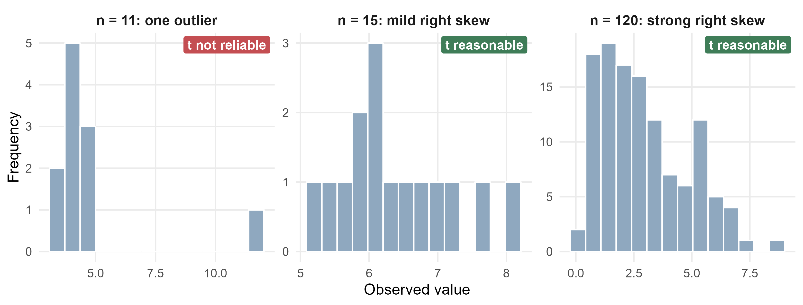

<style>
:root {
  --toc-width: 300px;
  --toc-collapsed-gutter: 72px;
  --chapter-width: 1100px;
  --ink: #23364a;
  --accent: #2c3e50;
  --line: #d8dee4;
  --toc-background: #f7f9fb;
}

html { scroll-behavior: smooth; }

body {
  font-size: 17px;
  line-height: 1.65;
  color: var(--ink);
}

.main-container { max-width: var(--chapter-width) !important; }
.section.chapter-root > h1 { display: none !important; }

#TOC li:has(> a[href="#chapter-17"]) > a[href="#chapter-17"] {
  display: none !important;
}

#TOC li:has(> a[href="#chapter-17"]) { margin-top: 0 !important; }

.sr-only {
  position: absolute;
  width: 1px;
  height: 1px;
  padding: 0;
  margin: -1px;
  overflow: hidden;
  clip: rect(0, 0, 0, 0);
  white-space: nowrap;
  border: 0;
}

#toc-toggle {
  position: fixed;
  top: 16px;
  left: calc(var(--toc-width) + 14px);
  width: 42px;
  height: 42px;
  display: flex;
  align-items: center;
  justify-content: center;
  padding: 0;
  border: 1px solid #c7d0d9;
  border-radius: 8px;
  background: #ffffff;
  color: var(--ink);
  box-shadow: 0 2px 8px rgba(24, 39, 55, 0.13);
  cursor: pointer;
  font-size: 24px;
  line-height: 1;
  z-index: 1200;
  transition: left 0.25s ease, background-color 0.2s ease;
}

#toc-toggle:hover { background: #eef3f7; }
#toc-toggle .menu-icon { display: none; }
#toc-toggle .close-icon { display: inline; }
body.toc-collapsed #toc-toggle { left: 14px; }
body.toc-collapsed #toc-toggle .menu-icon { display: inline; }
body.toc-collapsed #toc-toggle .close-icon { display: none; }

@media screen and (min-width: 992px) {
  .main-container {
    width: 100% !important;
    max-width: none !important;
    padding-left: calc(var(--toc-width) + 30px) !important;
    padding-right: 35px !important;
    box-sizing: border-box !important;
    transition: padding-left 0.25s ease;
  }

  body.toc-collapsed .main-container {
    padding-left: var(--toc-collapsed-gutter) !important;
  }

  .main-container > .row-fluid > .col-xs-12.col-sm-4.col-md-3,
  .main-container > .row > .col-xs-12.col-sm-4.col-md-3 {
    width: 0 !important;
    min-height: 0 !important;
    padding: 0 !important;
    margin: 0 !important;
  }

  #TOC,
  #TOC.tocify {
    position: fixed !important;
    top: 0 !important;
    bottom: 0 !important;
    left: 0 !important;
    width: var(--toc-width) !important;
    max-height: 100vh !important;
    overflow-y: auto !important;
    overflow-x: hidden !important;
    box-sizing: border-box !important;
    margin: 0 !important;
    padding: 72px 16px 28px 18px !important;
    background: var(--toc-background) !important;
    border: 0 !important;
    border-right: 1px solid var(--line) !important;
    border-radius: 0 !important;
    z-index: 1100 !important;
    transform: translateX(0);
    transition: transform 0.25s ease;
  }

  body.toc-collapsed #TOC,
  body.toc-collapsed #TOC.tocify {
    transform: translateX(calc(-1 * var(--toc-width)));
  }

  #TOC a {
    white-space: normal !important;
    overflow-wrap: break-word !important;
  }

  #TOC .tocify-item { border-radius: 4px; }
  #TOC .tocify-item a { color: var(--ink); text-decoration: none; }
  #TOC .tocify-item:hover { background: #e9eef3; }
  #TOC .tocify-item.active { background: var(--accent) !important; }
  #TOC .tocify-item.active a { color: #ffffff !important; }

  .toc-content,
  .toc-content.col-xs-12.col-sm-8.col-md-9 {
    width: 100% !important;
    max-width: var(--chapter-width) !important;
    float: none !important;
    margin-left: auto !important;
    margin-right: auto !important;
    padding-left: 15px !important;
    padding-right: 15px !important;
    box-sizing: border-box !important;
  }
}

@media screen and (max-width: 991px) {
  .main-container {
    width: auto !important;
    max-width: var(--chapter-width) !important;
    margin-left: auto !important;
    margin-right: auto !important;
    padding: 70px 18px 24px !important;
    box-sizing: border-box !important;
  }

  #toc-toggle,
  body.toc-collapsed #toc-toggle { left: 12px; }

  #toc-toggle .menu-icon,
  body.toc-collapsed #toc-toggle .menu-icon { display: inline; }

  #toc-toggle .close-icon,
  body.toc-collapsed #toc-toggle .close-icon { display: none; }

  body.toc-mobile-open #toc-toggle .menu-icon { display: none; }
  body.toc-mobile-open #toc-toggle .close-icon { display: inline; }

  #TOC,
  #TOC.tocify {
    position: fixed !important;
    top: 0 !important;
    bottom: 0 !important;
    left: 0 !important;
    width: min(84vw, 320px) !important;
    max-height: 100vh !important;
    overflow-y: auto !important;
    overflow-x: hidden !important;
    box-sizing: border-box !important;
    margin: 0 !important;
    padding: 72px 18px 28px !important;
    background: var(--toc-background) !important;
    border: 0 !important;
    border-right: 1px solid var(--line) !important;
    border-radius: 0 !important;
    z-index: 1100 !important;
    transform: translateX(-105%);
    transition: transform 0.25s ease;
  }

  body.toc-mobile-open #TOC,
  body.toc-mobile-open #TOC.tocify {
    transform: translateX(0);
    box-shadow: 6px 0 18px rgba(24, 39, 55, 0.16);
  }
}

h1, h2, h3, h4, h5 { margin-top: 1.6em; }
h2 { border-bottom: 3px solid var(--accent); padding-bottom: 0.25em; }
h3 { border-bottom: 1px solid var(--line); padding-bottom: 0.2em; }

blockquote {
  border-left: 4px solid var(--accent);
  background: #f7f9fa;
  padding: 0.7em 1em;
  margin: 1.2em 0;
}

table {
  width: 100%;
  margin: 1.35em auto;
  border-collapse: separate !important;
  border-spacing: 0;
  background: #ffffff;
  border: 1px solid #d6dde5;
  border-radius: 8px;
  overflow: hidden;
  box-shadow: 0 2px 8px rgba(24, 39, 55, 0.06);
}

table thead th {
  padding: 0.72em 0.9em !important;
  background: var(--accent);
  color: #ffffff;
  border: 0 !important;
  font-weight: 700;
}

table tbody td {
  padding: 0.65em 0.9em !important;
  border: 0 !important;
  border-bottom: 1px solid #e5e9ee !important;
}

table tbody tr:nth-child(even) td { background: #f7f9fb; }
table tbody tr:hover td { background: #eef4f8; }
table tbody tr:last-child td { border-bottom: 0 !important; }

img {
  display: block;
  max-width: 100%;
  height: auto;
  margin: 1.4em auto;
  border: 1px solid #e1e4e8;
  border-radius: 7px;
}

.math.display { overflow-x: auto; }

.btn-code,
.code-folding-btn,
div.btn-group.pull-right {
  display: none !important;
}
</style>

<button id="toc-toggle"
        type="button"
        aria-label="Toggle table of contents"
        aria-expanded="true">
  <span class="menu-icon" aria-hidden="true">&#9776;</span>
  <span class="close-icon" aria-hidden="true">&times;</span>
  <span class="sr-only">Toggle table of contents</span>
</button>

<script>
document.addEventListener("DOMContentLoaded", function () {
  const button = document.getElementById("toc-toggle");
  if (!button) return;

  button.addEventListener("click", function () {
    if (window.innerWidth <= 991) {
      document.body.classList.toggle("toc-mobile-open");
      button.setAttribute(
        "aria-expanded",
        document.body.classList.contains("toc-mobile-open")
      );
    } else {
      document.body.classList.toggle("toc-collapsed");
      button.setAttribute(
        "aria-expanded",
        !document.body.classList.contains("toc-collapsed")
      );
    }
  });
});
</script>

```{r setup, include=FALSE, echo=FALSE, warning=FALSE, message=FALSE}
knitr::opts_chunk$set(
  echo = TRUE,
  warning = FALSE,
  message = FALSE,
  error = FALSE,
  fig.align = "center",
  out.width = "92%"
)

if (!requireNamespace("ggplot2", quietly = TRUE)) {
  stop("The ggplot2 package must be installed before this chapter is knitted.")
}

suppressPackageStartupMessages({
  library(ggplot2)
})

# -------------------------------------------------------------
# All figures are created here with ggsave() and saved as
# slide_ch17_*.png. The same files are used by Chapter17_Slides.tex,
# so knit this document before compiling the slides.
# -------------------------------------------------------------

course_blue  <- "#294D73"
course_red   <- "#C44E52"
course_green <- "#3F7D58"
course_gold  <- "#BE892D"
course_grey  <- "#8FA8BF"

slide_theme <- theme_minimal(base_size = 15) +
  theme(
    plot.title = element_text(face = "bold", hjust = 0.5),
    plot.subtitle = element_text(hjust = 0.5, colour = "#444444"),
    panel.grid.minor = element_blank(),
    plot.background = element_rect(fill = "white", colour = NA),
    legend.position = "bottom"
  )

save_plot <- function(name, plot, width = 10, height = 5) {
  ggsave(name, plot, width = width, height = height, dpi = 300, bg = "white")
}

# Stacked dot plot positions: tied values stack upward
stack_y <- function(x) ave(seq_along(x), x, FUN = seq_along)

# ---- Data ---------------------------------------------------
testosterone <- c(0.30, 0.24, 0.19, 0.17, 0.18, 0.23, 0.24, 0.06, 0.15,
                  0.17, 0.18, 0.17, 0.15, 0.12, 0.25, 0.25, 0.25, 0.32,
                  0.35, 0.37, 0.39, 0.46, 0.49, 0.42, 0.36)
pwv <- c(18.8, 17.6, 17.5, 16.0, 14.8, 14.1, 13.7, 13.1, 12.9,
         12.9, 12.4, 10.1, 9.3, 9.1, 8.3, 8.3, 7.9, 7.2)
before <- c(18.8, 17.6, 17.5, 16.0, 14.8, 14.1, 13.7, 13.1, 12.9,
            12.9, 12.4, 10.1, 9.3, 9.1, 8.3, 7.9, 8.3, 7.2)
after  <- c(12.6, 10.8, 10.1, 10.1, 9.2, 7.6, 10.8, 7.7, 6.8,
            7.5, 9.4, 6.4, 9.0, 6.2, 7.2, 7.3, 5.7, 9.1)
difference <- after - before

# ---- 1. t family vs Standard Normal -------------------------
grid <- seq(-4.5, 4.5, length.out = 1200)
dens <- rbind(
  data.frame(x = grid, y = dnorm(grid),       dist = "Standard Normal"),
  data.frame(x = grid, y = dt(grid, df = 2),  dist = "t, df = 2"),
  data.frame(x = grid, y = dt(grid, df = 5),  dist = "t, df = 5"),
  data.frame(x = grid, y = dt(grid, df = 20), dist = "t, df = 20")
)
dens$dist <- factor(dens$dist, levels = unique(dens$dist))
p1 <- ggplot(dens, aes(x, y, colour = dist, linetype = dist)) +
  geom_line(linewidth = 1.1) +
  scale_colour_manual(values = c("black", course_red, course_gold, course_blue)) +
  scale_linetype_manual(values = c("dashed", "solid", "solid", "solid")) +
  annotate("text", x = 3.4, y = 0.075, label = "heavier tails\nfor small df",
           colour = course_red, size = 4.6) +
  labs(x = "Standardized value", y = "Density", colour = NULL, linetype = NULL) +
  slide_theme
save_plot("slide_ch17_t_distributions.png", p1, height = 4.8)

# ---- 2. Example 17.1 areas under t(10) ----------------------
g <- seq(-4.5, 4.5, length.out = 900)
areas <- rbind(
  data.frame(x = g, y = dt(g, 10), panel = "Area to the left of -3",
             shade = g <= -3),
  data.frame(x = g, y = dt(g, 10), panel = "Point with 0.05 to its right",
             shade = g >= qt(0.95, 10))
)
areas$panel <- factor(areas$panel, levels = unique(areas$panel))
labs_df <- data.frame(
  panel = factor(levels(areas$panel), levels = levels(areas$panel)),
  x = c(-3.4, 2.9), y = c(0.06, 0.12),
  lab = c("area = 0.0067", "area = 0.05\nt* = 1.812")
)
p2 <- ggplot(areas, aes(x, y)) +
  geom_area(data = subset(areas, shade), fill = course_red, alpha = 0.65) +
  geom_line(linewidth = 1, colour = course_blue) +
  geom_text(data = labs_df, aes(label = lab), size = 4.6, colour = course_red) +
  facet_wrap(~ panel) +
  labs(x = "t (10 degrees of freedom)", y = "Density") +
  slide_theme +
  theme(strip.text = element_text(face = "bold", size = 14))
save_plot("slide_ch17_t_areas.png", p2, height = 4.2)

# ---- 3. Testosterone dot plot -------------------------------
dt_df <- data.frame(x = testosterone, y = stack_y(testosterone))
p3 <- ggplot(dt_df, aes(x, y)) +
  geom_point(size = 4.2, colour = course_blue) +
  scale_y_continuous(NULL, breaks = NULL, limits = c(0.5, 4)) +
  scale_x_continuous(breaks = seq(0.05, 0.50, 0.05)) +
  labs(x = "Plasma testosterone concentration (nmol/L)") +
  slide_theme
save_plot("slide_ch17_testosterone_dotplot.png", p3, height = 3.4)

# ---- 4. Testosterone 95% CI ---------------------------------
ci <- t.test(testosterone)$conf.int
p4 <- ggplot(dt_df, aes(x, y)) +
  annotate("rect", xmin = ci[1], xmax = ci[2], ymin = 0.4, ymax = 4.2,
           fill = course_gold, alpha = 0.25) +
  geom_point(size = 4.2, colour = course_grey) +
  geom_vline(xintercept = mean(testosterone), colour = course_red,
             linewidth = 1.1) +
  annotate("label", x = mean(testosterone) + 0.005, y = 4.6, hjust = 0,
           label = "sample mean = 0.258", colour = course_red, size = 4.8,
           fill = "white", linewidth = 0) +
  annotate("text", x = 0.43, y = 3.4,
           label = "95% CI for the mean\n(0.212, 0.304)",
           colour = "#8A5E12", size = 4.8) +
  scale_y_continuous(NULL, breaks = NULL, limits = c(0.4, 4.9)) +
  scale_x_continuous(breaks = seq(0.05, 0.50, 0.05)) +
  labs(x = "Plasma testosterone concentration (nmol/L)") +
  slide_theme
save_plot("slide_ch17_testosterone_ci.png", p4, height = 3.6)

# ---- 5. PWV dot plot with reference value -------------------
dp <- data.frame(x = pwv, y = stack_y(pwv))
p5 <- ggplot(dp, aes(x, y)) +
  geom_vline(xintercept = 6.6, linetype = "dashed", colour = course_red,
             linewidth = 1) +
  annotate("text", x = 6.75, y = 2.6, label = "healthy-child\ncutoff 6.6 m/s",
           hjust = 0, colour = course_red, size = 4.6) +
  geom_point(size = 4.2, colour = course_blue) +
  scale_y_continuous(NULL, breaks = NULL, limits = c(0.5, 3)) +
  scale_x_continuous(limits = c(6, 19.5), breaks = seq(6, 19, 1)) +
  labs(x = "Pulse wave velocity (m/s)") +
  slide_theme
save_plot("slide_ch17_pwv_dotplot.png", p5, height = 3.4)

# ---- 6. Paired measurements (one line per child) ------------
long <- data.frame(
  child = rep(seq_along(before), 2),
  time = factor(rep(c("Before", "After"), each = length(before)),
                levels = c("Before", "After")),
  pwv = c(before, after)
)
long$went_up <- rep(after > before, 2)
p6 <- ggplot(long, aes(time, pwv, group = child)) +
  geom_line(aes(colour = went_up), linewidth = 0.9, alpha = 0.85) +
  geom_point(size = 2.8, colour = course_blue) +
  scale_colour_manual(values = c(`FALSE` = course_grey, `TRUE` = course_red),
                      labels = c("decreased", "increased")) +
  labs(x = NULL, y = "Pulse wave velocity (m/s)", colour = NULL,
       title = "Each line is one child") +
  slide_theme
save_plot("slide_ch17_before_after.png", p6, width = 5.6, height = 5)

# ---- 7. Paired differences ----------------------------------
# bin to the nearest 0.5 m/s so nearby values stack instead of overlapping
d_bin <- round(difference * 2) / 2
dd <- data.frame(x = d_bin, y = stack_y(d_bin))
p7 <- ggplot(dd, aes(x, y)) +
  geom_vline(xintercept = 0, linetype = "dashed", colour = course_red,
             linewidth = 1) +
  geom_point(size = 5, colour = course_green) +
  scale_y_continuous(NULL, breaks = NULL, limits = c(0.5, 5)) +
  scale_x_continuous(limits = c(-8, 2.5), breaks = seq(-8, 2, 2)) +
  labs(x = "d = after - before (m/s, nearest 0.5)", title = "The 18 differences") +
  slide_theme
save_plot("slide_ch17_differences.png", p7, width = 5.6, height = 5)

# ---- 8. Paired vs (incorrect) independent analysis ----------
paired_ci <- t.test(after, before, paired = TRUE)$conf.int
welch_ci  <- t.test(after, before)$conf.int
cmp <- data.frame(
  method = factor(c("Paired t (correct)", "Two-sample t (ignores pairing)"),
                  levels = c("Two-sample t (ignores pairing)", "Paired t (correct)")),
  est = mean(difference),
  lo = c(paired_ci[1], welch_ci[1]),
  hi = c(paired_ci[2], welch_ci[2]),
  se = c(sd(difference) / sqrt(18), sqrt(var(after) / 18 + var(before) / 18))
)
cmp$lab <- sprintf("SE = %.3f    95%% CI (%.2f, %.2f)", cmp$se, cmp$lo, cmp$hi)
p8 <- ggplot(cmp, aes(y = method, x = est)) +
  geom_vline(xintercept = 0, linetype = "dashed", colour = "grey40") +
  geom_errorbar(aes(xmin = lo, xmax = hi, colour = method),
                orientation = "y", width = 0.18, linewidth = 1.4) +
  geom_point(size = 4, aes(colour = method)) +
  geom_text(aes(label = lab), vjust = -1.5, size = 4.6) +
  scale_colour_manual(values = c(course_red, course_green), guide = "none") +
  scale_x_continuous(limits = c(-6.5, 0.5)) +
  labs(x = "Estimated mean change in PWV (after - before, m/s)", y = NULL) +
  slide_theme
save_plot("slide_ch17_paired_vs_independent.png", p8, height = 3.6)

# ---- 9. Robustness: three illustrative shapes ---------------
set.seed(1210)
rob <- rbind(
  data.frame(value = c(3.4, 3.7, 3.9, 4.0, 4.1, 4.2, 4.3, 4.5, 4.6, 4.8, 11.7),
             sample = "n = 11: one outlier"),
  data.frame(value = c(5.2, 5.5, 5.7, 5.8, 5.9, 6.0, 6.1, 6.2, 6.4, 6.5,
                       6.7, 6.9, 7.2, 7.6, 8.1),
             sample = "n = 15: mild right skew"),
  data.frame(value = rgamma(120, shape = 2.2, scale = 1.2),
             sample = "n = 120: strong right skew")
)
rob$sample <- factor(rob$sample, levels = unique(rob$sample))
verdict <- data.frame(
  sample = factor(levels(rob$sample), levels = levels(rob$sample)),
  lab = c("t not reliable", "t reasonable", "t reasonable"),
  col = c("bad", "ok", "ok")
)
p9 <- ggplot(rob, aes(value)) +
  geom_histogram(bins = 14, fill = course_grey, colour = "white") +
  geom_label(data = verdict, aes(x = Inf, y = Inf, label = lab, fill = col),
             hjust = 1.05, vjust = 1.2, colour = "white", size = 4.6,
             fontface = "bold", linewidth = 0) +
  scale_fill_manual(values = c(bad = course_red, ok = course_green),
                    guide = "none") +
  facet_wrap(~ sample, scales = "free", nrow = 1) +
  labs(x = "Observed value", y = "Frequency") +
  slide_theme +
  theme(strip.text = element_text(face = "bold", size = 14))
save_plot("slide_ch17_robustness.png", p9, width = 11, height = 4.2)
```

# Chapter 17 {.chapter-root .unlisted}

## From the $z$ Procedures to the $t$ Procedures

Chapter 14 introduced confidence intervals and hypothesis tests for a population mean $\mu$. Those procedures assumed that the population standard deviation $\sigma$ was known, and they used the standard error

$$
\frac{\sigma}{\sqrt{n}}
$$

In most applications, however, $\sigma$ is unknown. Only the sample is available, so we estimate $\sigma$ with the sample standard deviation $s$. The estimated standard error is

$$
\frac{s}{\sqrt{n}}
$$

Replacing $\sigma$ by $s$ adds uncertainty. The Standard Normal distribution no longer describes the standardized sample mean exactly. The correct reference distribution is a **Student's $t$ distribution**.

| | Chapter 14: $\sigma$ known | Chapter 17: $\sigma$ unknown |
|:--|:--|:--|
| Standard error | $\sigma/\sqrt{n}$ | $s/\sqrt{n}$ |
| Standardized statistic | $z$ | $t$ |
| Reference distribution | $N(0,1)$ | $t(n-1)$ |

> **Main transition**
>
> The logic of confidence intervals and hypothesis tests stays the same. The standard error is estimated from the sample, the reference distribution changes from $z$ to $t$, and the degrees of freedom must be identified.

### Learning Goals

After studying this chapter, you should be able to

1. Assess the conditions for inference about a population mean
2. Distinguish the population standard deviation, the sample standard deviation and the standard error
3. Explain why a $t$ distribution is used when $\sigma$ is unknown
4. Construct and interpret a one-sample $t$ confidence interval
5. Conduct and interpret a one-sample $t$ test
6. Analyze paired measurements through their within-pair differences
7. Assess whether a $t$ procedure is reasonably robust for a given sample
8. Use R to check hand calculations and carry out the procedures

### The Four-Step Process

Every example in this chapter follows the same structure used in Chapter 14:

1. **STATE:** Define the population, the parameter and the question
2. **PLAN:** Choose the procedure (interval or test) and, for a test, the hypotheses
3. **SOLVE:** Check the conditions, then calculate
4. **CONCLUDE:** Interpret the result in context, for the population the design supports

---

## Conditions for Inference about a Mean

The formulas mean something only when the data and the study design support the procedure.

### Condition 1: Random Sampling or a Comparable Design

The observations should reasonably be viewed as a simple random sample from the population of interest, or as observations produced by a design that supports a similar independence assumption.

This condition determines the **scope** of the conclusion. A correct calculation cannot make a convenience sample represent a wider population.

When sampling without replacement from a finite population, a common practical condition for independence is that the sample is no more than $10\%$ of the population:

$$
n\leq0.10N
$$

where $N$ is the population size. The $10\%$ condition is not needed when the observations come from an effectively infinite process or from independent experimental units.

### Condition 2: Shape of the Population

The one-sample $t$ procedures are exact when the population distribution is Normal. Real populations are rarely perfectly Normal, so the practical question is whether the procedure is still reliable for the observed sample size and shape.

The assessment should consider

- The sample size
- The degree of skewness
- The presence of outliers
- Whether the distribution has one meaningful centre

The Central Limit Theorem improves the sampling distribution of $\bar{x}$ as $n$ increases. It does not remove data-quality problems, make observations independent or make an unhelpful mean meaningful.

### Independence Is More Important Than Perfect Normality

Moderate non-Normality can often be handled with a large enough sample. Dependence, selection bias and systematic measurement error cannot be fixed by increasing the sample size.

For example, measuring the same animal repeatedly and treating every measurement as if it came from a different animal underestimates uncertainty. There may be many measurements, but they are not independent experimental units.

> **Priority of conditions**
>
> The sampling or study-design condition usually matters more than having data that look exactly Normal. Always plot the data before using a $t$ procedure.

---

## Standard Deviation and Standard Error

The sample standard deviation and the standard error answer different questions.

### The Sample Standard Deviation

The sample standard deviation is

$$
s
=
\sqrt{
\frac{
\sum_{i=1}^{n}(x_i-\bar{x})^2
}{
n-1
}
}
$$

It describes how the **individual observations** vary around the sample mean, and it estimates the unknown population standard deviation $\sigma$. Its units are the original units of the variable.

### The Standard Error of the Sample Mean

The standard error of $\bar{x}$ is

$$
\operatorname{SE}(\bar{x})
=
\frac{s}{\sqrt{n}}
$$

It estimates how much **sample means** would vary across repeated random samples of size $n$. Its units are also the original units of the variable.

| Quantity | What varies? | What it describes |
|:--|:--|:--|
| $s$ | Individual observations | Estimated spread of values in the population |
| $s/\sqrt{n}$ | Sample means | Estimated sample-to-sample spread of $\bar{x}$ |

### Effect of the Sample Size

For the same sample standard deviation, a larger $n$ gives a smaller standard error. If the sample size is multiplied by $4$,

$$
\frac{s}{\sqrt{4n}}
=
\frac{1}{2}\cdot\frac{s}{\sqrt{n}}
$$

so the standard error is cut in half. Because of this square-root relationship, much greater precision may require a much larger sample.

### A Frequent Mistake

The standard error is **not** $s$, and it is **not** $s/n$. The correct expression divides by the square root of the sample size:

$$
\boxed{
\operatorname{SE}(\bar{x})
=
\frac{s}{\sqrt{n}}
}
$$

Because $s$ changes from sample to sample, the estimated standard error is itself random. This is why the Standard Normal distribution is no longer exactly correct.

---

## The $t$ Distributions

Suppose an SRS of size $n$ comes from a Normal population with mean $\mu$ and standard deviation $\sigma$. If $\sigma$ were known, the standardized statistic would be

$$
z
=
\frac{\bar{x}-\mu}{\sigma/\sqrt{n}}\sim N(0,1)
$$

When $\sigma$ is unknown, it is replaced by $s$:

$$
t
=
\frac{\bar{x}-\mu}{s/\sqrt{n}}
$$

This statistic has a $t$ distribution with

$$
\operatorname{df}=n-1
$$

degrees of freedom. Both statistics count how many standard errors $\bar{x}$ lies from $\mu$.

### Why the Reference Distribution Changes

The denominator $s/\sqrt{n}$ is random because $s$ changes from sample to sample. This extra uncertainty makes the $t$ distribution more spread out than the Standard Normal distribution. Its heavier tails allow for the possibility that $s$ underestimates or overestimates $\sigma$.

As a result, $t$ intervals are wider than $z$ intervals, and the same standardized distance gives a larger $P$-value.

### Properties of the $t$ Family

The $t$ distributions form a family rather than a single curve.

- Every $t$ distribution is symmetric about $0$
- Every $t$ distribution is single-peaked and bell-shaped
- A $t$ distribution has heavier tails than the Standard Normal distribution
- Smaller degrees of freedom produce heavier tails
- As the degrees of freedom increase, the $t$ distribution approaches $N(0,1)$

```{r t-distribution-plot, echo=FALSE}
knitr::include_graphics("slide_ch17_t_distributions.png")
```

For a small sample, $s$ is a less stable estimate of $\sigma$, so the critical value must be larger. With a large sample, $s$ estimates $\sigma$ accurately and the difference between $t^*$ and $z^*$ becomes small.

### Degrees of Freedom

The degrees of freedom identify which member of the $t$ family to use. For one-sample inference,

$$
\operatorname{df}=n-1
$$

We lose one degree of freedom by estimating the population mean with $\bar{x}$. Once the sample mean is fixed, only $n-1$ deviations from it can vary freely, because

$$
\sum_{i=1}^{n}(x_i-\bar{x})=0
$$

For first-year applications, the essential step is to calculate $n-1$ and use the matching distribution.

| Distribution | 95% critical value |
|:--:|:--:|
| $t(5)$ | $2.571$ |
| $t(10)$ | $2.228$ |
| $t(20)$ | $2.086$ |
| $t(50)$ | $2.009$ |
| $N(0,1)$ | $1.960$ |

The cost of estimating $\sigma$ is large for small samples and small for large ones.

### William S. Gosset and Student's $t$

William S. Gosset developed the $t$ distribution while working for the Guinness brewery. He needed to make reliable decisions from the small experimental samples used in brewing and agriculture.

The company restricted employees from publishing its work, so Gosset published under the pen name **Student**. The distribution is therefore often called **Student's $t$ distribution**. This history reflects the method's purpose: allowing for the extra uncertainty that comes from estimating $\sigma$ from a small sample.

---

## Probabilities and Critical Values in R

The R functions for a $t$ distribution mirror the Normal-distribution functions.

| Task | Standard Normal | $t$ distribution |
|:--|:--|:--|
| Left-tail probability | `pnorm()` | `pt()` |
| Quantile or critical value | `qnorm()` | `qt()` |
| Density | `dnorm()` | `dt()` |
| Random values | `rnorm()` | `rt()` |

Every $t$ calculation must include the degrees of freedom.

### Example 17.1: Reading $t$ Probabilities

For a $t$ distribution with $10$ degrees of freedom, find (a) the area to the left of $t=-3$ and (b) the point $t^*$ with probability $0.05$ to its right.

```{r t-areas-plot, echo=FALSE}

```

**(a) An area question.** Use `pt()`:

```{r t-left-tail}
pt(q = -3, df = 10)
```

$$
P(T\leq-3)\approx0.0067
$$

**(b) A cutoff question.** The point with $0.05$ to its right has $1-0.05=0.95$ to its left, so use `qt()`:

```{r t-upper-critical-value}
qt(p = 0.95, df = 10)
```

$$
t^*\approx1.812
$$

Because the distribution is symmetric, $P(T\leq-1.812)=P(T\geq1.812)=0.05$. For a right-tail area directly, use `pt(t, df, lower.tail = FALSE)`.

### Two-Sided Critical Values

For a $95\%$ confidence interval, the central area is $0.95$. The remaining $0.05$ is split equally between the two tails, $0.025$ each, so the upper critical value has cumulative probability $0.975$:

```{r t-two-sided-critical-values}
qt(0.975, df = c(4, 9, 19, 49, 199))
```

The critical values decrease toward $1.960$, the Standard Normal critical value for a $95\%$ interval.

---

## The One-Sample $t$ Confidence Interval

The one-sample $t$ confidence interval estimates an unknown population mean when the population standard deviation is also unknown. For a sample of size $n$, a level $C$ confidence interval is

$$
\boxed{
\bar{x}
\pm
t^*\frac{s}{\sqrt{n}}
}
$$

where

- $\bar{x}$ is the point estimate
- $s/\sqrt{n}$ is the estimated standard error
- $t^*$ is the critical value from the $t(n-1)$ distribution with central area $C$
- $m=t^*s/\sqrt{n}$ is the margin of error

The interval is exact for a Normal population and approximately correct for a large enough sample from other population shapes.

### What Controls the Width?

- A **higher confidence level** increases $t^*$ and widens the interval
- **More variable data** (larger $s$) widen the interval
- A **larger sample** shrinks $s/\sqrt{n}$ and usually narrows the interval

The confidence level $C$ describes the long-run success rate of the *method*: in repeated sampling, a proportion $C$ of such intervals capture $\mu$. It is not the probability that one already-computed interval contains the fixed parameter.

### Example 17.2: Testosterone Concentrations

A study recorded plasma testosterone concentrations for $25$ obese adolescent males. Measurements are in nanomoles per litre of blood.

|  |  |  |  |  |
|--:|--:|--:|--:|--:|
| $0.30$ | $0.24$ | $0.19$ | $0.17$ | $0.18$ |
| $0.23$ | $0.24$ | $0.06$ | $0.15$ | $0.17$ |
| $0.18$ | $0.17$ | $0.15$ | $0.12$ | $0.25$ |
| $0.25$ | $0.25$ | $0.32$ | $0.35$ | $0.37$ |
| $0.39$ | $0.46$ | $0.49$ | $0.42$ | $0.36$ |

**STATE:** Estimate $\mu$, the population mean testosterone concentration for obese adolescent males similar to those in the study, with $95\%$ confidence.

**PLAN:** $\sigma$ is unknown, so use a one-sample $t$ interval.

### Example 17.2: Checking the Data

**SOLVE:** Before calculating anything, plot the data.

```{r testosterone-dotplot, echo=FALSE}
knitr::include_graphics("slide_ch17_testosterone_dotplot.png")
```

The dot plot is single-peaked, with no extreme outlier or strong skewness. With $n=25$, a $t$ procedure is reasonable.

### Example 17.2: Calculation

The summary statistics are

$$
n=25,\qquad \bar{x}=0.2584,\qquad s\approx0.1115
$$

The estimated standard error is

$$
\operatorname{SE}(\bar{x})
=
\frac{0.1115}{\sqrt{25}}
\approx
0.0223
$$

With $\operatorname{df}=25-1=24$, the $95\%$ critical value is

$$
t^*=t^*_{0.975,24}\approx2.064
$$

The margin of error is

$$
m
=
t^*\frac{s}{\sqrt{n}}
=
2.064(0.0223)
\approx
0.0460
$$

and the interval is

$$
0.2584\pm0.0460
\quad\Longrightarrow\quad
\boxed{
(0.2124,\ 0.3044)\text{ nmol/L}
}
$$

For comparison, $z^*=1.960$, but $t^*\approx2.064$. The larger critical value makes the interval a little wider, to allow for estimating $\sigma$ with $s$.

### Example 17.2: Conclusion

```{r testosterone-ci-plot, echo=FALSE}
knitr::include_graphics("slide_ch17_testosterone_ci.png")
```

**CONCLUDE:** We are $95\%$ confident that the population mean plasma testosterone concentration for obese adolescent males similar to those in the study is between approximately $0.212$ and $0.304$ nmol/L.

### Example 17.2: What the Interval Does Not Tell Us

The participants were recruited through one medical centre rather than selected as an SRS of all obese adolescent males. The interval describes uncertainty for a population similar to these participants. The study design limits any wider generalization.

The interval covers random sample-to-sample variation under the model. It does **not**

- give a range for *individual* boys (most of the observations in the plot lie outside it)
- correct for selection bias or systematic measurement error
- show that obesity *causes* lower testosterone, because this is an observational study

### Manual Calculation in R

```{r testosterone-manual-calculation}
n_testosterone <- length(testosterone)
xbar_testosterone <- mean(testosterone)
s_testosterone <- sd(testosterone)
df_testosterone <- n_testosterone - 1

se_testosterone <- s_testosterone / sqrt(n_testosterone)
t_star_testosterone <- qt(p = 0.975, df = df_testosterone)
margin_testosterone <- t_star_testosterone * se_testosterone

c(
  mean = xbar_testosterone,
  standard_deviation = s_testosterone,
  standard_error = se_testosterone,
  critical_value = t_star_testosterone,
  margin_of_error = margin_testosterone,
  lower = xbar_testosterone - margin_testosterone,
  upper = xbar_testosterone + margin_testosterone
)
```

### The Direct R Method

The `t.test()` function constructs the interval directly from the observations.

```{r testosterone-t-test-confidence-interval}
testosterone_result <- t.test(
  x = testosterone,
  conf.level = 0.95
)

testosterone_result$estimate
testosterone_result$conf.int
```

The stored result contains several components. Selecting `estimate` and `conf.int` reports only what this question needs. By default, `t.test()` also tests whether the mean is zero, and that test is not relevant here.

> **Reading software output**
>
> Software may report more than the research question requires. Interpret only the parts of the output that correspond to the stated analysis.

---

## The One-Sample $t$ Test

The one-sample $t$ test evaluates a claim about a population mean when $\sigma$ is unknown. The null hypothesis is $H_0:\mu=\mu_0$, and the one-sample $t$ statistic is

$$
\boxed{
t
=
\frac{\bar{x}-\mu_0}{s/\sqrt{n}}
}
$$

It measures the distance between the observed sample mean and the null value in estimated standard errors. Under $H_0$, the statistic follows a $t$ distribution with $\operatorname{df}=n-1$.

### P-Value by Alternative

Let $T$ have a $t(n-1)$ distribution and let $t$ be the observed test statistic.

| Alternative | P-value | R argument |
|:--|:--|:--|
| $H_a:\mu>\mu_0$ | $P(T\geq t)$ | `alternative = "greater"` |
| $H_a:\mu<\mu_0$ | $P(T\leq t)$ | `alternative = "less"` |
| $H_a:\mu\ne\mu_0$ | $2P(T\geq|t|)$ | `alternative = "two.sided"` |

The alternative hypothesis, not the sign of the observed statistic, determines which tail or tails to use. It must be chosen from the research question **before** looking at the data. The $P$-value is calculated assuming $H_0$ and the model are true.

### Example 17.3: Pulse Wave Velocity and Progeria

Hutchinson–Gilford progeria syndrome is a rare genetic condition associated with accelerated aging. Pulse wave velocity (PWV) is used as a measure of arterial stiffness. PWV was measured in $18$ children diagnosed with progeria:

|  |  |  |  |  |  |
|--:|--:|--:|--:|--:|--:|
| $18.8$ | $17.6$ | $17.5$ | $16.0$ | $14.8$ | $14.1$ |
| $13.7$ | $13.1$ | $12.9$ | $12.9$ | $12.4$ | $10.1$ |
| $9.3$ | $9.1$ | $8.3$ | $8.3$ | $7.9$ | $7.2$ |

In healthy children, a PWV above $6.6$ m/s would be considered abnormal. The question is whether the population mean PWV for children with progeria is greater than $6.6$ m/s.

### Example 17.3: Hypotheses

**STATE:** Let $\mu$ be the population mean PWV for children with progeria similar to those in the study.

**PLAN:** Use a one-sample $t$ test of

$$
H_0:\mu=6.6\text{ m/s}
\qquad
H_a:\mu>6.6\text{ m/s}
$$

The test is upper-tailed because the scientific question asks whether the mean is *higher* than the reference value.

Progeria is rare, and the participants were recruited worldwide rather than selected through a formal SRS. The conclusion applies most directly to comparable children with progeria.

### Example 17.3: Checking the Data

**SOLVE:**

```{r pwv-dotplot, echo=FALSE}
knitr::include_graphics("slide_ch17_pwv_dotplot.png")
```

The plot shows no outlier and no strong departure from a single-peaked distribution, so a $t$ test is reasonable for $n=18$. Every child is above the $6.6$ m/s cutoff.

### Example 17.3: Test Statistic and P-Value

The data give

$$
n=18,\qquad \bar{x}\approx12.444,\qquad s\approx3.638
$$

The standard error is

$$
\operatorname{SE}(\bar{x})
=
\frac{3.638}{\sqrt{18}}
\approx
0.857
$$

and the test statistic, with $\operatorname{df}=17$, is

$$
t
=
\frac{12.444-6.6}{0.857}
\approx
6.816
$$

The observed sample mean is about $6.8$ estimated standard errors above the null value. Because the alternative is upper-tailed,

$$
P\text{-value}
=
P(T_{17}\geq6.816)
\approx
1.50\times10^{-6}
$$

```{r pwv-manual-p-value}
pt(q = 6.816273, df = 17, lower.tail = FALSE)
```

### Example 17.3: Conclusion

If the population mean were $6.6$ m/s, a sample mean this large would occur in only about $1.5$ out of every million random samples of $18$ children.

**CONCLUDE:** The data provide very strong evidence that the population mean PWV for children with progeria similar to those in the study is greater than $6.6$ m/s.

### Manual Test Calculation in R

```{r pwv-manual-test}
mu_null_pwv <- 6.6
n_pwv <- length(pwv)
xbar_pwv <- mean(pwv)
s_pwv <- sd(pwv)
se_pwv <- s_pwv / sqrt(n_pwv)
df_pwv <- n_pwv - 1

t_pwv <- (xbar_pwv - mu_null_pwv) / se_pwv
p_pwv_upper <- pt(q = t_pwv, df = df_pwv, lower.tail = FALSE)

c(
  mean = xbar_pwv,
  standard_deviation = s_pwv,
  standard_error = se_pwv,
  t_statistic = t_pwv,
  degrees_of_freedom = df_pwv,
  p_value = p_pwv_upper
)
```

### Direct Test with `t.test()`

```{r pwv-direct-test}
t.test(
  x = pwv,
  mu = 6.6,
  alternative = "greater"
)
```

The value supplied to `alternative` must match the stated research hypothesis.

### Statistical Significance and Effect Size

The result is statistically significant, but the $P$-value does not measure how large or how clinically important the difference is. The observed difference from the reference value is

$$
12.444-6.6=5.844\text{ m/s}
$$

A confidence interval describes the plausible range of the population mean:

```{r pwv-confidence-interval}
t.test(
  x = pwv,
  conf.level = 0.95
)$conf.int
```

Whether a mean PWV between about $10.6$ and $14.3$ m/s is clinically important requires medical expertise. That judgment depends on the reference group, the measurement process and the patient population.

### Confidence Intervals and Two-Sided Tests

When a two-sided test and a confidence interval use the same data, model and level,

- **reject** $H_0:\mu=\mu_0$ at level $\alpha$ if $\mu_0$ lies *outside* the $(1-\alpha)100\%$ confidence interval
- **fail to reject** if $\mu_0$ lies *inside* the interval

For the PWV data, the $95\%$ interval is $(10.64,\ 14.25)$ m/s. The value $6.6$ lies far outside it, so a two-sided test at $\alpha=0.05$ also rejects $H_0$.

The test asks whether one particular value $\mu_0$ is plausible. The interval shows every plausible value and how precise the estimate is.

### What Failure to Reject Would Mean

If the $P$-value were not small, the correct conclusion would be that the data do not provide enough evidence against $H_0$. It would not be correct to claim that

- the null hypothesis has been proved
- the population mean equals the null value exactly
- no meaningful difference exists

A non-significant result may come from a small effect, high variability, a small sample or a combination of these.

---

## Matched Pairs $t$ Procedures

Many studies measure the same subject twice, or match different subjects on relevant characteristics. Common matched-pairs designs include

- Measurements before and after treatment on the same individual
- Two treatments applied to the same experimental unit at different times
- Two individuals matched on age, sex, species, baseline condition or another relevant characteristic

The matching creates dependence between the two observations in each pair.

### Reduce Each Pair to One Difference

For pair $i$, define

$$
d_i
=
\text{response under condition 2}
-
\text{response under condition 1}
$$

The paired analysis then applies the one-sample $t$ procedures to $d_1,d_2,\ldots,d_n$. The parameter is $\mu_d$, the population mean paired difference, and $\operatorname{df}=n-1$, where $n$ is the **number of pairs**.

### The Direction of the Difference

The sign of the difference must be defined before the hypotheses are written. Reversing the subtraction reverses the signs of $\bar{d}$ and the test statistic, and it reverses the direction of a one-sided alternative.

| Definition | Improvement means | Alternative |
|:--|:--|:--|
| $d=\text{after}-\text{before}$ | negative differences | $H_a:\mu_d<0$ |
| $d=\text{before}-\text{after}$ | positive differences | $H_a:\mu_d>0$ |

Either definition is valid if it is stated clearly and used consistently.

### Conditions for Matched Pairs

The one-sample conditions apply to the **differences**:

1. The pairs should be independent of one another
2. The pairs should represent the target population or come from an appropriate randomized design
3. The distribution of the differences should be close enough to Normal for the sample size, with particular attention to outliers

The two observations *within* a pair are expected to be dependent. That dependence is the reason the paired design is used.

### Example 17.4: Treatment for Progeria

The $18$ children in the PWV study received lonafarnib for two years. PWV was measured before and after treatment.

| Child | Before | After | $d$ | Child | Before | After | $d$ |
|:--:|--:|--:|--:|:--:|--:|--:|--:|
| $1$ | $18.8$ | $12.6$ | $-6.2$ | $10$ | $12.9$ | $7.5$ | $-5.4$ |
| $2$ | $17.6$ | $10.8$ | $-6.8$ | $11$ | $12.4$ | $9.4$ | $-3.0$ |
| $3$ | $17.5$ | $10.1$ | $-7.4$ | $12$ | $10.1$ | $6.4$ | $-3.7$ |
| $4$ | $16.0$ | $10.1$ | $-5.9$ | $13$ | $9.3$ | $9.0$ | $-0.3$ |
| $5$ | $14.8$ | $9.2$ | $-5.6$ | $14$ | $9.1$ | $6.2$ | $-2.9$ |
| $6$ | $14.1$ | $7.6$ | $-6.5$ | $15$ | $8.3$ | $7.2$ | $-1.1$ |
| $7$ | $13.7$ | $10.8$ | $-2.9$ | $16$ | $7.9$ | $7.3$ | $-0.6$ |
| $8$ | $13.1$ | $7.7$ | $-5.4$ | $17$ | $8.3$ | $5.7$ | $-2.6$ |
| $9$ | $12.9$ | $6.8$ | $-6.1$ | $18$ | $7.2$ | $9.1$ | $1.9$ |

The sample for the analysis is the $18$ differences, not the $36$ raw measurements.

### Example 17.4: Hypotheses and Data Check

**PLAN:** Define

$$
d=\text{after-treatment PWV}-\text{before-treatment PWV}
$$

so a reduction gives a negative difference. Let $\mu_d$ be the population mean of $d$. The treatment is expected to reduce PWV:

$$
H_0:\mu_d=0
\qquad
H_a:\mu_d<0
$$

```{r paired-plots, echo=FALSE, out.width="48%", fig.show="hold"}
knitr::include_graphics(c("slide_ch17_before_after.png", "slide_ch17_differences.png"))
```

The connecting lines keep the pairing visible and show that PWV fell for $17$ of the $18$ children. The differences are mildly skewed but contain no severe outlier. With $n=18$, the paired $t$ procedure is reasonable.

### Example 17.4: Test Statistic and P-Value

**SOLVE:** For the $18$ paired differences,

$$
n=18,\qquad \bar{d}\approx-3.917,\qquad s_d\approx2.644
$$

$$
\operatorname{SE}(\bar{d})
=
\frac{s_d}{\sqrt{n}}
=
\frac{2.644}{\sqrt{18}}
\approx
0.623
$$

The test statistic, with $\operatorname{df}=17$, is

$$
t
=
\frac{\bar{d}-0}{s_d/\sqrt{n}}
=
\frac{-3.917}{0.623}
\approx
-6.286
$$

Because the alternative is lower-tailed,

$$
P\text{-value}
=
P(T_{17}\leq-6.286)
\approx
4.10\times10^{-6}
$$

**CONCLUDE:** The data provide very strong evidence that the treatment lowers mean PWV for comparable children with progeria.

### Manual Paired Calculation in R

```{r paired-manual-calculation}
n_difference <- length(difference)
mean_difference <- mean(difference)
sd_difference <- sd(difference)
se_difference <- sd_difference / sqrt(n_difference)

t_difference <- mean_difference / se_difference
p_difference <- pt(q = t_difference, df = n_difference - 1)

c(
  mean_difference = mean_difference,
  standard_deviation = sd_difference,
  standard_error = se_difference,
  t_statistic = t_difference,
  p_value = p_difference
)
```

### Direct Paired Test in R

```{r paired-direct-test}
t.test(
  x = after,
  y = before,
  paired = TRUE,
  alternative = "less"
)
```

The argument `paired = TRUE` is essential. It tells R to calculate the within-child differences, `after - before`, before carrying out the one-sample analysis. An equivalent command applies `t.test()` to the differences directly:

```{r paired-equivalent-test}
t.test(
  x = difference,
  mu = 0,
  alternative = "less"
)
```

Both commands use the same $18$ differences and give the same test statistic and $P$-value.

### Confidence Interval for the Mean Change

A $95\%$ interval for the mean difference uses $t^*=2.110$ with $\operatorname{df}=17$:

$$
\bar{d}\pm t^*\frac{s_d}{\sqrt{n}}
=
-3.917\pm2.110(0.623)
\quad\Longrightarrow\quad
(-5.231,\ -2.602)\text{ m/s}
$$

```{r paired-confidence-interval}
t.test(
  x = after,
  y = before,
  paired = TRUE,
  conf.level = 0.95
)$conf.int
```

Equivalently, the estimated mean **reduction** (before minus after) is between about $2.60$ and $5.23$ m/s.

The interval describes the plausible size of the population mean change. Whether a reduction in this range is clinically important requires subject-matter judgment, including how PWV relates to health outcomes, the treatment's side effects and how much responses vary between patients.

### Why the Pairing Must Not Be Ignored

The before and after samples are not independent: each after-treatment value is linked to the same child's before-treatment value. An independent two-sample procedure would treat the $36$ measurements as if they came from $36$ unrelated children.

```{r paired-vs-independent-plot, echo=FALSE}

```

Both analyses give the same estimate, $-3.917$ m/s. However, ignoring the pairing raises the standard error from $0.623$ to $0.966$ and widens the interval considerably. This happens because the independent analysis counts the large child-to-child differences in baseline PWV as noise. The paired analysis removes them by comparing each child with themselves.

```{r paired-vs-independent-code}
t.test(after, before, paired = TRUE)$conf.int   # correct: paired
t.test(after, before)$conf.int                  # incorrect: ignores pairing
```

> **Design determines analysis**
>
> When observations are paired, analyze the paired differences. When samples are genuinely independent, use an independent-samples procedure.

### When Matching Helps

Matching is useful when the two observations within a pair tend to be similar for reasons unrelated to the treatment. Baseline vascular condition varies a lot among children, so comparing each child's post-treatment measurement with their own baseline removes much of that variation from the treatment comparison.

Poor or arbitrary matching may provide little benefit. Matching variables should be chosen because they are scientifically related to the response.

---

## Robustness of the $t$ Procedures

A procedure is **robust** when its confidence level or $P$-value changes little under moderate departures from its conditions.

The one-sample $t$ procedures are generally robust to moderate non-Normality, especially as the sample size increases. They are **not** robust to outliers, because both $\bar{x}$ and $s$ are sensitive to extreme observations.

### Practical Guidelines

| Sample size | Practical guidance |
|:--|:--|
| $n<15$ | Use $t$ procedures only when the data are close to symmetric, single-peaked and free of outliers |
| $15\leq n<40$ | Mild or moderate skewness is usually acceptable, but strong skewness and outliers remain concerns |
| $n\geq40$ | Strong skewness is often manageable, but influential outliers and the scientific structure still need attention |

These cutoffs are guidelines rather than automatic rules. How severe the departure is, and the purpose of the analysis, also matter.

```{r robustness-plot, echo=FALSE}

```

The figure uses illustrative datasets:

- The small sample contains a clear outlier, so the $t$ procedure is not reliable without further investigation
- The moderate sample has mild right skewness without an extreme value, so a $t$ procedure is generally reasonable
- The large sample is strongly right-skewed, but by the Central Limit Theorem the sampling distribution of the mean is still approximately Normal

### Example 17.5: Assessing Several Samples

The chapter describes four settings.

| Dataset | Sample size | Assessment |
|:--|--:|:--|
| Oak acorn volumes | $11$ | A clear extreme outlier makes a one-sample $t$ analysis unreliable |
| Aleppo pine needle lengths | $15$ | Mild right skewness without outliers is acceptable |
| Brown treesnake weights | About $500$ | The large sample handles substantial skewness, but the heaviest snake should still be investigated |
| Wild bee cocoon widths | About $800$ | The calculation is stable, but clear bimodality makes one overall mean hard to interpret |

The bee-cocoon example shows an important distinction: a method can be mathematically stable while the chosen parameter is scientifically unhelpful. The two modes correspond to female and male cocoons. An overall mean depends on the sex ratio in the sample, so it can change even when neither group changes. Reporting separate means for females and males is more informative.

### Why Outliers Matter

An extreme observation can affect the sample mean, the sample standard deviation, the standard error, the $t$ statistic and the interval endpoints. The effects do not necessarily cancel: an outlier may pull the mean, inflate the standard deviation or do both.

An unusual value should be investigated rather than deleted automatically. Possible explanations include

- a data-entry or measurement error
- a genuine but rare observation
- a member of a different population or subgroup
- a strongly skewed population distribution

Any decision to correct or exclude a value should be documented and justified using information about the observation, never just because removing it gives a preferred result.

### Sensitivity Analysis

When an unusual observation is present, calculate the result both with and without it. This comparison is called a **sensitivity analysis**, and it asks whether the main conclusion depends heavily on one value. Report both results and the reason for the comparison. A large change means the conclusion is sensitive and should be interpreted cautiously.

### Large Samples Do Not Solve Every Problem

A large $n$ can improve the shape of the sampling distribution of $\bar{x}$. It cannot

- correct selection bias
- create independence
- remove confounding
- repair systematic measurement error
- turn a mixture of distinct populations into one homogeneous population
- guarantee practical importance

The Central Limit Theorem is a statement about the sampling distribution of a statistic under a probability model. It does not guarantee that every large dataset produces trustworthy conclusions.

---

## Choosing the Correct Procedure

The study design and the parameter determine the method.

| Study structure | Parameter | Procedure |
|:--|:--|:--|
| One quantitative sample | Population mean $\mu$ | One-sample $t$ interval or test |
| Same subjects measured twice | Mean paired difference $\mu_d$ | Paired $t$ interval or test |
| Matched pairs of subjects | Mean paired difference $\mu_d$ | Paired $t$ interval or test |
| Two unrelated groups | Difference between two population means | Two-sample $t$ procedure (Chapter 18) |

An independent two-sample procedure should never be substituted for a paired procedure when the observations are linked.

### A Decision Checklist

Before using a one-sample or paired $t$ procedure, ask:

1. What is the target population?
2. What population mean is being estimated or tested?
3. How were the observations selected or assigned?
4. Are the observational units independent?
5. Are the observations paired or unpaired?
6. What does a graph show about shape, outliers and subgroups?
7. Is the sample size adequate for the observed shape?
8. Does the direction of the alternative match the research question?
9. Are the confidence interval and $P$-value interpreted for the correct population?
10. Are statistical significance and practical importance kept separate?

---

## Common Errors and How to Correct Them

| Error | Correction |
|:--|:--|
| Using $z^*$ or $N(0,1)$ when $\sigma$ is unknown | Use $t$ with $\operatorname{df}=n-1$ |
| Using $s$ (or $s/n$) as the standard error | The standard error is $s/\sqrt{n}$ |
| Choosing the tail after seeing the data | Choose the alternative from the research question beforehand |
| Reporting $P=0$ from software output | Report $P<0.001$ or the value in scientific notation |
| Treating a small $P$-value as a large effect | Report the estimate and a confidence interval |
| Analyzing paired data as two independent samples | Analyze the $n$ differences, with $\operatorname{df}=n-1$ (not $2n-2$) |
| Generalizing beyond the population the design supports | Match the scope of the conclusion to how the data were collected |

Changing a two-sided question to a one-sided test after seeing the direction of the data halves the $P$-value. The test then no longer has the error rate it claims.

A precise confidence interval from a convenience sample can still be biased for the intended population. The interval measures random sampling variation under the assumed model, not every source of error.

---

## A Complete Reporting Template

### Confidence Interval

A complete confidence-interval report includes the target population and parameter, the estimate, the confidence level, the endpoints with units, an interpretation in context and any important limitations. A useful sentence structure is:

> We are [confidence level] confident that the population mean [variable] for [population] lies between [lower endpoint] and [upper endpoint] [units], under the stated sampling and model conditions.

### Hypothesis Test

A complete hypothesis-test report includes the parameter and hypotheses, the test statistic and degrees of freedom, the $P$-value, the decision when $\alpha$ is specified, a conclusion in context and a distinction between statistical and practical importance. A useful sentence structure is:

> The data provide [strength of evidence] that the population mean [variable] is [direction stated in the alternative]. The conclusion applies to [population supported by the design] under the stated conditions.

Avoid saying that the null hypothesis has been proved or that a non-significant result shows no effect.

---

## Chapter Summary

### Standard Error and the $t$ Statistic

When $\sigma$ is unknown, estimate it with $s$. The estimated standard error of the sample mean is $s/\sqrt{n}$, and the one-sample $t$ statistic

$$
t
=
\frac{\bar{x}-\mu}{s/\sqrt{n}}
$$

has a $t$ distribution with $\operatorname{df}=n-1$.

### The $t$ Distributions

- The $t$ distributions are symmetric and bell-shaped, with heavier tails than the Standard Normal
- Smaller degrees of freedom produce greater spread
- The $t$ distributions approach $N(0,1)$ as the degrees of freedom increase
- R uses `pt()` for probabilities and `qt()` for critical values

### One-Sample Interval and Test

A level $C$ confidence interval for $\mu$ is $\bar{x}\pm t^*s/\sqrt{n}$. To test $H_0:\mu=\mu_0$, calculate $t=(\bar{x}-\mu_0)/(s/\sqrt{n})$. The alternative determines whether the $P$-value is a left-tail, right-tail or two-tail area under $t(n-1)$.

### Matched Pairs

For paired data, calculate one difference within each pair and apply the one-sample $t$ procedures to the differences. The parameter is $\mu_d$, and the order of subtraction determines the sign of $\bar{d}$ and the direction of a one-sided alternative.

### Robustness

- Random sampling or an appropriate design matters more than exact Normality
- Small samples need data that are close to symmetric and free of outliers
- Moderate samples tolerate mild skewness
- Large samples tolerate stronger skewness, but influential observations still need investigation
- A large sample does not repair bias, dependence or an inappropriate summary

### R Functions

| Purpose | R command |
|:--|:--|
| Left-tail $t$ probability | `pt(t, df)` |
| Right-tail $t$ probability | `pt(t, df, lower.tail = FALSE)` |
| $t$ critical value | `qt(probability, df)` |
| One-sample interval | `t.test(x, conf.level = C)` |
| One-sample upper-tail test | `t.test(x, mu = mu0, alternative = "greater")` |
| One-sample lower-tail test | `t.test(x, mu = mu0, alternative = "less")` |
| Paired test | `t.test(after, before, paired = TRUE)` |

### Final Workflow

1. Define the population, parameter and research question
2. Decide whether the data are one-sample, paired or independent
3. Examine how the observations were obtained
4. Graph the observations or paired differences
5. Assess sample size, skewness and outliers
6. Calculate the standard error and degrees of freedom
7. Construct the interval, or calculate the test statistic and $P$-value
8. Interpret the result for the population the design supports
9. Report effect size, precision and study limitations
10. Keep statistical evidence separate from scientific or clinical importance
