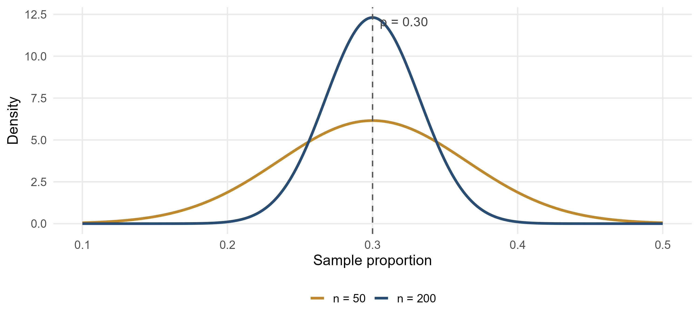

<style>
:root {
  --chapter-width: 1100px;
  --ink: #23364a;
  --accent: #294d73;
  --green: #3f7d58;
  --gold: #be892d;
  --red: #a94b46;
  --line: #d8dee4;
  --soft: #f5f7f9;
}

html { scroll-behavior: smooth; }

body {
  font-size: 17px;
  line-height: 1.65;
  color: var(--ink);
}

.main-container {
  max-width: var(--chapter-width) !important;
  padding-bottom: 60px;
}

.section.chapter-root > h1 { display: none !important; }

h1, h2, h3, h4 { margin-top: 1.45em; }
h2 {
  border-bottom: 3px solid var(--accent);
  padding-bottom: 0.24em;
}
h3 {
  border-bottom: 1px solid var(--line);
  padding-bottom: 0.16em;
}

blockquote {
  border-left: 4px solid var(--accent);
  background: var(--soft);
  padding: 0.75em 1em;
  margin: 1.1em 0;
}

table {
  width: auto;
  margin-left: auto;
  margin-right: auto;
}

th { background: #eef3f7; }

pre {
  border: 1px solid var(--line);
  border-radius: 5px;
}

img {
  display: block;
  max-width: 100%;
  height: auto;
  margin: 1.2em auto;
  border: 1px solid #e1e4e8;
  border-radius: 7px;
}

.formula-box {
  border: 2px solid var(--accent);
  background: #f8fbfd;
  border-radius: 7px;
  padding: 0.75em 1em;
  margin: 1em 0;
}

.caution-box {
  border-left: 5px solid var(--gold);
  background: #fffaf0;
  padding: 0.75em 1em;
  margin: 1em 0;
}

.conclusion-box {
  border-left: 5px solid var(--green);
  background: #f4faf6;
  padding: 0.75em 1em;
  margin: 1em 0;
}

@media print {
  #TOC { display: none !important; }
  body { font-size: 11pt; }
  .main-container { max-width: none !important; }
}
</style>

```{r setup, include=FALSE}
knitr::opts_chunk$set(
  echo = TRUE,
  warning = FALSE,
  message = FALSE,
  fig.align = "center",
  out.width = "90%"
)

if (!requireNamespace("ggplot2", quietly = TRUE)) {
  stop("The ggplot2 package must be installed before this chapter is knitted.")
}

suppressPackageStartupMessages(library(ggplot2))

# -------------------------------------------------------------
# All figures are created here with ggsave() and saved as
# slide_ch19_*.png. The same files are used by chapter-19-short.tex,
# so knit this document before compiling the slides.
# -------------------------------------------------------------

course_blue  <- "#294D73"
course_red   <- "#C44E52"
course_green <- "#3F7D58"
course_gold  <- "#BE892D"
course_grey  <- "#8FA8BF"

slide_theme <- theme_minimal(base_size = 15) +
  theme(
    plot.title = element_text(face = "bold", hjust = 0.5),
    plot.subtitle = element_text(hjust = 0.5, colour = "#444444"),
    panel.grid.minor = element_blank(),
    plot.background = element_rect(fill = "white", colour = NA),
    strip.text = element_text(face = "bold", size = 14),
    legend.position = "bottom"
  )

save_plot <- function(name, plot, width = 10, height = 5) {
  ggsave(name, plot, width = width, height = height, dpi = 300, bg = "white")
}

wald <- function(x, n, z = qnorm(0.975)) {
  p <- x / n
  se <- sqrt(p * (1 - p) / n)
  c(est = p, lo = p - z * se, hi = p + z * se)
}

# ---- 1. Sampling distribution for two sample sizes ----------
p_pop <- 0.30
grid <- seq(0.10, 0.50, length.out = 1000)
samp <- rbind(
  data.frame(p_hat = grid, density = dnorm(grid, p_pop, sqrt(p_pop * (1 - p_pop) / 50)),
             n = "n = 50"),
  data.frame(p_hat = grid, density = dnorm(grid, p_pop, sqrt(p_pop * (1 - p_pop) / 200)),
             n = "n = 200")
)
samp$n <- factor(samp$n, levels = c("n = 50", "n = 200"))
f1 <- ggplot(samp, aes(p_hat, density, colour = n)) +
  geom_line(linewidth = 1.3) +
  geom_vline(xintercept = p_pop, linetype = "dashed", colour = "grey35") +
  annotate("text", x = 0.305, y = max(samp$density) * 0.98, hjust = 0,
           label = "p = 0.30", colour = "grey25", size = 4.8) +
  scale_colour_manual(values = c(course_gold, course_blue)) +
  labs(x = "Sample proportion", y = "Density", colour = NULL) +
  slide_theme
save_plot("slide_ch19_sampling_n.png", f1, height = 4.6)

# ---- 2. Shape: when the Normal approximation works ----------
shape_df <- function(n, p, lab) {
  x <- 0:n
  data.frame(p_hat = x / n, prob = dbinom(x, n, p), panel = lab,
             normal = dnorm(x / n, p, sqrt(p * (1 - p) / n)) / n)
}
shp <- rbind(
  shape_df(200, 0.30, "n = 200, p = 0.30: np = 60 (Normal works)"),
  shape_df(20, 0.05, "n = 20, p = 0.05: np = 1 (Normal fails)")
)
shp$panel <- factor(shp$panel, levels = unique(shp$panel))
shp <- subset(shp, (panel == levels(panel)[1] & p_hat >= 0.18 & p_hat <= 0.42) |
                   (panel == levels(panel)[2] & p_hat <= 0.30))
norm_curve <- function(n, p, lab, from, to) {
  g <- seq(from, to, length.out = 500)
  data.frame(p_hat = g, normal = dnorm(g, p, sqrt(p * (1 - p) / n)) / n, panel = lab)
}
curves <- rbind(
  norm_curve(200, 0.30, levels(shp$panel)[1], 0.18, 0.42),
  norm_curve(20, 0.05, levels(shp$panel)[2], -0.12, 0.30)
)
curves$panel <- factor(curves$panel, levels = levels(shp$panel))
f2 <- ggplot(shp, aes(p_hat, prob)) +
  geom_col(fill = course_grey, width = 0.004) +
  geom_line(data = curves, aes(y = normal), colour = course_red, linewidth = 1) +
  geom_vline(data = data.frame(panel = factor(levels(shp$panel)[2], levels = levels(shp$panel))),
             aes(xintercept = 0), colour = "grey40") +
  facet_wrap(~ panel, scales = "free") +
  labs(x = "Sample proportion", y = "Probability",
       subtitle = "Bars: exact distribution of the sample proportion    Red curve: Normal approximation") +
  slide_theme
save_plot("slide_ch19_shape.png", f2, width = 11, height = 4.4)

# ---- 3. HPV confidence interval -----------------------------
hpv <- wald(515, 1921)
f3 <- ggplot(data.frame(y = 1, est = hpv[["est"]], lo = hpv[["lo"]], hi = hpv[["hi"]]),
             aes(x = est, y = y)) +
  geom_errorbar(aes(xmin = lo, xmax = hi), orientation = "y", width = 0.25,
                linewidth = 1.6, colour = course_blue) +
  geom_point(size = 5, colour = course_red) +
  annotate("text", x = hpv[["est"]], y = 1.3, label = "sample proportion 0.268",
           colour = course_red, size = 5) +
  annotate("text", x = hpv[["lo"]], y = 0.78, label = "0.248", size = 5) +
  annotate("text", x = hpv[["hi"]], y = 0.78, label = "0.288", size = 5) +
  scale_y_continuous(NULL, breaks = NULL, limits = c(0.65, 1.4)) +
  scale_x_continuous(limits = c(0.23, 0.31), breaks = seq(0.23, 0.31, 0.01)) +
  labs(x = "Proportion of women testing positive for HPV") +
  slide_theme
save_plot("slide_ch19_hpv_ci.png", f3, height = 2.8)

# ---- 4. Aphid null distribution of p-hat ---------------------
se0 <- sqrt(0.25 / 20)
ph <- seq(0.1, 1, length.out = 1000)
f4 <- ggplot(data.frame(p_hat = ph, d = dnorm(ph, 0.5, se0)), aes(p_hat, d)) +
  geom_area(data = data.frame(p_hat = ph[ph >= 0.95], d = dnorm(ph[ph >= 0.95], 0.5, se0)),
            fill = course_red, alpha = 0.6) +
  geom_line(linewidth = 1.2, colour = course_blue) +
  geom_vline(xintercept = 0.95, linetype = "dashed", colour = course_red, linewidth = 1) +
  annotate("text", x = 0.93, y = 2.6, hjust = 1, colour = course_red, size = 4.8,
           label = "observed 0.95\nz = 4.02 standard errors\nabove 0.5") +
  annotate("text", x = 0.5, y = 0.35, label = "centre p0 = 0.5", size = 4.6, colour = "grey25") +
  labs(x = "Sample proportion if H0 is true (n = 20)", y = "Density") +
  slide_theme
save_plot("slide_ch19_aphid_null.png", f4, height = 4.2)
```

# Chapter 19 {.chapter-root .unlisted}

## From Population Means to Population Proportions

Chapters 17 and 18 made inferences about a population mean $\mu$ for a quantitative response. Chapter 19 turns to a **binary categorical response** and an unknown population proportion $p$.

Examples include

- The proportion of people who currently test positive for an infection
- The proportion of patients who respond to a treatment
- The proportion of animals that show a particular behaviour

Each individual has one of two outcomes. The outcome being counted is called a **success**, but the word does not mean the result is good.

| | Quantitative response | Binary categorical response |
|:--|:--|:--|
| Population parameter | Mean $\mu$ | Proportion $p$ |
| Sample statistic | Mean $\bar{x}$ | Proportion $\hat{p}$ |
| Typical question | Average measurement | Fraction with an outcome |
| Reference model | $t$ distribution | Normal approximation |

> **Main question**
>
> How can a sample proportion be used to estimate or test an unknown population proportion? The logic of estimation and testing is unchanged. Only the standard errors and conditions are new.

Every worked example in this chapter follows four steps: **State**, **Plan**, **Solve** and **Conclude**.

### Learning Goals

After studying this chapter, you should be able to

1. Define the population, success outcome and population proportion
2. Calculate and interpret a sample proportion
3. Describe the sampling distribution of $\hat{p}$
4. Assess the conditions for one-proportion inference
5. Construct and interpret a large-sample confidence interval for $p$
6. Conduct and interpret a one-proportion $z$ test
7. Explain why intervals use $\hat{p}$ and tests use $p_0$
8. Reproduce the calculations with short R commands

### Defining the Success Outcome

The success outcome needs a precise definition. For example, a smoking study could define a smoker as anyone who smoked at least once in the previous $30$ days, or as anyone who currently smokes at least half a pack per day. These definitions answer different questions and produce different values of $p$.

<div class="caution-box">
A large sample cannot fix an unclear definition of success. The definition determines the parameter being estimated.
</div>

---

## The Sample Proportion

Suppose a random sample contains $n$ individuals and $X$ successes. The sample proportion is

<div class="formula-box">

$$
\boxed{
\hat{p}=\frac{X}{n}
}
$$

</div>

- $\hat{p}$ ("p-hat") estimates the unknown population proportion $p$
- $0\le\hat{p}\le1$, and $100\hat{p}\%$ is the corresponding sample percentage
- A different random sample usually gives a different value of $\hat{p}$

The value of $\hat{p}$ describes the **sample**. Inference is needed to say something about $p$ for the whole population.

---

## The Sampling Distribution of $\hat{p}$

The sampling distribution describes the values of $\hat{p}$ across all possible random samples of the same size from the same population. For a random sample of size $n$ from a large population with proportion $p$:

### Centre

$$
\mu_{\hat{p}}=p
$$

so $\hat{p}$ is an **unbiased** estimator of $p$.

### Spread

$$
\sigma_{\hat{p}}
=
\sqrt{
\frac{
p(1-p)
}{
n
}
}
$$

A larger $n$ gives a smaller standard deviation, so the sample proportion tends to fall closer to $p$. Multiplying the sample size by $4$ halves the standard deviation:

$$
\sqrt{\frac{p(1-p)}{4n}}
=
\frac{1}{2}
\sqrt{\frac{p(1-p)}{n}}
$$

```{r sampling-n-plot, echo=FALSE}

```

Both curves are centred at $p=0.30$. The curve for $n=200$ is narrower because larger samples produce less sampling variation.

### Shape

When the expected numbers of successes and failures are large, the sampling distribution of $\hat{p}$ is approximately Normal. The approximation is less reliable when the sample size is small or $p$ is close to $0$ or $1$.

```{r shape-plot, echo=FALSE}
knitr::include_graphics("slide_ch19_shape.png")
```

On the left, $np=60$ successes are expected, and the exact distribution (bars) closely follows the Normal curve. On the right, only $np=1$ success is expected. The distribution piles up at $0$ and is strongly right-skewed, and the Normal curve even puts probability on impossible negative values.

---

## Conditions for Inference about a Proportion

### Randomness

The data should come from an SRS or another defensible random process. Convenience samples, voluntary response samples and samples with substantial nonresponse can give biased estimates.

### Independence

When sampling without replacement, the population should be much larger than the sample:

$$
n\leq0.10N
$$

where $N$ is the population size. This keeps the observations approximately independent.

### Large Counts

The count condition depends on the procedure:

| Procedure | Count condition | Uses |
|:--|:--|:--|
| Confidence interval | $X\ge15$ and $n-X\ge15$ | observed counts |
| One-proportion $z$ test | $np_0\ge10$ and $n(1-p_0)\ge10$ | expected counts under $H_0$ |

> **Design before formula**
>
> A larger sample reduces random error. It does not remove selection bias, nonresponse bias or an unclear definition of success.

---

## Large-Sample Confidence Interval for a Proportion

A confidence interval has the general structure

$$
\text{estimate}
\pm
\text{critical value}
\times
\text{standard error}
$$

The standard deviation of $\hat{p}$ involves the unknown $p$, so the large-sample method estimates it with $\hat{p}$:

$$
SE_{\hat{p}}
=
\sqrt{
\frac{
\hat{p}(1-\hat{p})
}{
n
}
}
$$

A level $C$ confidence interval is

<div class="formula-box">

$$
\boxed{
\hat{p}
\pm
z^*
\sqrt{
\frac{
\hat{p}(1-\hat{p})
}{
n
}
}
}
$$

</div>

and the margin of error is $m=z^*\times SE_{\hat{p}}$.

| Confidence level | $90\%$ | $95\%$ | $99\%$ |
|:--|:--:|:--:|:--:|
| $z^*$ | $1.645$ | $1.960$ | $2.576$ |

### Why $z^*$ and Not $t^*$?

For a mean, the spread depends on a *separate* unknown parameter $\sigma$. Estimating $\sigma$ with $s$ leads to a $t$ distribution.

For a proportion, the spread depends on the *same* parameter we are estimating:

$$
\operatorname{Var}(\hat{p})
=
\frac{
p(1-p)
}{
n
}
$$

Replacing $p$ with $\hat{p}$ does not create a $t$ statistic. The method keeps the Normal approximation and a $z^*$ critical value.

### Conditions for the Large-Sample Interval

Use the large-sample interval when the sampling design supports inference, the population is much larger than the sample, and the sample contains at least **15 successes and 15 failures**:

$$
X\geq15
\qquad\text{and}\qquad
n-X\geq15
$$

Observed counts are used because $p$ is unknown.

---

## Example 19.3: HPV Confidence Interval

**Example 19.1: HPV prevalence.** A national survey obtained valid specimens from $1921$ women aged $14$ to $59$. Of these, $515$ tested positive for HPV, so

$$
\hat{p}
=
\frac{515}{1921}
\approx
0.2681
\qquad(26.8\%)
$$

```{r hpv-sample-proportion}
x_hpv <- 515
n_hpv <- 1921

p_hat_hpv <- x_hpv / n_hpv
p_hat_hpv
```

### State

Estimate $p$, the proportion of women aged $14$ to $59$ in the target population who currently test positive for HPV.

### Plan

Construct a $95\%$ large-sample confidence interval from $X=515$ positives among $n=1921$ valid specimens.

### Solve: Check the Conditions

- NHANES uses a complex representative design rather than a literal SRS. For an introductory calculation, we treat it as roughly comparable to an SRS.
- The population of women is far larger than $1921$.
- There are $X=515\ge15$ successes and $n-X=1406\ge15$ failures.

The count condition is easily met. The sampling design is the part that needs careful interpretation.

### Solve: Calculate the Interval

Work through the interval one step at a time.

**Step 1. Estimate**

$$
\hat{p}=\frac{515}{1921}=0.2681
$$

**Step 2. Standard error**

$$
SE=\sqrt{\frac{(0.2681)(0.7319)}{1921}}=0.01011
$$

**Step 3. Margin of error**

$$
m=z^*\times SE=1.960(0.01011)=0.01981
$$

**Step 4. Interval**

$$
\hat{p}\pm m=0.2681\pm0.01981=\boxed{(0.2483,\ 0.2879)}
$$

```{r hpv-large-sample-interval}
se_hpv <- sqrt(p_hat_hpv * (1 - p_hat_hpv) / n_hpv)
margin_hpv <- qnorm(0.975) * se_hpv

c(
  estimate = p_hat_hpv,
  standard_error = se_hpv,
  lower = p_hat_hpv - margin_hpv,
  upper = p_hat_hpv + margin_hpv
)
```

The R function `prop.test()` uses a different (score) method with a continuity correction, so its interval will not match this hand calculation exactly.

### Conclude

```{r hpv-ci-plot, echo=FALSE}
knitr::include_graphics("slide_ch19_hpv_ci.png")
```

<div class="conclusion-box">
We are $95\%$ confident that between about $24.8\%$ and $28.8\%$ of women aged $14$ to $59$ in the target population would currently test positive for HPV.
</div>

### Study Limitation: Nonresponse

About $23\%$ of the original sample gave no usable specimen. If nonrespondents differ in HPV status, the estimate is biased, and the margin of error does **not** measure that bias. The confidence interval measures random sampling uncertainty only.

---

## Hypothesis Tests for a Population Proportion

A hypothesis test evaluates a specific claim about $p$. The null hypothesis is

$$
H_0:p=p_0
$$

and the test asks how unusual $\hat{p}$ would be **if $H_0$ were true**.

### The Null Standard Error

Under $H_0$, the sampling distribution of $\hat{p}$ has centre $p_0$ and standard deviation

$$
\sqrt{
\frac{
p_0(1-p_0)
}{
n
}
}
$$

The test's standard error uses the null value $p_0$, not $\hat{p}$.

### One-Proportion $z$ Statistic

<div class="formula-box">

$$
\boxed{
z
=
\frac{
\hat{p}-p_0
}{
\sqrt{
p_0(1-p_0)/n
}
}
}
$$

</div>

The statistic measures how far the sample proportion is from the null value, in null standard errors.

### Conditions and $P$-Values

Use the test when the design is random, the observations are independent and the **expected** counts under $H_0$ are large enough:

$$
np_0\geq10
\qquad\text{and}\qquad
n(1-p_0)\geq10
$$

| Alternative | $P$-value | Direction |
|:--|:--|:--|
| $H_a:p>p_0$ | $P(Z\geq z)$ | upper tail |
| $H_a:p<p_0$ | $P(Z\leq z)$ | lower tail |
| $H_a:p\ne p_0$ | $2P(Z\geq|z|)$ | two tails |

Choose the direction from the research question **before** looking at the data.

### Confidence Interval vs. Test: Two Differences

| | Confidence interval | Hypothesis test |
|:--|:--|:--|
| Standard error uses | $\hat{p}$ | $p_0$ |
| Count condition uses | observed counts | expected counts under $H_0$ |

**Why?** A confidence interval has no null value, so it can only use what was observed. A test assumes $H_0$ is true, so everything is calculated under $p_0$.

<div class="caution-box">
<b>Common mistakes:</b> using $\hat{p}$ in the test's standard error, or using $p_0$ in a confidence interval.
</div>

---

## Example 19.6: Aphid Righting Behaviour

Researchers released $20$ live pea aphids upside down. Nineteen landed on their legs.

### State

Let $p$ be the proportion of live pea aphids that land on their legs under these conditions. Do they land on their legs more often than the $0.5$ expected by chance?

### Plan

Use a one-proportion $z$ test of

$$
H_0:p=0.5
\qquad
H_a:p>0.5
$$

This is an upper-tail test.

### Solve: Check the Conditions

Under $H_0$, the expected counts are

$$
np_0=20(0.5)=10
\qquad\text{and}\qquad
n(1-p_0)=20(0.5)=10
$$

Both just meet the minimum of $10$.

### Solve: Calculate the Test Statistic

Work through the test one step at a time.

**Step 1. Sample proportion**

$$
\hat{p}=\frac{19}{20}=0.95
$$

**Step 2. Null standard error**

$$
SE_0=\sqrt{\frac{(0.5)(0.5)}{20}}=0.1118
$$

**Step 3. Test statistic**

$$
z=\frac{\hat{p}-p_0}{SE_0}=\frac{0.95-0.5}{0.1118}=4.025
$$

**Step 4. $P$-value (upper tail)**

$$
P(Z\geq4.025)\approx0.0000285
$$

```{r aphid-proportion-test}
x_aphid <- 19
n_aphid <- 20
p0_aphid <- 0.50

p_hat_aphid <- x_aphid / n_aphid
se_null_aphid <- sqrt(p0_aphid * (1 - p0_aphid) / n_aphid)   # uses p0, not p_hat
z_aphid <- (p_hat_aphid - p0_aphid) / se_null_aphid
p_value_aphid <- pnorm(z_aphid, lower.tail = FALSE)

c(
  sample_proportion = p_hat_aphid,
  null_standard_error = se_null_aphid,
  z_statistic = z_aphid,
  p_value = p_value_aphid
)
```

Because the expected counts only just meet the condition, check with the exact binomial $P$-value, $P(X\ge19)$ when $X\sim B(20,0.5)$. It is $21/2^{20}\approx0.00002$, which gives the same conclusion.

```{r aphid-exact}
sum(dbinom(19:20, size = 20, prob = 0.5))
```

### How Unusual Is 0.95?

```{r aphid-null-plot, echo=FALSE}
knitr::include_graphics("slide_ch19_aphid_null.png")
```

If $H_0$ were true, sample proportions would cluster around $0.5$ with a standard error of about $0.11$. The observed $0.95$ is about $4$ standard errors out, so far into the tail that the $P$-value area is too small to see.

### Conclude

<div class="conclusion-box">
The $P$-value is extremely small. There is very strong evidence that live pea aphids land on their legs more often than chance alone would predict under the study conditions.
</div>

The test does not identify the biological mechanism behind the behaviour. It also does not show that every aphid population, or every natural fall, has the same success rate. Statistical significance measures incompatibility with the null model. Scientific interpretation still depends on the design and the biology.

---

## R Functions Used in This Chapter

- `qnorm()` gives a Normal critical value, for example `qnorm(0.975)` $=1.960$
- `pnorm()` gives a Normal cumulative probability (use `lower.tail = FALSE` for an upper tail)
- `dbinom()` gives exact binomial probabilities, useful as a check when counts are borderline

The function `prop.test()` uses a score-based method and, by default, a continuity correction, so its results differ slightly from the hand calculations. The direct formulas are used in this chapter because they show exactly which standard error is being used.

---

## Common Errors

| Error | Correction |
|:--|:--|
| Confusing $\hat{p}$ (known) with $p$ (unknown) | State the parameter in words first |
| Using $\hat{p}$ in the test's standard error | Use $\sqrt{p_0(1-p_0)/n}$ |
| Using $p_0$ in a confidence interval | Use $\hat{p}$ |
| Checking test conditions with observed counts | Use expected counts $np_0$ and $n(1-p_0)$ |
| Treating the margin of error as the total error | It covers random sampling only, not bias |

---

## Chapter 19 Summary

| Goal | Procedure | Condition |
|:--|:--|:--|
| Estimate $p$ | $\hat{p}\pm z^*\sqrt{\hat{p}(1-\hat{p})/n}$ | $X\ge15$, $n-X\ge15$ |
| Test $H_0:p=p_0$ | $z=(\hat{p}-p_0)/\sqrt{p_0(1-p_0)/n}$ | $np_0\ge10$, $n(1-p_0)\ge10$ |

- $\hat{p}=X/n$ estimates $p$. Its sampling distribution has centre $p$ and spread $\sqrt{p(1-p)/n}$
- Intervals use what was observed ($\hat{p}$). Tests work under the null value ($p_0$)

> **Final principle**
>
> The procedure measures random sampling uncertainty. The population definition, sampling quality and study conditions determine the scope of the conclusion.
