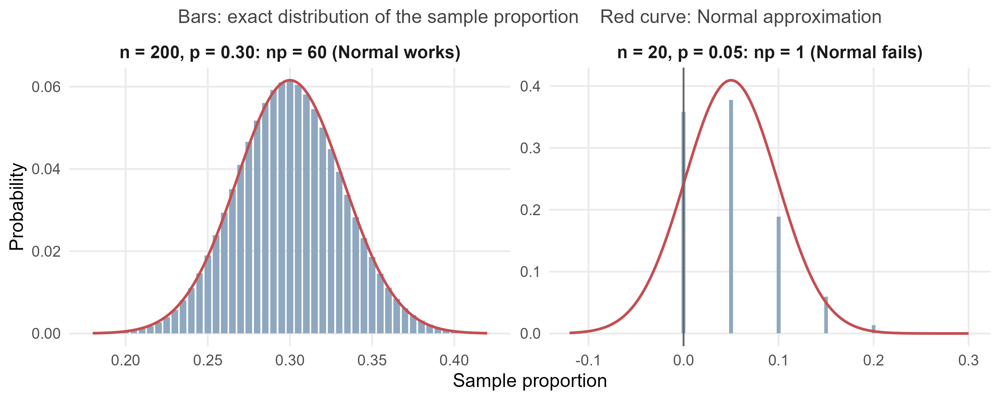
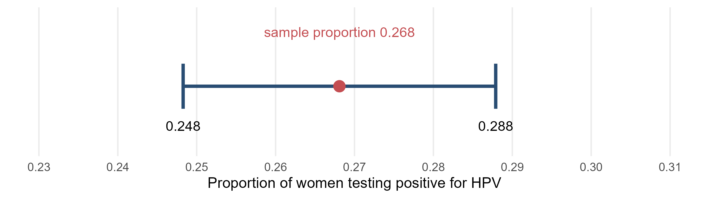
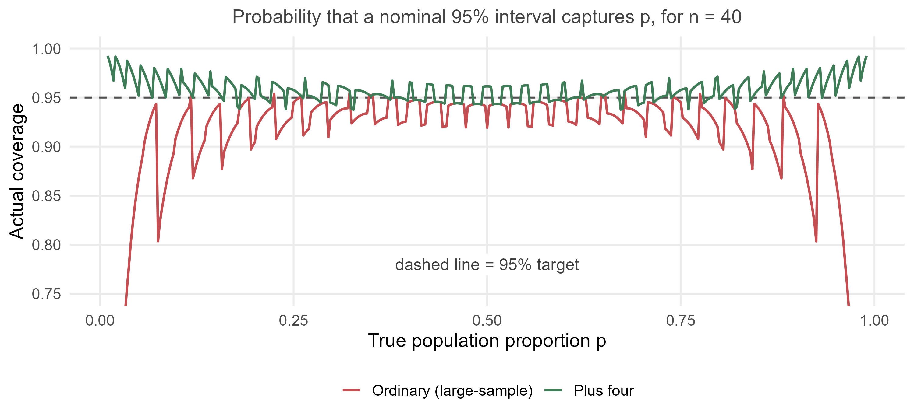
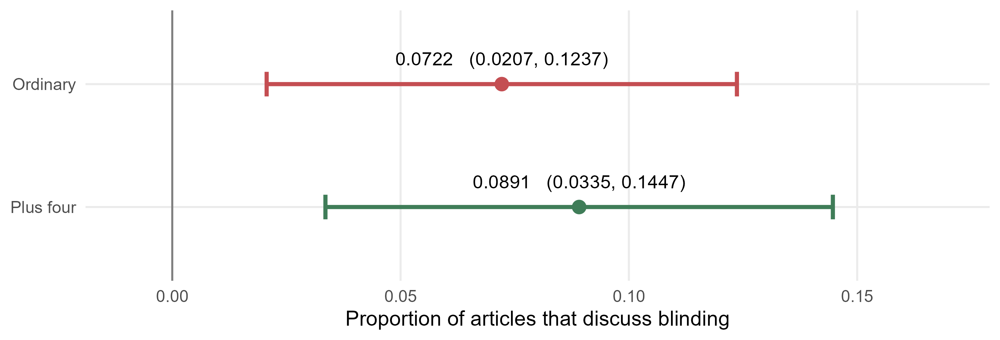
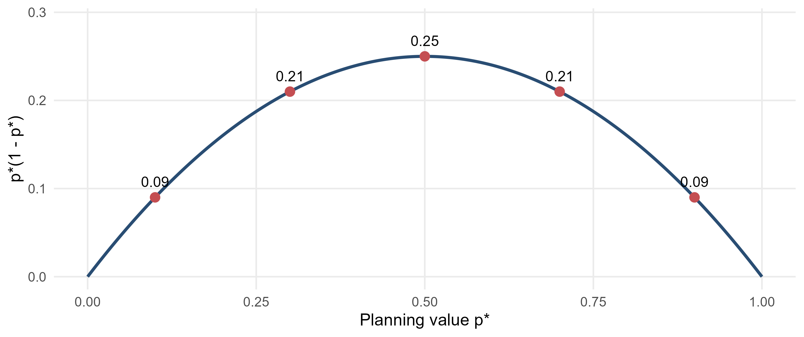
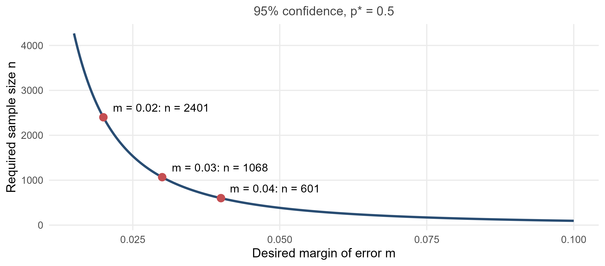
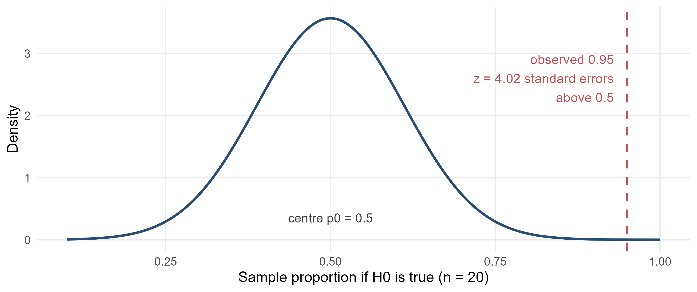

<style>
:root {
  --chapter-width: 1100px;
  --ink: #23364a;
  --accent: #294d73;
  --green: #3f7d58;
  --gold: #be892d;
  --red: #a94b46;
  --line: #d8dee4;
  --soft: #f5f7f9;
}

html { scroll-behavior: smooth; }

body {
  font-size: 17px;
  line-height: 1.65;
  color: var(--ink);
}

.main-container {
  max-width: var(--chapter-width) !important;
  padding-bottom: 60px;
}

.section.chapter-root > h1 { display: none !important; }

h1, h2, h3, h4 { margin-top: 1.45em; }
h2 {
  border-bottom: 3px solid var(--accent);
  padding-bottom: 0.24em;
}
h3 {
  border-bottom: 1px solid var(--line);
  padding-bottom: 0.16em;
}

blockquote {
  border-left: 4px solid var(--accent);
  background: var(--soft);
  padding: 0.75em 1em;
  margin: 1.1em 0;
}

table {
  width: auto;
  margin-left: auto;
  margin-right: auto;
}

th { background: #eef3f7; }

pre {
  border: 1px solid var(--line);
  border-radius: 5px;
}

img {
  display: block;
  max-width: 100%;
  height: auto;
  margin: 1.2em auto;
  border: 1px solid #e1e4e8;
  border-radius: 7px;
}

.formula-box {
  border: 2px solid var(--accent);
  background: #f8fbfd;
  border-radius: 7px;
  padding: 0.75em 1em;
  margin: 1em 0;
}

.caution-box {
  border-left: 5px solid var(--gold);
  background: #fffaf0;
  padding: 0.75em 1em;
  margin: 1em 0;
}

.conclusion-box {
  border-left: 5px solid var(--green);
  background: #f4faf6;
  padding: 0.75em 1em;
  margin: 1em 0;
}

@media print {
  #TOC { display: none !important; }
  body { font-size: 11pt; }
  .main-container { max-width: none !important; }
}
</style>

```{r setup, include=FALSE}
knitr::opts_chunk$set(
  echo = TRUE,
  warning = FALSE,
  message = FALSE,
  fig.align = "center",
  out.width = "90%"
)

if (!requireNamespace("ggplot2", quietly = TRUE)) {
  stop("The ggplot2 package must be installed before this chapter is knitted.")
}

suppressPackageStartupMessages(library(ggplot2))

# -------------------------------------------------------------
# All figures are created here with ggsave() and saved as
# slide_ch19_*.png. The same files are used by Chapter19_Slides.tex,
# so knit this document before compiling the slides.
# -------------------------------------------------------------

course_blue  <- "#294D73"
course_red   <- "#C44E52"
course_green <- "#3F7D58"
course_gold  <- "#BE892D"
course_grey  <- "#8FA8BF"

slide_theme <- theme_minimal(base_size = 15) +
  theme(
    plot.title = element_text(face = "bold", hjust = 0.5),
    plot.subtitle = element_text(hjust = 0.5, colour = "#444444"),
    panel.grid.minor = element_blank(),
    plot.background = element_rect(fill = "white", colour = NA),
    strip.text = element_text(face = "bold", size = 14),
    legend.position = "bottom"
  )

save_plot <- function(name, plot, width = 10, height = 5) {
  ggsave(name, plot, width = width, height = height, dpi = 300, bg = "white")
}

wald <- function(x, n, z = qnorm(0.975)) {
  p <- x / n
  se <- sqrt(p * (1 - p) / n)
  c(est = p, lo = p - z * se, hi = p + z * se)
}
plus4 <- function(x, n, z = qnorm(0.975)) wald(x + 2, n + 4, z)

# ---- 1. Sampling distribution for two sample sizes ----------
p_pop <- 0.30
grid <- seq(0.10, 0.50, length.out = 1000)
samp <- rbind(
  data.frame(p_hat = grid, density = dnorm(grid, p_pop, sqrt(p_pop * (1 - p_pop) / 50)),
             n = "n = 50"),
  data.frame(p_hat = grid, density = dnorm(grid, p_pop, sqrt(p_pop * (1 - p_pop) / 200)),
             n = "n = 200")
)
samp$n <- factor(samp$n, levels = c("n = 50", "n = 200"))
f1 <- ggplot(samp, aes(p_hat, density, colour = n)) +
  geom_line(linewidth = 1.3) +
  geom_vline(xintercept = p_pop, linetype = "dashed", colour = "grey35") +
  annotate("text", x = 0.305, y = max(samp$density) * 0.98, hjust = 0,
           label = "p = 0.30", colour = "grey25", size = 4.8) +
  scale_colour_manual(values = c(course_gold, course_blue)) +
  labs(x = "Sample proportion", y = "Density", colour = NULL) +
  slide_theme
save_plot("slide_ch19_sampling_n.png", f1, height = 4.6)

# ---- 2. Shape: when the Normal approximation works ----------
shape_df <- function(n, p, lab) {
  x <- 0:n
  data.frame(p_hat = x / n, prob = dbinom(x, n, p), panel = lab,
             normal = dnorm(x / n, p, sqrt(p * (1 - p) / n)) / n)
}
shp <- rbind(
  shape_df(200, 0.30, "n = 200, p = 0.30: np = 60 (Normal works)"),
  shape_df(20, 0.05, "n = 20, p = 0.05: np = 1 (Normal fails)")
)
shp$panel <- factor(shp$panel, levels = unique(shp$panel))
shp <- subset(shp, (panel == levels(panel)[1] & p_hat >= 0.18 & p_hat <= 0.42) |
                   (panel == levels(panel)[2] & p_hat <= 0.30))
norm_curve <- function(n, p, lab, from, to) {
  g <- seq(from, to, length.out = 500)
  data.frame(p_hat = g, normal = dnorm(g, p, sqrt(p * (1 - p) / n)) / n, panel = lab)
}
curves <- rbind(
  norm_curve(200, 0.30, levels(shp$panel)[1], 0.18, 0.42),
  norm_curve(20, 0.05, levels(shp$panel)[2], -0.12, 0.30)
)
curves$panel <- factor(curves$panel, levels = levels(shp$panel))
f2 <- ggplot(shp, aes(p_hat, prob)) +
  geom_col(fill = course_grey, width = 0.004) +
  geom_line(data = curves, aes(y = normal), colour = course_red, linewidth = 1) +
  geom_vline(data = data.frame(panel = factor(levels(shp$panel)[2], levels = levels(shp$panel))),
             aes(xintercept = 0), colour = "grey40") +
  facet_wrap(~ panel, scales = "free") +
  labs(x = "Sample proportion", y = "Probability",
       subtitle = "Bars: exact distribution of the sample proportion    Red curve: Normal approximation") +
  slide_theme
save_plot("slide_ch19_shape.png", f2, width = 11, height = 4.4)

# ---- 3. HPV confidence interval -----------------------------
hpv <- wald(515, 1921)
f3 <- ggplot(data.frame(y = 1, est = hpv[["est"]], lo = hpv[["lo"]], hi = hpv[["hi"]]),
             aes(x = est, y = y)) +
  geom_errorbar(aes(xmin = lo, xmax = hi), orientation = "y", width = 0.25,
                linewidth = 1.6, colour = course_blue) +
  geom_point(size = 5, colour = course_red) +
  annotate("text", x = hpv[["est"]], y = 1.3, label = "sample proportion 0.268",
           colour = course_red, size = 5) +
  annotate("text", x = hpv[["lo"]], y = 0.78, label = "0.248", size = 5) +
  annotate("text", x = hpv[["hi"]], y = 0.78, label = "0.288", size = 5) +
  scale_y_continuous(NULL, breaks = NULL, limits = c(0.65, 1.4)) +
  scale_x_continuous(limits = c(0.23, 0.31), breaks = seq(0.23, 0.31, 0.01)) +
  labs(x = "Proportion of women testing positive for HPV") +
  slide_theme
save_plot("slide_ch19_hpv_ci.png", f3, height = 2.8)

# ---- 4. Actual coverage: ordinary vs plus four, n = 40 ------
n_cov <- 40
p_seq <- seq(0.01, 0.99, by = 0.0025)
coverage <- function(method) {
  ints <- t(sapply(0:n_cov, function(x) method(x, n_cov)))
  sapply(p_seq, function(p) sum(dbinom(0:n_cov, n_cov, p) * (ints[, "lo"] <= p & p <= ints[, "hi"])))
}
cov_df <- rbind(
  data.frame(p = p_seq, coverage = coverage(wald),  method = "Ordinary (large-sample)"),
  data.frame(p = p_seq, coverage = coverage(plus4), method = "Plus four")
)
f4 <- ggplot(cov_df, aes(p, coverage, colour = method)) +
  geom_hline(yintercept = 0.95, linetype = "dashed", colour = "grey30") +
  geom_line(linewidth = 0.9) +
  annotate("label", x = 0.5, y = 0.78, label = "dashed line = 95% target", size = 4.6, colour = "grey25", linewidth = 0) +
  scale_colour_manual(values = c(course_red, course_green)) +
  coord_cartesian(ylim = c(0.75, 1)) +
  labs(x = "True population proportion p", y = "Actual coverage", colour = NULL,
       subtitle = "Probability that a nominal 95% interval captures p, for n = 40") +
  slide_theme
save_plot("slide_ch19_coverage.png", f4, height = 4.6)

# ---- 5. Blinding: ordinary vs plus four ---------------------
bl <- rbind(wald(7, 97), plus4(7, 97))
bl_df <- data.frame(
  method = factor(c("Ordinary", "Plus four"), levels = c("Plus four", "Ordinary")),
  est = bl[, "est"], lo = bl[, "lo"], hi = bl[, "hi"]
)
bl_df$lab <- sprintf("%.4f   (%.4f, %.4f)", bl_df$est, bl_df$lo, bl_df$hi)
f5 <- ggplot(bl_df, aes(x = est, y = method, colour = method)) +
  geom_vline(xintercept = 0, colour = "grey50") +
  geom_errorbar(aes(xmin = lo, xmax = hi), orientation = "y", width = 0.2, linewidth = 1.4) +
  geom_point(size = 4) +
  geom_text(aes(label = lab), vjust = -1.4, size = 4.8, colour = "black") +
  scale_colour_manual(values = c(course_green, course_red), guide = "none") +
  scale_x_continuous(limits = c(-0.01, 0.17)) +
  labs(x = "Proportion of articles that discuss blinding", y = NULL) +
  slide_theme
save_plot("slide_ch19_blinding.png", f5, height = 3.4)

# ---- 6. Why p* = 0.5 is conservative ------------------------
ps <- seq(0, 1, length.out = 400)
marks <- data.frame(p = c(0.1, 0.3, 0.5, 0.7, 0.9))
marks$v <- marks$p * (1 - marks$p)
f6 <- ggplot(data.frame(p = ps, v = ps * (1 - ps)), aes(p, v)) +
  geom_line(linewidth = 1.3, colour = course_blue) +
  geom_point(data = marks, size = 3.5, colour = course_red) +
  geom_text(data = marks, aes(label = sprintf("%.2f", v)), vjust = -1, size = 4.6) +
  scale_y_continuous(limits = c(0, 0.29)) +
  labs(x = "Planning value p*", y = "p*(1 - p*)") +
  slide_theme
save_plot("slide_ch19_pstar.png", f6, height = 4.2)

# ---- 7. Required sample size vs margin of error -------------
m_seq <- seq(0.015, 0.10, length.out = 400)
n_df <- data.frame(m = m_seq, n = (1.96 / m_seq)^2 * 0.25)
n_marks <- data.frame(m = c(0.04, 0.03, 0.02), n = c(601, 1068, 2401))
f7 <- ggplot(n_df, aes(m, n)) +
  geom_line(linewidth = 1.3, colour = course_blue) +
  geom_point(data = n_marks, size = 3.8, colour = course_red) +
  geom_text(data = n_marks, aes(label = paste0("m = ", m, ": n = ", n)),
            hjust = -0.1, vjust = -0.7, size = 4.8) +
  scale_x_continuous(limits = c(0.015, 0.10)) +
  labs(x = "Desired margin of error m", y = "Required sample size n",
       subtitle = "95% confidence, p* = 0.5") +
  slide_theme
save_plot("slide_ch19_sample_size.png", f7, height = 4.4)

# ---- 8. Aphid null distribution of p-hat ---------------------
se0 <- sqrt(0.25 / 20)
ph <- seq(0.1, 1, length.out = 1000)
f8 <- ggplot(data.frame(p_hat = ph, d = dnorm(ph, 0.5, se0)), aes(p_hat, d)) +
  geom_area(data = data.frame(p_hat = ph[ph >= 0.95], d = dnorm(ph[ph >= 0.95], 0.5, se0)),
            fill = course_red, alpha = 0.6) +
  geom_line(linewidth = 1.2, colour = course_blue) +
  geom_vline(xintercept = 0.95, linetype = "dashed", colour = course_red, linewidth = 1) +
  annotate("text", x = 0.93, y = 2.6, hjust = 1, colour = course_red, size = 4.8,
           label = "observed 0.95\nz = 4.02 standard errors\nabove 0.5") +
  annotate("text", x = 0.5, y = 0.35, label = "centre p0 = 0.5", size = 4.6, colour = "grey25") +
  labs(x = "Sample proportion if H0 is true (n = 20)", y = "Density") +
  slide_theme
save_plot("slide_ch19_aphid_null.png", f8, height = 4.2)
```

# Chapter 19 {.chapter-root .unlisted}

## From Population Means to Population Proportions

Earlier inference procedures focused on a population mean $\mu$ for a quantitative response. Chapter 19 turns to a **binary categorical response** and an unknown population proportion $p$.

Examples include

- The proportion of people who currently test positive for an infection
- The proportion of animals that show a particular behaviour
- The proportion of patients who respond to a treatment
- The proportion of manufactured items that fail an inspection

Each individual has one of two outcomes. The outcome being counted is called a **success**, but the word does not mean the result is good.

| | Quantitative response | Binary categorical response |
|:--|:--|:--|
| Population parameter | Mean $\mu$ | Proportion $p$ |
| Sample statistic | Mean $\bar{x}$ | Proportion $\hat{p}$ |
| Typical question | Average measurement | Fraction with an outcome |
| Reference model | $t$ distribution | Normal approximation |

> **Main transition**
>
> Replace the sample mean $\bar{x}$ with the sample proportion $\hat{p}$. The logic of estimation and testing stays the same, but the standard errors and conditions change.

### Learning Goals

After studying this chapter, you should be able to

1. Define the population, success outcome and population proportion
2. Calculate and interpret a sample proportion
3. Describe the sampling distribution of $\hat{p}$
4. Assess the conditions for one-proportion inference
5. Construct large-sample and plus four confidence intervals
6. Determine the sample size required for a desired margin of error
7. Conduct and interpret a one-proportion $z$ test
8. Reproduce the calculations with short R commands

---

## Defining the Population and the Outcome

Inference begins with a precise research question.

### The Target Population

The population is the full group the researcher hopes to generalize to. A phrase such as "the infection rate" is incomplete until it names the population, the place and the time period.

### The Observational Unit

The observational unit is the individual on which the outcome is recorded. Depending on the study, it might be a person, animal, plant, article, field plot or manufactured device.

### The Success Outcome

The success outcome needs an operational definition. For example, a smoking study could define a smoker as

- Anyone who smoked at least once in the previous $30$ days
- Anyone who smoked on at least $20$ of the previous $30$ days
- Anyone who currently smokes at least half a pack per day

These definitions answer different questions and produce different values of $p$.

<div class="caution-box">
A large sample cannot fix an unclear definition of success. The definition determines the parameter being estimated.
</div>

### One Proportion versus Two Proportions

Chapter 19 considers one unknown population proportion. A comparison such as abrupt versus gradual smoking cessation involves two population proportions and needs a two-proportion procedure (Chapter 20).

---

## The Sample Proportion

Suppose a random sample contains $n$ individuals and $X$ successes. The sample proportion is

$$
\boxed{
\hat{p}=\frac{X}{n}
}
$$

It estimates the unknown population proportion $p$. The sample proportion always satisfies $0\le\hat{p}\le1$, and $100\hat{p}\%$ is the corresponding sample percentage. A different random sample usually gives a different value of $\hat{p}$.

### Example 19.1: HPV Prevalence

A national survey obtained valid specimens from $1921$ women aged $14$ to $59$. Of these, $515$ tested positive for HPV. The sample proportion is

$$
\hat{p}
=
\frac{515}{1921}
\approx
0.2681
\qquad(26.81\%)
$$

The value $26.81\%$ describes the sample. The population proportion $p$ is still unknown, and inference is needed to estimate it.

```{r hpv-sample-proportion}
x_hpv <- 515
n_hpv <- 1921

p_hat_hpv <- x_hpv / n_hpv
p_hat_hpv
```

---

## The Sampling Distribution of $\hat{p}$

A different random sample usually gives a different sample proportion. The sampling distribution describes the values of $\hat{p}$ across all possible random samples of the same size from the same population.

### Centre and Spread

The mean of the sampling distribution is

$$
\mu_{\hat{p}}=p
$$

so $\hat{p}$ is an **unbiased** estimator of $p$. The standard deviation is

$$
\sigma_{\hat{p}}
=
\sqrt{
\frac{
p(1-p)
}{
n
}
}
$$

A larger $n$ gives a smaller standard deviation, so the sample proportion tends to fall closer to $p$. Multiplying the sample size by $4$ halves the standard deviation:

$$
\sqrt{\frac{p(1-p)}{4n}}
=
\frac{1}{2}
\sqrt{\frac{p(1-p)}{n}}
$$

```{r sampling-n-plot, echo=FALSE}
knitr::include_graphics("slide_ch19_sampling_n.png")
```

Both curves are centred at $p=0.30$. The curve for $n=200$ is narrower because larger samples produce less sampling variation.

### Shape

When the expected numbers of successes and failures are large enough, the sampling distribution of $\hat{p}$ is approximately Normal. The approximation is less reliable when

- the sample size is small
- the population proportion is close to $0$
- the population proportion is close to $1$

```{r shape-plot, echo=FALSE}

```

On the left, $np=60$ successes are expected, and the exact distribution (bars) is almost exactly the Normal curve. On the right, only $np=1$ success is expected. The distribution piles up at $0$ and is strongly right-skewed, and the Normal curve even puts probability on impossible negative values. At the extremes, $p=0$ gives $\hat{p}=0$ in every sample and $p=1$ gives $\hat{p}=1$ in every sample. Neither case can be bell-shaped.

---

## Conditions for Inference about a Proportion

The formulas depend on the sampling design and on how good the Normal approximation is.

### Random Sampling or a Comparable Design

The observations should reasonably represent the target population. A simple random sample gives a direct basis for population inference. Other carefully designed probability samples may need specialized analyses but follow the same general logic. Convenience samples, voluntary response samples and samples with substantial nonresponse can give biased estimates.

### Independence

When sampling without replacement, a common practical condition is

$$
n\leq0.10N
$$

where $N$ is the population size. This keeps the sampled observations approximately independent. It is not needed when the population is effectively infinite or the data come from independent trials.

### Large Counts

The count condition depends on the procedure:

| Procedure | Count condition | Uses |
|:--|:--|:--|
| Large-sample confidence interval | $X\ge15$ and $n-X\ge15$ | observed counts |
| Plus four confidence interval | $n\ge10$, confidence at least $90\%$ | sample size |
| One-proportion $z$ test | $np_0\ge10$ and $n(1-p_0)\ge10$ | expected counts under $H_0$ |

> **Priority of conditions**
>
> The sampling condition determines whether the result can represent the target population. The count condition determines whether the Normal approximation is accurate enough for the calculation. A larger sample reduces random error, but it does not remove selection bias, nonresponse bias or an unclear definition of success.

---

## Large-Sample Confidence Interval for a Proportion

A confidence interval has the general structure

$$
\text{estimate}
\pm
\text{critical value}
\times
\text{standard error}
$$

The standard deviation of $\hat{p}$ involves the unknown $p$, so the large-sample method substitutes $\hat{p}$:

$$
\operatorname{SE}(\hat{p})
=
\sqrt{
\frac{
\hat{p}(1-\hat{p})
}{
n
}
}
$$

A level $C$ confidence interval is

<div class="formula-box">

$$
\boxed{
\hat{p}
\pm
z^*
\sqrt{
\frac{
\hat{p}(1-\hat{p})
}{
n
}
}
}
$$

</div>

and the margin of error is $m=z^*\operatorname{SE}(\hat{p})$.

| Confidence level | $z^*$ |
|:--|--:|
| $90\%$ | $1.645$ |
| $95\%$ | $1.960$ |
| $99\%$ | $2.576$ |

### Why the Method Uses $z$ Rather Than $t$

For a mean, the sampling spread involves a *separate* unknown parameter $\sigma$. Estimating $\sigma$ with $s$ leads to a $t$ distribution.

For a proportion, the sampling spread is determined by the *same* parameter $p$ that is being estimated:

$$
\operatorname{Var}(\hat{p})
=
\frac{
p(1-p)
}{
n
}
$$

Replacing $p$ by $\hat{p}$ does not lead to a $t$ statistic. The procedure continues to use a Normal approximation and a Standard Normal critical value $z^*$.

### Conditions for the Large-Sample Interval

Use the ordinary large-sample interval only when

1. the sampling design supports inference to the target population
2. the observations can be treated as independent
3. the sample contains at least $15$ successes and at least $15$ failures:

$$
X\geq15
\qquad\text{and}\qquad
n-X\geq15
$$

Observed counts are used because $p$ is unknown.

---

## Example 19.3: HPV Confidence Interval

### State

Let $p$ be the proportion of women aged $14$ to $59$ in the target population who currently test positive for HPV.

### Plan

Construct a $95\%$ large-sample confidence interval from $X=515$ positive specimens among $n=1921$ valid specimens.

### Solve: Check the Conditions

- NHANES used a complex representative sample rather than a literal SRS. A full survey analysis accounts for that design. For an introductory calculation, the sample is treated as approximately comparable to random sampling.
- The target population is far larger than $1921$.
- The observed counts are $X=515$ successes and $n-X=1406$ failures. Both are well above $15$.

### Solve: Calculate the Interval

$$
\hat{p}
=
\frac{515}{1921}
\approx
0.2681
$$

$$
SE
=
\sqrt{
\frac{
(0.2681)(0.7319)
}{
1921
}
}
\approx
0.01011
$$

$$
m
=
1.960(0.01011)
\approx
0.01981
$$

$$
0.2681\pm0.01981
\quad\Longrightarrow\quad
\boxed{
(0.2483,\ 0.2879)
}
$$

```{r hpv-large-sample-interval}
se_hpv <- sqrt(p_hat_hpv * (1 - p_hat_hpv) / n_hpv)
z_star_hpv <- qnorm(0.975)
margin_hpv <- z_star_hpv * se_hpv

c(
  estimate = p_hat_hpv,
  standard_error = se_hpv,
  lower = p_hat_hpv - margin_hpv,
  upper = p_hat_hpv + margin_hpv
)
```

### Conclude

```{r hpv-ci-plot, echo=FALSE}

```

<div class="conclusion-box">
We are $95\%$ confident that the proportion of women aged $14$ to $59$ in the target population who would currently test positive for HPV lies between approximately $0.248$ and $0.288$ (that is, between $24.8\%$ and $28.8\%$).
</div>

### Nonresponse and Scope

About $23\%$ of the original sample did not provide a usable specimen, and the nonrespondents differed from the respondents in some demographic characteristics.

If nonresponse is related to HPV status, the estimate may be biased. The confidence interval measures random sampling uncertainty under the model. It does **not** account for nonresponse bias, measurement problems or an unrepresentative sampling frame.

---

## Why the Ordinary Interval Can Be Inaccurate

The large-sample interval is often called the **Wald interval**. Its formula is simple, but its actual long-run coverage can be well below the stated confidence level. The problem is worse when

- the sample size is modest
- the sample contains few successes or few failures
- the true population proportion is close to $0$ or $1$

The sample proportion can only take the discrete values $0,\ 1/n,\ 2/n,\ldots,\ 1$, and a continuous Normal curve may approximate this discrete distribution poorly when the counts are small.

```{r coverage-plot, echo=FALSE}

```

For $n=40$, the figure shows the exact probability that each method's "95%" interval actually captures $p$. The ordinary interval (red) often falls well short of $95\%$, especially for $p$ near $0$ or $1$. The plus four interval (green) stays much closer to the target.

---

## The Plus Four Confidence Interval

The plus four method adds four imaginary observations, **two successes and two failures**:

$$
\widetilde{p}
=
\frac{
X+2
}{
n+4
}
$$

The confidence interval uses the ordinary formula with $\widetilde{p}$ and the adjusted sample size $n+4$:

<div class="formula-box">

$$
\boxed{
\widetilde{p}
\pm
z^*
\sqrt{
\frac{
\widetilde{p}(1-\widetilde{p})
}{
n+4
}
}
}
$$

</div>

### Conditions for the Plus Four Interval

Use the plus four interval when

- the sampling design supports inference
- the observations can be treated as independent
- the confidence level is at least $90\%$
- the original sample size satisfies $n\geq10$

The method does **not** require $15$ observed successes and $15$ observed failures.

### Why the Adjustment Helps

The adjusted estimate is pulled slightly toward $0.5$. When $\hat{p}$ is near $0$, adding two successes moves it up. When $\hat{p}$ is near $1$, adding two failures moves it down. This small adjustment improves long-run coverage for many combinations of $n$ and $p$, as the coverage plot shows.

---

## Example 19.4: Blinding in Clinical Trials

Investigators randomly sampled $97$ articles describing placebo-controlled randomized trials. Only $7$ of them discussed whether blinding had succeeded. Let $p$ be the proportion of all similar articles that discuss the success of blinding.

### Why the Ordinary Interval Is Not Recommended

There are only $X=7$ successes, and $7<15$, so the ordinary large-sample count condition fails. The original sample size satisfies $n=97\geq10$, so a $95\%$ plus four interval is appropriate.

### Plus Four Calculation

$$
\widetilde{p}
=
\frac{7+2}{97+4}
=
\frac{9}{101}
\approx
0.0891
$$

$$
SE
=
\sqrt{
\frac{
(0.0891)(0.9109)
}{
101
}
}
\approx
0.02835
$$

$$
m
=
1.960(0.02835)
\approx
0.05556
$$

$$
0.0891\pm0.05556
\quad\Longrightarrow\quad
\boxed{
(0.0335,\ 0.1447)
}
$$

```{r blinding-plus-four-interval}
x_blind <- 7
n_blind <- 97

x_plus4 <- x_blind + 2
n_plus4 <- n_blind + 4
p_plus4 <- x_plus4 / n_plus4

se_plus4 <- sqrt(p_plus4 * (1 - p_plus4) / n_plus4)
margin_plus4 <- qnorm(0.975) * se_plus4

c(
  estimate = p_plus4,
  standard_error = se_plus4,
  lower = p_plus4 - margin_plus4,
  upper = p_plus4 + margin_plus4
)
```

### Conclude

<div class="conclusion-box">
We are $95\%$ confident that between approximately $3.4\%$ and $14.5\%$ of all similar articles discuss whether blinding succeeded.
</div>

### Ordinary and Plus Four Results

```{r blinding-plot, echo=FALSE}

```

| Method | Estimate | Lower bound | Upper bound |
|:--|--:|--:|--:|
| Ordinary large-sample | $0.0722$ | $0.0207$ | $0.1237$ |
| Plus four | $0.0891$ | $0.0335$ | $0.1447$ |

The numerical difference is modest. But confidence intervals are repeated-sampling procedures, and the plus four method's coverage is much more reliable in exactly this kind of situation, with few successes.

---

## Choosing the Sample Size

Researchers often choose a sample size before collecting data so that the confidence interval will have a specified margin of error. The large-sample margin of error is approximately

$$
m
=
z^*
\sqrt{
\frac{
p^*(1-p^*)
}{
n
}
}
$$

where $p^*$ is a **planning value** for the anticipated proportion. Solving for $n$ gives

<div class="formula-box">

$$
\boxed{
n
=
\left(
\frac{
z^*
}{
m
}
\right)^2
p^*(1-p^*)
}
$$

</div>

**Always round up.** Rounding down would give a margin of error slightly larger than requested.

### Choosing $p^*$

A reasonable planning value may come from a pilot study, from previous research on a similar population or from credible subject-matter knowledge. When no useful estimate is available, use $p^*=0.5$.

```{r pstar-plot, echo=FALSE}

```

The product $p^*(1-p^*)$ reaches its maximum of $0.25$ at $p^*=0.5$. For example, $(0.3)(0.7)=0.21$ and $(0.1)(0.9)=0.09$. Using $p^*=0.5$ therefore gives the largest required sample size, which is a **conservative** plan that cannot leave too little precision. If the true proportion is near $0$ or $1$, a reliable prior estimate can greatly reduce the required sample size.

---

## Example 19.5: Planning a University Survey

A university wants to estimate the proportion of students who never floss, with $95\%$ confidence and a margin of error no greater than $m=0.04$. With no precise prior estimate, use $p^*=0.5$:

$$
n
=
\left(
\frac{
1.960
}{
0.04
}
\right)^2
(0.5)(0.5)
=
600.25
\quad\Longrightarrow\quad
\boxed{
n=601
}
$$

An SRS of $601$ students gives a margin of error no greater than about $0.04$ at the $95\%$ confidence level, provided the sampling and response assumptions hold.

```{r flossing-sample-size}
confidence <- 0.95
margin <- 0.04
p_star <- 0.50

z_star <- qnorm(1 - (1 - confidence) / 2)
n_required <- (z_star / margin)^2 * p_star * (1 - p_star)

ceiling(n_required)
```

### Effect of the Desired Margin of Error

```{r sample-size-plot, echo=FALSE}

```

| Desired margin of error | Calculated value | Required sample size |
|:--|--:|--:|
| $0.04$ | $600.25$ | $601$ |
| $0.03$ | $1067.11$ | $1068$ |
| $0.02$ | $2401.00$ | $2401$ |

The sample size is inversely proportional to the square of the margin of error, so **halving the margin of error requires about four times the sample size**.

### Response Rate

The planned number is the number of *completed* observations needed. If only $60\%$ of contacted students are expected to respond, more students must be invited:

$$
\frac{601}{0.60}
\approx
1001.7
\quad\Longrightarrow\quad
\text{about } 1002 \text{ invitations}
$$

This adjustment does not remove nonresponse bias. It only ensures enough completed surveys.

---

## Hypothesis Tests for a Population Proportion

A hypothesis test evaluates a specific claim about $p$. The null hypothesis is

$$
H_0:p=p_0
$$

and the alternative is $H_a:p>p_0$, $H_a:p<p_0$ or $H_a:p\ne p_0$. The direction must come from the research question, not from the observed sample result.

### The Null Standard Error

If $H_0$ is true, the sampling distribution of $\hat{p}$ has centre $p_0$ and standard deviation

$$
\sqrt{
\frac{
p_0(1-p_0)
}{
n
}
}
$$

The test asks how unusual the observed statistic would be *if $H_0$ were true*, so the standard error uses the null value $p_0$, not $\hat{p}$.

### One-Proportion $z$ Statistic

<div class="formula-box">

$$
\boxed{
z
=
\frac{
\hat{p}-p_0
}{
\sqrt{
p_0(1-p_0)/n
}
}
}
$$

</div>

The statistic measures how far the sample proportion is from the null value, in null standard errors.

### Conditions for the Test

Use the Normal approximation when the design supports inference, the observations can be treated as independent and the **expected** counts under $H_0$ are large enough:

$$
np_0\geq10
\qquad\text{and}\qquad
n(1-p_0)\geq10
$$

These differ from the confidence-interval conditions. A test assumes $H_0$, so its conditions use the expected counts under $p_0$. A confidence interval has no null value, so it uses the observed counts.

| | Confidence interval | Hypothesis test |
|:--|:--|:--|
| Standard error uses | $\hat{p}$ (or $\widetilde{p}$) | $p_0$ |
| Count condition uses | observed counts | expected counts under $H_0$ |

### Tail Areas

| Alternative hypothesis | P-value |
|:--|:--|
| $H_a:p>p_0$ | $P(Z\geq z)$ |
| $H_a:p<p_0$ | $P(Z\leq z)$ |
| $H_a:p\ne p_0$ | $2P(Z\geq|z|)$ |

---

## Example 19.6: Aphid Righting Behaviour

Researchers released $20$ live pea aphids upside down from delicate tweezers. Nineteen landed on their legs.

### State

Let $p$ be the proportion of live pea aphids that land on their legs under comparable dropping conditions. Do aphids land on their legs more often than the probability $0.5$ expected from chance alone?

### Plan

$$
H_0:p=0.5
\qquad
H_a:p>0.5
$$

This is an upper-tail test.

### Solve: Check the Conditions

The study describes an unbiased laboratory selection of aphids, so the scope of inference applies most directly to aphids and dropping conditions like those studied. Under $H_0$, the expected counts are

$$
np_0=20(0.5)=10
\qquad\text{and}\qquad
n(1-p_0)=20(0.5)=10
$$

Both just meet the minimum of $10$.

### Solve: Calculate the Test Statistic

$$
\hat{p}
=
\frac{19}{20}
=
0.95
\qquad
SE_0
=
\sqrt{
\frac{
(0.5)(0.5)
}{
20
}
}
\approx
0.1118
$$

$$
z
=
\frac{
0.95-0.5
}{
0.1118
}
\approx
4.025
$$

$$
P\text{-value}
=
P(Z\geq4.025)
\approx
0.0000285
$$

```{r aphid-null-plot, echo=FALSE}

```

If $H_0$ were true, sample proportions would cluster around $0.5$ with a standard error of about $0.11$. The observed $0.95$ lies about $4$ standard errors above the centre, so far out in the tail that the shaded area is too small to see.

```{r aphid-proportion-test}
x_aphid <- 19
n_aphid <- 20
p0_aphid <- 0.50

p_hat_aphid <- x_aphid / n_aphid
se_null_aphid <- sqrt(p0_aphid * (1 - p0_aphid) / n_aphid)
z_aphid <- (p_hat_aphid - p0_aphid) / se_null_aphid
p_value_aphid <- pnorm(z_aphid, lower.tail = FALSE)

c(
  sample_proportion = p_hat_aphid,
  null_standard_error = se_null_aphid,
  z_statistic = z_aphid,
  p_value = p_value_aphid
)
```

Because the expected counts only just meet the condition, it is reassuring to check the exact binomial $P$-value, $P(X\ge19)$ when $X\sim B(20,0.5)$. It is $21/2^{20}\approx0.00002$, which gives the same conclusion.

```{r aphid-exact}
sum(dbinom(19:20, size = 20, prob = 0.5))
```

### Conclude

<div class="conclusion-box">
The $P$-value is extremely small. The data provide very strong evidence that live pea aphids land on their legs more often than chance alone would predict under the study conditions.
</div>

The test does not identify the biological mechanism that lets aphids right themselves. It also does not establish that the same success rate applies to every aphid population or every natural falling condition.

---

## R Functions and Method Choices

### Direct Calculations

Short calculations make each method transparent:

- `qnorm()` gives a Normal critical value
- `pnorm()` gives a Normal cumulative probability (use `lower.tail = FALSE` for an upper tail)
- `ceiling()` rounds a planned sample size up

For the plus four interval, enter the adjusted count $X+2$ and adjusted sample size $n+4$ into the large-sample calculation.

### A Note about `prop.test()` and `binom.test()`

The R function `prop.test()` does not reproduce the Wald interval shown in this chapter. It uses a score-based method and, by default, a continuity correction, so its numbers differ slightly from the hand calculations. `binom.test()` gives exact binomial $P$-values and intervals.

For this chapter, the direct formulas are more useful because they show exactly which standard error and approximation the course is using.

---

## Common Errors

| Error | Correction |
|:--|:--|
| Confusing $\hat{p}$ (known, from the sample) with $p$ (unknown parameter) | State the parameter in words before calculating |
| Using $\hat{p}$ in the test standard error | A test of $H_0:p=p_0$ uses $\sqrt{p_0(1-p_0)/n}$ |
| Using $p_0$ in a confidence interval | An interval has no null value: use $\hat{p}$, or $\widetilde{p}$ for plus four |
| Using the large-sample interval with few successes or failures | Use plus four when $X<15$ or $n-X<15$ |
| Rounding a planned sample size down | Always round up: $600.25$ becomes $601$ |
| Treating the margin of error as the total error | It covers random sampling only, not bias, nonresponse or measurement error |

---

## Procedure Guide

| Research goal | Recommended procedure | Main numerical condition |
|:--|:--|:--|
| Estimate one proportion with large observed counts | Ordinary large-sample interval | At least $15$ successes and $15$ failures |
| Estimate one proportion with moderate or unbalanced counts | Plus four interval | Confidence at least $90\%$ and $n\geq10$ |
| Plan a sample for a desired precision | Sample-size formula | Choose $z^*$, $m$ and $p^*$ |
| Test a specific value $p_0$ | One-proportion $z$ test | $np_0\geq10$ and $n(1-p_0)\geq10$ |
| Compare two groups | Two-proportion procedure | Studied in Chapter 20 |

---

## Chapter 19 Summary

| Quantity | Formula |
|:--|:--|
| Sample proportion | $\hat{p}=X/n$ |
| Sampling distribution | centre $p$, standard deviation $\sqrt{p(1-p)/n}$ |
| Large-sample interval | $\hat{p}\pm z^*\sqrt{\hat{p}(1-\hat{p})/n}$ |
| Plus four interval | $\widetilde{p}\pm z^*\sqrt{\widetilde{p}(1-\widetilde{p})/(n+4)}$, with $\widetilde{p}=(X+2)/(n+4)$ |
| Required sample size | $n=(z^*/m)^2\,p^*(1-p^*)$, rounded up |
| One-proportion test | $z=(\hat{p}-p_0)/\sqrt{p_0(1-p_0)/n}$ |

> **Final principle**
>
> The formula quantifies uncertainty from random sampling. The definition of the population and outcome, the sampling design and the data-collection process determine what the result can legitimately mean.
