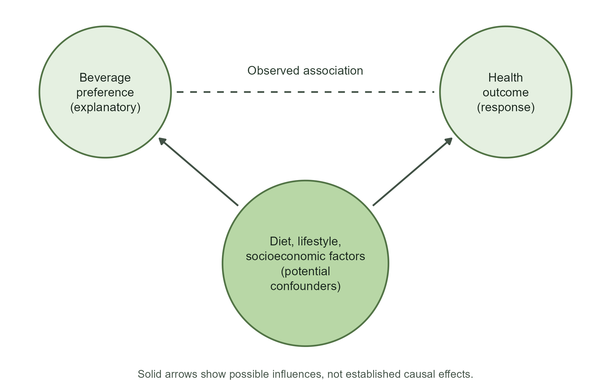
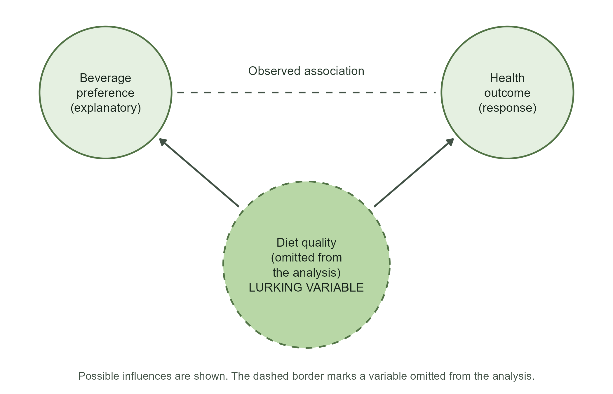
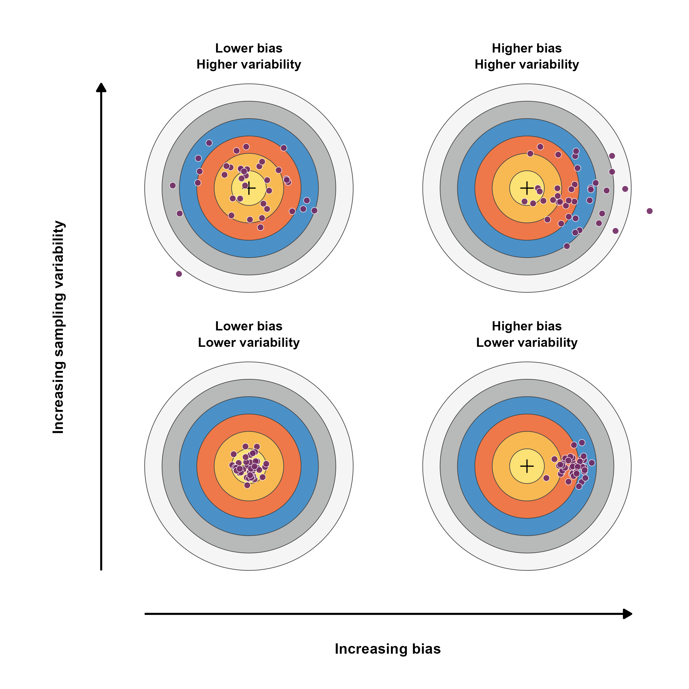

<style>
/* ============================================================
   CHAPTER 6 — PAGE + COLLAPSIBLE TABLE OF CONTENTS
   ============================================================ */

:root {
  --toc-width: 300px;
  --toc-collapsed-gutter: 72px;
  --chapter-width: 1100px;

  --ink: #23364a;
  --accent: #2c3e50;
  --line: #d8dee4;
  --soft: #f6f8fa;
  --toc-background: #f7f9fb;
}


/* ============================================================
   GENERAL PAGE
   ============================================================ */

html {
  scroll-behavior: smooth;
}

body {
  font-size: 17px;
  line-height: 1.65;
  color: var(--ink);
}

.main-container {
  max-width: var(--chapter-width) !important;
}


/* ============================================================
   HIDE DUMMY CHAPTER CONTENT
   ============================================================ */

/*
   Chapter 6 is the visible chapter heading; Pandoc applies a section-number offset of 5 so that its subsections begin at 6.1.

   Hide the visible "Chapter 6" H1 because the document title
   already says Chapter 6, but KEEP the section itself so that
   H2 headings are numbered 6.1, 6.2, 6.3, ...
*/
.section.chapter-root > h1 {
  display: none !important;
}


/* ============================================================
   HIDE EARLIER DUMMY CHAPTERS FROM THE TABLE OF CONTENTS
   ============================================================ */

/*
   R Markdown/tocify does not reliably expose the chapter names
   through data-unique, so select them through their generated
   href values instead.
*/

#TOC li:has(a[href="#chapter-1-dummy"]),
#TOC li:has(a[href="#chapter-2-dummy"]),
#TOC li:has(a[href="#chapter-3-dummy"]),
#TOC li:has(a[href="#chapter-4-dummy"]),
#TOC li:has(a[href="#chapter-5-dummy"]) {
  display: none !important;
}


/*
   Also hide the Chapter 6 parent entry itself.

   Its children — 6.1, 6.2, 6.3, ... — remain visible.
*/
#TOC li:has(> a[href="#chapter-6"]) > a[href="#chapter-6"] {
  display: none !important;
}


/*
   tocify may place the Chapter 6 subsections inside the same
   list item. Remove spacing belonging to the hidden parent.
*/
#TOC li:has(> a[href="#chapter-6"]) {
  margin-top: 0 !important;
}


/* ============================================================
   ACCESSIBILITY
   ============================================================ */

.sr-only {
  position: absolute;
  width: 1px;
  height: 1px;
  padding: 0;
  margin: -1px;
  overflow: hidden;
  clip: rect(0, 0, 0, 0);
  white-space: nowrap;
  border: 0;
}


/* ============================================================
   SIDEBAR TOGGLE BUTTON
   ============================================================ */

#toc-toggle {
  position: fixed;

  top: 16px;
  left: calc(var(--toc-width) + 14px);

  width: 42px;
  height: 42px;

  display: flex;
  align-items: center;
  justify-content: center;

  padding: 0;

  border: 1px solid #c7d0d9;
  border-radius: 8px;

  background: #ffffff;
  color: var(--ink);

  box-shadow: 0 2px 8px rgba(24, 39, 55, 0.13);

  cursor: pointer;

  font-size: 24px;
  line-height: 1;

  z-index: 1200;

  transition:
    left 0.25s ease,
    background-color 0.2s ease,
    box-shadow 0.2s ease,
    transform 0.2s ease;
}

#toc-toggle:hover {
  background: #eef3f7;
  box-shadow: 0 3px 10px rgba(24, 39, 55, 0.18);
}

#toc-toggle:focus-visible {
  outline: 3px solid rgba(44, 62, 80, 0.28);
  outline-offset: 2px;
}


/* Open/close icons */

#toc-toggle .menu-icon {
  display: none;
}

#toc-toggle .close-icon {
  display: inline;
}


/* Button position when sidebar is collapsed */

body.toc-collapsed #toc-toggle {
  left: 14px;
}

body.toc-collapsed #toc-toggle .menu-icon {
  display: inline;
}

body.toc-collapsed #toc-toggle .close-icon {
  display: none;
}


/* ============================================================
   DESKTOP LAYOUT
   ============================================================ */

@media screen and (min-width: 992px) {

  /*
     Make room for fixed sidebar.
  */
  .main-container {
    width: 100% !important;
    max-width: none !important;

    padding-left: calc(var(--toc-width) + 30px) !important;
    padding-right: 35px !important;

    box-sizing: border-box !important;

    transition: padding-left 0.25s ease;
  }


  /*
     When sidebar is collapsed, reclaim almost all of the space.
  */
  body.toc-collapsed .main-container {
    padding-left: var(--toc-collapsed-gutter) !important;
  }


  /*
     Bootstrap normally reserves a column for the TOC.
     The TOC is fixed now, so remove that reserved column.
  */
  .main-container > .row-fluid > .col-xs-12.col-sm-4.col-md-3,
  .main-container > .row > .col-xs-12.col-sm-4.col-md-3 {
    width: 0 !important;
    min-height: 0 !important;
    padding: 0 !important;
    margin: 0 !important;
  }


  /* ----------------------------------------------------------
     FLOATING TOC
     ---------------------------------------------------------- */

  #TOC,
  #TOC.tocify {
    position: fixed !important;

    top: 0 !important;
    bottom: 0 !important;
    left: 0 !important;

    width: var(--toc-width) !important;
    max-height: 100vh !important;

    box-sizing: border-box !important;

    overflow-y: auto !important;
    overflow-x: hidden !important;

    margin: 0 !important;
    padding: 72px 16px 28px 18px !important;

    background: var(--toc-background) !important;

    border: 0 !important;
    border-right: 1px solid var(--line) !important;
    border-radius: 0 !important;

    box-shadow: none !important;

    z-index: 1100 !important;

    transform: translateX(0);

    transition: transform 0.25s ease;
  }


  /*
     Completely slide sidebar off screen when collapsed.
  */
  body.toc-collapsed #TOC,
  body.toc-collapsed #TOC.tocify {
    transform: translateX(calc(-1 * var(--toc-width)));
  }


  /*
     Allow long section headings to wrap rather than getting
     clipped.
  */
  #TOC a {
    white-space: normal !important;
    overflow-wrap: break-word !important;
    word-break: normal !important;
  }


  /* ----------------------------------------------------------
     TOC TYPOGRAPHY
     ---------------------------------------------------------- */

  #TOC .tocify-item {
    border-radius: 4px;
  }

  #TOC .tocify-item a {
    color: var(--ink);
    text-decoration: none;
  }

  #TOC .tocify-item:hover {
    background: #e9eef3;
  }

  #TOC .tocify-item.active {
    background: var(--accent) !important;
  }

  #TOC .tocify-item.active a {
    color: #ffffff !important;
  }


  /* ----------------------------------------------------------
     MAIN CHAPTER CONTENT
     ---------------------------------------------------------- */

  .toc-content,
  .toc-content.col-xs-12.col-sm-8.col-md-9 {
    width: 100% !important;
    max-width: var(--chapter-width) !important;

    float: none !important;

    margin-left: auto !important;
    margin-right: auto !important;

    padding-left: 15px !important;
    padding-right: 15px !important;

    box-sizing: border-box !important;
  }


  /*
     Fallback for Pandoc output that does not use Bootstrap's
     normal R Markdown container structure.
  */
  body.standalone-pandoc {
    width: calc(100% - var(--toc-width)) !important;
    max-width: none !important;

    box-sizing: border-box !important;

    margin: 0 0 0 var(--toc-width) !important;
    padding: 50px 45px !important;

    transition:
      width 0.25s ease,
      margin-left 0.25s ease,
      padding-left 0.25s ease;
  }

  body.standalone-pandoc.toc-collapsed {
    width: 100% !important;

    margin-left: 0 !important;
    padding-left: var(--toc-collapsed-gutter) !important;
  }

  body.standalone-pandoc > header,
  body.standalone-pandoc > section {
    max-width: var(--chapter-width);

    margin-left: auto;
    margin-right: auto;
  }
}


/* ============================================================
   MOBILE / TABLET
   ============================================================ */

@media screen and (max-width: 991px) {

  .main-container {
    width: auto !important;
    max-width: var(--chapter-width) !important;

    margin-left: auto !important;
    margin-right: auto !important;

    padding: 70px 18px 24px !important;

    box-sizing: border-box !important;
  }


  /*
     Toggle remains at upper-left on mobile.
  */
  #toc-toggle,
  body.toc-collapsed #toc-toggle {
    left: 12px;
  }


  /*
     Mobile starts with menu icon.
  */
  #toc-toggle .menu-icon,
  body.toc-collapsed #toc-toggle .menu-icon {
    display: inline;
  }

  #toc-toggle .close-icon,
  body.toc-collapsed #toc-toggle .close-icon {
    display: none;
  }


  /*
     Show X while the mobile TOC is open.
  */
  body.toc-mobile-open #toc-toggle .menu-icon {
    display: none;
  }

  body.toc-mobile-open #toc-toggle .close-icon {
    display: inline;
  }


  /* ----------------------------------------------------------
     MOBILE TOC DRAWER
     ---------------------------------------------------------- */

  #TOC,
  #TOC.tocify {
    position: fixed !important;

    top: 0 !important;
    bottom: 0 !important;
    left: 0 !important;

    width: min(84vw, 320px) !important;
    max-height: 100vh !important;

    box-sizing: border-box !important;

    overflow-y: auto !important;
    overflow-x: hidden !important;

    margin: 0 !important;
    padding: 72px 18px 28px !important;

    background: var(--toc-background) !important;

    border: 0 !important;
    border-right: 1px solid var(--line) !important;
    border-radius: 0 !important;

    z-index: 1100 !important;

    transform: translateX(-105%);

    transition: transform 0.25s ease;
  }

  body.toc-mobile-open #TOC,
  body.toc-mobile-open #TOC.tocify {
    transform: translateX(0);

    box-shadow: 6px 0 18px rgba(24, 39, 55, 0.16);
  }


  /*
     Prevent long headings from being clipped.
  */
  #TOC a {
    white-space: normal !important;
    overflow-wrap: break-word !important;
    word-break: normal !important;
  }


  body.standalone-pandoc {
    width: auto !important;
    max-width: var(--chapter-width) !important;

    margin: 0 auto !important;
    padding: 70px 18px 24px !important;

    box-sizing: border-box !important;
  }
}


/* ============================================================
   SECTION HEADINGS
   ============================================================ */

h1,
h2,
h3,
h4,
h5 {
  margin-top: 1.6em;
}

h2 {
  border-bottom: 3px solid var(--accent);
  padding-bottom: 0.25em;
}

h3 {
  border-bottom: 1px solid var(--line);
  padding-bottom: 0.2em;
}


/* ============================================================
   BLOCKQUOTES / DEFINITION BOXES
   ============================================================ */

blockquote {
  border-left: 4px solid var(--accent);

  background: #f7f9fa;

  padding: 0.7em 1em;
  margin-top: 1.2em;
  margin-bottom: 1.2em;
}


/* ============================================================
   TABLES
   ============================================================ */

table {
  width: 100%;

  margin: 1.35em auto;

  border-collapse: separate !important;
  border-spacing: 0;

  background: #ffffff;

  border: 1px solid #d6dde5;
  border-radius: 8px;

  overflow: hidden;

  box-shadow: 0 2px 8px rgba(24, 39, 55, 0.06);
}

table thead th {
  padding: 0.72em 0.9em !important;

  background: var(--accent);
  color: #ffffff;

  border: 0 !important;
  border-bottom: 1px solid #1e2d3b !important;

  font-weight: 700;

  vertical-align: middle !important;
}

table tbody td {
  padding: 0.65em 0.9em !important;

  border: 0 !important;
  border-bottom: 1px solid #e5e9ee !important;

  vertical-align: middle !important;
}

table tbody tr:nth-child(even) td {
  background: #f7f9fb;
}

table tbody tr:hover td {
  background: #eef4f8;
}

table tbody tr:last-child td {
  border-bottom: 0 !important;
}


/* ============================================================
   IMAGES
   ============================================================ */

img {
  display: block;

  max-width: 100%;
  height: auto;

  margin: 1.4em auto;

  border: 1px solid #e1e4e8;
  border-radius: 7px;
}


/* ============================================================
   MATHEMATICS
   ============================================================ */

.math.display {
  overflow-x: auto;
}


/* ============================================================
   HIDE R MARKDOWN CODE-FOLDING UI
   ============================================================ */

.btn-code,
.code-folding-btn,
div.btn-group.pull-right {
  display: none !important;
}
</style>

<button id="toc-toggle"
        type="button"
        aria-label="Toggle table of contents"
        aria-expanded="true">
  <span class="menu-icon" aria-hidden="true">&#9776;</span>
  <span class="close-icon" aria-hidden="true">&times;</span>
  <span class="sr-only">Toggle table of contents</span>
</button>

<script>
document.addEventListener("DOMContentLoaded", function () {
  const button = document.getElementById("toc-toggle");

  if (!button) return;

  button.addEventListener("click", function () {
    if (window.innerWidth <= 991) {
      document.body.classList.toggle("toc-mobile-open");

      const isOpen =
        document.body.classList.contains("toc-mobile-open");

      button.setAttribute("aria-expanded", isOpen);
    } else {
      document.body.classList.toggle("toc-collapsed");

      const isOpen =
        !document.body.classList.contains("toc-collapsed");

      button.setAttribute("aria-expanded", isOpen);
    }
  });
});
</script>


```{r setup, include=FALSE, echo=FALSE, warning=FALSE, message=FALSE}
knitr::opts_chunk$set(
  echo = TRUE,
  warning = FALSE,
  message = FALSE,
  error = FALSE,
  fig.align = "center",
  fig.width = 6,
  fig.height = 4
)

library(ggplot2)
library(dplyr)
library(tidyr)
library(gridExtra)

set.seed(123)

lecture_theme <- theme_minimal(base_size = 11) +
  theme(
    plot.title = element_text(size = 13, face = "bold", hjust = 0.5),
    axis.title = element_blank(),
    axis.text = element_blank(),
    panel.grid = element_blank(),
    plot.background = element_rect(fill = "white", colour = NA),
    panel.background = element_rect(fill = "white", colour = NA),
    plot.margin = margin(8, 10, 8, 10)
  )

lecture_chart_theme <- theme_minimal(base_size = 11) +
  theme(
    plot.title = element_text(size = 13, face = "bold", hjust = 0.5),
    plot.subtitle = element_text(size = 10.5, hjust = 0.5),
    axis.title = element_text(size = 11.5),
    axis.text = element_text(size = 9.5, colour = "#333333"),
    panel.grid.minor = element_blank(),
    plot.background = element_rect(fill = "white", colour = NA),
    panel.background = element_rect(fill = "white", colour = NA),
    plot.margin = margin(8, 10, 8, 10)
  )

save_plot <- function(filename, plot, width, height) {
  ggsave(
    filename = filename,
    plot = plot,
    width = width,
    height = height,
    units = "in",
    dpi = 300,
    bg = "white"
  )
}

# =============================================================
# Chapter 6: Confounding Diagram
# =============================================================
create_circle <- function(x0, y0, r, node_name, fill_colour,
                          border = "solid") {
  theta <- seq(0, 2 * pi, length.out = 180)

  data.frame(
    x = x0 + r * cos(theta),
    y = y0 + r * sin(theta),
    node = node_name,
    fill = fill_colour,
    border = border
  )
}

# Calculate endpoints so arrows stop outside the circles.
circle_edge <- function(from, to, r_from, r_to, gap = 0.10) {
  direction <- (to - from) / sqrt(sum((to - from)^2))

  start <- from + (r_from + gap) * direction
  end <- to - (r_to + gap) * direction

  data.frame(
    x = start[1],
    y = start[2],
    xend = end[1],
    yend = end[2]
  )
}

make_diagram <- function(lurking = FALSE) {
  explanatory <- c(0, 2.2)
  response <- c(7, 2.2)
  third_variable <- c(3.5, -0.8)

  upper_radius <- 1.15
  lower_radius <- 1.45

  circles <- rbind(
    create_circle(
      0, 2.2, upper_radius,
      "Explanatory", "#E5F0E1"
    ),
    create_circle(
      7, 2.2, upper_radius,
      "Response", "#E5F0E1"
    ),
    create_circle(
      3.5, -0.8, lower_radius,
      "Third variable", "#B8D7A6",
      border = if (lurking) "dashed" else "solid"
    )
  )

  # These arrows represent possible influences, not proven causes.
  influences <- rbind(
    circle_edge(
      third_variable, explanatory,
      lower_radius, upper_radius
    ),
    circle_edge(
      third_variable, response,
      lower_radius, upper_radius
    )
  )

  lower_label <- if (lurking) {
    "Diet quality\n(omitted from\nthe analysis)\nLURKING VARIABLE"
  } else {
    "Diet, lifestyle,\nsocioeconomic factors\n(potential\nconfounders)"
  }

  labels <- data.frame(
    x = c(0, 7, 3.5),
    y = c(2.2, 2.2, -0.8),
    label = c(
      "Beverage\npreference\n(explanatory)",
      "Health\noutcome\n(response)",
      lower_label
    )
  )

  caption <- if (lurking) {
    paste(
      "Possible influences are shown.",
      "The dashed border marks a variable omitted from the analysis."
    )
  } else {
    "Solid arrows show possible influences, not established causal effects."
  }

  ggplot() +
    # An observed association has no causal arrowhead.
    annotate(
      "segment",
      x = 1.25, y = 2.2,
      xend = 5.75, yend = 2.2,
      linetype = "dashed",
      linewidth = 0.65,
      colour = "#425246"
    ) +
    annotate(
      "text",
      x = 3.5, y = 2.58,
      label = "Observed association",
      size = 3.5,
      colour = "#26382B"
    ) +
    geom_segment(
      data = influences,
      aes(x = x, y = y, xend = xend, yend = yend),
      arrow = grid::arrow(
        length = grid::unit(0.18, "cm"),
        type = "closed"
      ),
      linewidth = 0.70,
      colour = "#425246"
    ) +
    geom_polygon(
      data = circles,
      aes(
        x = x, y = y,
        group = node,
        fill = fill,
        linetype = border
      ),
      colour = "#527446",
      linewidth = 0.65
    ) +
    scale_fill_identity() +
    scale_linetype_identity() +
    geom_text(
      data = labels,
      aes(x = x, y = y, label = label),
      size = 3.5,
      lineheight = 1.03,
      colour = "#18251C"
    ) +
    coord_fixed(
      xlim = c(-1.6, 8.6),
      ylim = c(-2.5, 3.6),
      expand = FALSE
    ) +
    labs(caption = caption) +
    theme_void() +
    theme(
      plot.caption = element_text(
        size = 9,
        colour = "#425246",
        hjust = 0.5,
        margin = margin(t = 8)
      ),
      plot.margin = margin(10, 10, 10, 10),
      plot.background = element_rect(
        fill = "white",
        colour = NA
      )
    )
}

# Create the two diagrams.
p_confound <- make_diagram(lurking = FALSE)
p_lurking <- make_diagram(lurking = TRUE)

# Display both diagrams in the knitted document.
print(p_confound)
print(p_lurking)

# Save image files for the Beamer slides.
ggsave(
  filename = "fig_ch6_confounding.png",
  plot = p_confound,
  width = 7,
  height = 4.5,
  units = "in",
  dpi = 300,
  bg = "white"
)

ggsave(
  filename = "fig_ch6_lurking.png",
  plot = p_lurking,
  width = 7,
  height = 4.5,
  units = "in",
  dpi = 300,
  bg = "white"
)

scenarios <- data.frame(
  scenario = c(
    "Low bias, high variability",
    "High bias, high variability",
    "Low bias, low variability",
    "High bias, low variability"
  ),
  centre_x = c(0, 16, 0, 16),
  centre_y = c(16, 16, 0, 0),
  bias = c(0, 2.6, 0, 2.6),
  spread = c(1.65, 1.65, 0.55, 0.55),
  label = c(
    "Lower bias\nHigher variability",
    "Higher bias\nHigher variability",
    "Lower bias\nLower variability",
    "Higher bias\nLower variability"
  )
)

# -------------------------------------------------------------
# Target rings, drawn from the outside inward
# -------------------------------------------------------------

make_circle <- function(r, fill_colour) {
  theta <- seq(0, 2 * pi, length.out = 180)

  data.frame(
    x = r * cos(theta),
    y = r * sin(theta),
    fill = fill_colour
  )
}

radii <- 6:1

ring_colours <- c(
  "#F5F5F5",
  "#B8B9B9",
  "#4B91C8",
  "#EE784A",
  "#F8B953",
  "#FCE174"
)

rings <- do.call(
  rbind,
  lapply(seq_along(radii), function(i) {
    data.frame(
      make_circle(radii[i], ring_colours[i]),
      ring = i
    )
  })
)

# Position one target in each quadrant.
rings_all <- do.call(
  rbind,
  lapply(seq_len(nrow(scenarios)), function(i) {
    data.frame(
      x = rings$x + scenarios$centre_x[i],
      y = rings$y + scenarios$centre_y[i],
      fill = rings$fill,
      ring = rings$ring,
      scenario = scenarios$scenario[i]
    )
  })
)

# -------------------------------------------------------------
# Illustrative estimates from repeated samples
# -------------------------------------------------------------

set.seed(42)

n_repeated_samples <- 40

points_all <- do.call(
  rbind,
  lapply(seq_len(nrow(scenarios)), function(i) {
    data.frame(
      x = scenarios$centre_x[i] +
        rnorm(
          n_repeated_samples,
          mean = scenarios$bias[i],
          sd = scenarios$spread[i]
        ),
      y = scenarios$centre_y[i] +
        rnorm(
          n_repeated_samples,
          mean = 0,
          sd = scenarios$spread[i]
        ),
      scenario = scenarios$scenario[i]
    )
  })
)

# -------------------------------------------------------------
# Draw the targets and the axes for the panel arrangement
# -------------------------------------------------------------

p_targets <- ggplot() +
  geom_polygon(
    data = rings_all,
    aes(
      x = x,
      y = y,
      group = interaction(scenario, ring),
      fill = fill
    ),
    colour = "#444444",
    linewidth = 0.25
  ) +
  scale_fill_identity() +

  # Each cross marks a true population value.
  geom_point(
    data = scenarios,
    aes(x = centre_x, y = centre_y),
    shape = 3,
    size = 3,
    stroke = 0.7,
    colour = "black"
  ) +

  # Each point represents an estimate from one repeated sample.
  geom_point(
    data = points_all,
    aes(x = x, y = y),
    shape = 21,
    fill = "#702963",
    colour = "white",
    stroke = 0.3,
    size = 2.3,
    alpha = 0.9
  ) +

  # Target labels
  geom_text(
    data = scenarios,
    aes(
      x = centre_x,
      y = centre_y + 7.6,
      label = label
    ),
    size = 3.8,
    fontface = "bold",
    lineheight = 1.05
  ) +

  # Horizontal axis: bias increases from left to right.
  annotate(
    "segment",
    x = -6, y = -8.5,
    xend = 22, yend = -8.5,
    arrow = grid::arrow(
      length = grid::unit(0.25, "cm"),
      type = "closed"
    ),
    linewidth = 0.8
  ) +
  annotate(
    "text",
    x = 8, y = -10.5,
    label = "Increasing bias",
    size = 4.3,
    fontface = "bold"
  ) +

  # Vertical axis: variability increases from bottom to top.
  annotate(
    "segment",
    x = -8.5, y = -6,
    xend = -8.5, yend = 22,
    arrow = grid::arrow(
      length = grid::unit(0.25, "cm"),
      type = "closed"
    ),
    linewidth = 0.8
  ) +
  annotate(
    "text",
    x = -11, y = 8,
    label = "Increasing sampling variability",
    angle = 90,
    size = 4.3,
    fontface = "bold"
  ) +

  coord_fixed(
    xlim = c(-13, 24),
    ylim = c(-12, 26),
    expand = FALSE
  ) +
  theme_void() +
  theme(
    plot.background = element_rect(
      fill = "white",
      colour = NA
    ),
    plot.margin = margin(12, 12, 12, 12)
  )

print(p_targets)

ggsave(
  filename = "fig_ch6_archery.png",
  plot = p_targets,
  width = 8,
  height = 8,
  units = "in",
  dpi = 300,
  bg = "white"
)
```

# Chapter 6 {.chapter-root .unlisted}

## Gathering Data

Statistical methods are useful only when the data have been collected in a way that addresses the scientific question. Before any calculation is performed, the study design should make clear who or what is being studied, what is being measured and how the observations are obtained.

Many scientific questions concern populations that are too large to study completely. A health researcher may want to estimate a proportion for adults in a country. A wildlife biologist may want to learn about a fish population in a river system. A laboratory may want to understand a biological process from a manageable set of specimens. In each situation, the quality of the conclusion depends on the quality of the data-generation process.

This chapter begins by separating observational studies from experiments. It then develops the ideas of populations, samples, probability sampling and common sources of survey bias. The final sections compare case-control and cohort studies, which are two important observational designs used in health and life-science research.

> **Study design comes before statistical analysis**
>
> A numerical method cannot repair a study design that systematically excludes important groups, measures the wrong variable or mixes the effect of an explanatory variable with other factors. Statistical reasoning therefore begins with a careful description of how the data were generated.

The central questions of this chapter are:

1. Is the study observational or experimental?
2. If a sample was used, how was it selected from the population?
3. What sources of bias or confounding could affect the conclusion?
4. Does the design support generalization, a causal conclusion, both or neither?

### Observation versus Experiment

Two broad approaches are used to gather data in the life sciences. An **observational study** records information without deliberately assigning the explanatory conditions of interest. An **experiment** deliberately assigns a treatment or condition to experimental units, then observes the response.

> **Observational study**
>
> An observational study observes individuals and measures variables of interest without deliberately assigning the main explanatory condition being studied. Observational studies are useful for describing populations, comparing naturally occurring groups and studying exposures that cannot ethically or practically be assigned.

> **Experiment**
>
> An experiment deliberately imposes one or more treatments on experimental units in order to compare their responses. A well-designed randomized experiment can provide strong evidence about cause and effect because random assignment helps separate the treatment effect from other variables.

The distinction is important because an observational association can have several explanations. Individuals who differ in the explanatory variable may also differ in age, environment, behaviour, socioeconomic conditions or other characteristics. A randomized experiment is designed to make treatment groups comparable before the treatment is applied.

Observational studies remain essential when experiments would be unethical, impossible or scientifically inappropriate. For example, a researcher should not randomly assign people to smoke cigarettes in order to study long-term health effects. In such settings, causal reasoning must rely on observational evidence together with careful design, subject-matter knowledge and assumptions about possible confounding.

A useful first-year distinction is therefore that **random sampling** helps support generalization from a sample to a population, while **random assignment** helps support causal comparisons between treatments. These two uses of randomness solve different problems.

**Seedling example**

Suppose researchers want to know whether fertilizer increases seedling growth.

- In an **observational study**, the researchers compare seedlings that growers already fertilize with seedlings they do not fertilize. Fertilizer use is observed rather than assigned. The two groups may also differ in soil, sunlight, watering or grower experience.
- In an **experiment**, the researchers assign seedlings to receive fertilizer or water alone, keep the other growing conditions as comparable as possible and compare growth after four weeks.

The experimental design gives researchers more control over competing explanations. The observational design can identify an association, but it does not by itself establish that fertilizer caused the difference in growth.

### Random Sampling versus Random Assignment

Suppose a greenhouse contains $1000$ seedlings and researchers select $60$ for a study.

> **Random sampling asks: Which seedlings enter the study?**
>
> Randomly selecting $60$ seedlings helps the sample represent the greenhouse population. This supports generalization from the sample to that population.

> **Random assignment asks: Which treatment does each selected seedling receive?**
>
> Randomly assigning $30$ seedlings to fertilizer and $30$ to water alone helps make the treatment groups comparable on average. This supports a causal comparison between the treatments.

A study can use random sampling, random assignment, both or neither. Random assignment does not automatically make the participants representative of a wider population, and random sampling alone does not establish causation.

### When Observational Studies Are Needed

Randomized experiments are powerful, but researchers cannot always assign the conditions they want to study.

- **The assignment would be unethical.** Researchers should not assign people to smoke cigarettes to investigate long-term health outcomes.
- **The characteristic cannot be assigned.** Researchers studying age and memory must observe people of different ages.
- **The research concerns existing conditions.** Ecologists may compare wildlife populations in habitats that have already experienced different levels of disturbance.

Researchers can strengthen observational evidence by measuring other relevant variables, comparing similar groups, using appropriate statistical adjustments and examining alternative explanations. These steps improve the evidence, but they do not reproduce all the protection provided by random assignment.

### Confounding and Lurking Variables

The main difficulty in an observational study is that the explanatory variable can be associated with other variables that also affect the response. This issue is described through the related ideas of lurking variables and confounding.

> **Lurking variable**
>
> A lurking variable is a variable that is not included as an explanatory or response variable in the analysis but may help explain the observed relationship between the variables that are measured.

> **Confounding**
>
> Confounding occurs when the effects of two or more explanatory variables on a response cannot be separated clearly from the available data.

A lurking variable is therefore a possible source of an alternative explanation. Confounding describes the resulting difficulty in separating effects. The terms are related, but they are not identical.

Confounding is a major concern in observational research because naturally occurring groups can differ in many ways. Careful design can reduce this problem through methods such as restriction, matching or stratification. Statistical adjustment can also account for measured variables. These approaches can reduce confounding, but unmeasured differences may still remain.

**Lurking-variable example**

Suppose an observational study finds that fertilized seedlings grow more than unfertilized seedlings.

- The explanatory variable is **fertilizer use**.
- The response variable is **seedling growth**.
- Growers who use fertilizer might also place their seedlings in sunnier locations, but the researchers did not record sunlight exposure.

Sunlight is a possible **lurking variable** because it was omitted from the analysis and may help explain the observed association. Greater growth could reflect fertilizer, sunlight or both.

Now suppose nearly every fertilized seedling receives full sunlight while nearly every unfertilized seedling grows in shade. The groups differ in both fertilizer use and sunlight exposure, and the data contain little opportunity to compare fertilizer treatments under the same sunlight conditions. The effects of fertilizer and sunlight are therefore **confounded**.

> **The distinction**
>
> Lurking describes the omission of a variable from the analysis. Confounding describes the inability to separate the effects of explanatory variables. A variable can be measured and still participate in confounding if the study contains no suitable comparisons.

Researchers could reduce confounding by:

1. **Restriction:** include only seedlings grown in full sunlight
2. **Matching:** compare fertilized and unfertilized seedlings with similar sunlight exposure and soil conditions
3. **Stratification:** compare fertilizer groups separately within full-sun, partial-shade and shade categories
4. **Statistical adjustment:** include measured factors such as sunlight and watering in a statistical model

These approaches help only for variables that are measured adequately and for which suitable comparisons exist. Unmeasured or poorly measured differences can still affect the conclusion.

### Confounding in an Observational Study

**Example 6.2: Wine, Beer, or Spirits?**

**Question**

Some observational studies have reported that health outcomes differ among moderate drinkers who prefer wine, beer or spirits. Does an observed difference in health establish that the type of beverage itself causes the difference?

**Explanation**

Beverage preference can be related to many other characteristics. Groups that prefer different beverages may also differ in diet, smoking behaviour, exercise, income, education, access to health care or other factors. If those characteristics also relate to the health outcome, the effect of beverage preference cannot be separated cleanly from the effects of the other variables.

The diagram below represents this structure. The dashed arrow represents the observed association between beverage preference and health. The lower node represents potential confounding variables that can be related to both the explanatory variable and the response.






**Solution**

The observational association does not by itself establish a causal effect of beverage type. Potential confounders provide alternative explanations for the observed difference. A scientifically appropriate conclusion is that beverage preference and health are associated in the observed data after considering the study design. A causal claim would require stronger evidence and careful control of competing explanations.

The confounding example shows why the way individuals enter a study matters. The next step is to consider how a sample can be chosen so that it gives useful information about a larger population.

---

## Sampling

A **census** attempts to collect information from every unit in a population. A **sample** is a subset of that population from which data are actually collected. Sampling is necessary because a census is often expensive, slow, difficult to complete or impossible.

Suppose a university health centre wants to learn about the sleep habits of first-year students. Asking every first-year student would be a census. A more practical approach is to select a sample of students and use the resulting data to learn about the larger group.

The goal is not simply to collect many observations. The goal is to select observations through a design that supports the intended generalization. A carefully selected moderate-sized sample can be more informative about a population than a much larger sample collected from a systematically unrepresentative group.

### Core Terminology

Several terms should be distinguished before a sample is selected.

> **Population, sample, sampling frame and sampling design**
>
> **Population:** The full group of individuals or units about which information is desired
>
> **Sample:** The subset of individuals or units from which data are actually collected
>
> **Sampling frame:** The practical list or mechanism used to identify units that can be selected for the sample
>
> **Sampling design:** The planned method used to choose the sample from the sampling frame or population

Two additional terms connect sampling to later statistical inference.

> **Parameter and statistic**
>
> A **parameter** is a numerical characteristic of a population. A **statistic** is a numerical characteristic calculated from a sample. Statistical inference uses sample statistics to learn about unknown population parameters.

For the sleep study, the **target population** is all currently enrolled first-year students at the university. The health centre wants to estimate the proportion whose average nighttime sleep over the previous $7$ nights is at least $7$ hours.

The reported average number of hours is quantitative. To answer the study question, the researchers classify each student into one of two categories:

$$
\text{Yes: average sleep}\geq 7\text{ hours}
$$

$$
\text{No: average sleep}<7\text{ hours}
$$

The resulting yes-or-no variable is categorical.

### Why a Representative Sample Matters

A familiar analogy is a well-mixed pot of soup. A spoonful taken after thorough mixing can provide useful information about the flavour of the pot because the ingredients are distributed throughout the mixture. The analogy should not be interpreted as meaning that one spoonful represents the pot perfectly. Small samples can still vary by chance.

A blood specimen provides a similar idea. A small specimen can be informative about a larger biological system when the measured component is sufficiently well mixed and the collection process is appropriate. Measurement error, biological variation and handling procedures can still affect the result.

Human populations, wildlife populations and ecological systems are usually much more heterogeneous than a pot of soup. Individuals differ across many characteristics. A sampling design is therefore needed to give relevant groups an appropriate chance of being represented.

### Planning a Sample

A useful sampling plan begins by answering several questions before data collection starts.

1. **The target population must be defined clearly.** The definition should state exactly which individuals or units the scientific conclusion is intended to describe.
2. **The variables must be defined operationally.** The study should state what is being measured, how it is measured and how categories or thresholds are determined.
3. **The sampling frame must be identified.** The frame should be examined for groups that may be missing or duplicated.
4. **The sampling method must be specified.** The design should explain how chance, stratification or other selection rules will be used.

These steps improve reproducibility because another researcher can determine who was eligible, how measurements were classified and how individuals entered the sample.

### Defining a Population and a Variable

**Example: Sleep Habits of First-Year Students**

The university health centre wants to estimate the proportion of currently enrolled first-year students who average at least $7$ hours of nighttime sleep. Each selected student reports their average nighttime sleep over the previous $7$ nights.

> **Population**
>
> All currently enrolled first-year students at the university. This is the group the health centre wants to describe.

> **Variable**
>
> Whether the student's reported average nighttime sleep over the previous $7$ nights is at least $7$ hours. The possible categories are yes and no.

The exact definitions matter. Replacing nighttime sleep with total sleep, changing the reporting period or including students from other years would change the variable or population being studied.

### From the Population to the Sample

The health centre needs a practical way to identify and select students.

- The **sampling frame** could be the university's current first-year enrolment list.
- The **sampling design** could randomly select $200$ distinct student IDs from that list and invite those students to complete the survey.
- The **sample** consists of the selected students from whom usable data are obtained.

These three ideas should be kept separate. The population is the group the researchers want to describe, the frame is the practical source used for selection and the sample is the group providing the observed data. If the enrolment list is incomplete, the sampling frame does not fully cover the target population. If selected students do not respond, the respondents may differ from the original probability sample.

### Parameter versus Statistic

Let $p$ represent the proportion of **all currently enrolled first-year students at the university** who meet the sleep criterion. This population proportion is a parameter and is unknown.

Suppose all $200$ selected students respond and $124$ meet the criterion. The sample proportion is

$$
\hat{p}=\frac{124}{200}=0.62
$$

The value $\hat p=0.62$ is a statistic because it is calculated from the sample. Another random sample of $200$ students would probably produce a different value of $\hat p$. Statistical inference uses the observed statistic to estimate the population parameter and to describe the uncertainty created by sampling variability.

### Why the Selection Method Matters

Suppose the health centre surveys only students studying in the library at $10$ p.m. Students who study elsewhere, work evening shifts, commute or go to bed earlier may be absent. If their sleep habits differ from those of students in the library, the resulting sample can systematically misrepresent the target population.

Selecting students randomly from a complete enrolment list gives students across these groups a chance of selection. Surveying more students in the same library does not solve the problem because the selection mechanism continues to exclude the same types of students.

> **Sample size is not enough**
>
> A larger sample generally reduces random sampling variability when the design is unchanged. It does not automatically correct systematic undercoverage, self-selection or measurement bias.

### A Complete Plan for the Sleep Survey

Before collecting data, the health centre should specify:

1. **Target population:** currently enrolled first-year students at the university
2. **Measurement:** reported average nighttime sleep over the previous $7$ nights, classified using the $7$-hour threshold
3. **Sampling frame:** an updated first-year enrolment list
4. **Selection method:** randomly select $200$ distinct student IDs
5. **Missing-data plan:** arrange reminders, record the response rate and specify how incomplete answers will be handled

Planning these details in advance makes the study reproducible and exposes possible weaknesses before the survey begins.

### Generalizing from a Sample

A sample supports statistical generalization only to the extent that the sampling design connects the observed units to the target population.

Suppose $62\%$ of the surveyed students meet the sleep criterion. This statistic estimates the proportion among first-year students at this university, provided that the enrolment frame, random selection and response process work as intended.

The design does not automatically support conclusions about:

- students in later years
- students at other universities
- all young adults in the province or country

Even with random selection, the statistic varies from sample to sample. An incomplete enrolment list, nonresponse or inaccurate sleep reports can introduce additional errors.

> **Main principle**
>
> A useful generalization depends on who was eligible, how the sample was selected and how the data were collected. The scope of the conclusion should not exceed the scope of the design.

The next section develops sampling designs that use chance to reduce systematic selection bias and support population inference more directly.

---

## Sampling Designs

Statistical inference uses information from a sample to learn about a population. Reliable inference depends on two different ideas that should not be confused: **sampling variability** and **bias**.

Suppose the university repeatedly selects random samples of first-year students and calculates the proportion meeting the sleep criterion. Different samples will usually give different values. This natural sample-to-sample variation is **sampling variability**.

**Bias** concerns a different question: where are the estimates centred over repeated use of the method? A method is biased when its estimates systematically tend to be above or below the true population value. Surveying only students in the library late at night may repeatedly misrepresent the university's first-year students.

A larger random sample usually reduces sampling variability. A larger sample does not automatically remove bias.

### Sampling Variability and Bias

The archery analogy below is useful when each plotted point is interpreted as an **estimate from one repeated sample**. The centre of the target represents the true population parameter. A collection of estimates that is centred on the target is unbiased in the long run. A collection that is tightly concentrated has low variability.



The panels illustrate several ideas. Smaller samples tend to produce more variable estimates. Larger samples tend to produce less variable estimates when the sampling design is otherwise comparable. A precise unbiased method produces estimates tightly concentrated around the true parameter. A biased design can produce estimates that are tightly clustered around the wrong value.

- **Upper left:** the estimates vary widely but are centred near the truth
- **Upper right:** the estimates vary widely and are centred away from the truth
- **Lower left:** the estimates are tightly grouped near the truth
- **Lower right:** the estimates are tightly grouped but systematically miss the truth

> **Bias**
>
> A sampling or measurement method is biased when it systematically tends to produce results that are shifted away from the true population value in a particular direction.

The distinction between variability and bias is fundamental. Random variation can often be reduced by increasing sample size. Systematic bias requires a change in the design or measurement process.

> **Precision does not guarantee accuracy**
>
> Increasing the sample size can tighten the grouping of estimates. It does not necessarily move that grouping toward the true value. Surveying more late-night library users may estimate that group's sleep habits very precisely while still misrepresenting all first-year students.

### Poor Sampling Designs

Two common sampling methods allow human choice to determine who enters the sample. These methods can be useful for exploratory work, but they do not provide the same basis for population inference as probability sampling.

#### Convenience Samples

A **convenience sample** selects individuals who are easy to reach. For the sleep study, a researcher might survey students leaving one first-year lecture. This is convenient, but it includes only students enrolled in that course who attended on that day. Students in other courses and students absent from the lecture have no opportunity to participate. Attendance and course schedules may also relate to sleep habits.

The problem is not that every convenience sample must be badly distorted. The problem is that the design gives no known probability mechanism connecting the sample to the full population, so the direction and size of selection bias are difficult to assess.

#### Voluntary Response Samples

A **voluntary response sample** is created when an open invitation allows individuals to choose whether to participate. The health centre might post an open link stating, "Are you getting enough sleep? Tell us about it!"

Students who are especially concerned about their sleep may be more motivated to respond. Participation can therefore depend on the very characteristic being studied. Posting the survey widely does not ensure that the respondents represent all first-year students.

An open survey is a voluntary response sample. A survey sent only to students who were selected randomly is a probability-sampling design, even though the selected students can still choose whether to respond. Failure of selected students to respond is a **nonresponse** problem rather than voluntary response sampling.

### Probability Samples

A **probability sample** uses a random selection mechanism so that every population unit has a known, nonzero probability of inclusion. The selection probabilities do not have to be equal in every probability design.

Probability sampling does not guarantee that one particular sample will perfectly match the population. Its advantage is that chance rather than personal judgement controls selection, which provides a mathematical basis for assessing sampling variability.

Suppose veterinary researchers want to estimate the average weight of all dairy cows in a region. They could randomly select cow IDs from a complete regional registry. The registry defines the sampling frame, and the random procedure defines how cows enter the sample.

> **Simple random sample**
>
> A simple random sample, abbreviated SRS, of size $n$ is selected so that every possible sample of size $n$ from the population has the same chance of being chosen.

Suppose the registry contains $1000$ cows and the researchers select $50$ distinct cows. They can number the cows from $1$ to $1000$ and use software to select $50$ distinct numbers at random. In this SRS,

$$
P(\text{a particular cow is selected})=\frac{50}{1000}=0.05
$$

Every cow has the same inclusion probability, and every possible group of $50$ cows is equally likely. Selecting the nearest cows until $50$ have been weighed would not satisfy the definition of an SRS.

A simple random sample is an important reference design, but large studies often use more efficient or practical probability designs.

#### Other Probability Designs

A **stratified random sample** divides the population into non-overlapping groups called strata, then takes a probability sample within every stratum. For the cow study, the researchers could divide the registry by breed and randomly sample cows from each breed. Stratification ensures that every specified breed group contributes observations and can improve precision when units within a stratum are relatively similar.

A **cluster sample** randomly selects naturally occurring groups, then studies every unit or a defined set of units in the selected groups. The researchers could randomly select farms and weigh every dairy cow on those farms. Cluster sampling can reduce travel and administrative costs, but cows from the same farm may be more similar to one another than cows selected independently across the region.

A **multistage sample** makes random selections in successive stages. The researchers could randomly select farms and then randomly select cows within the chosen farms. Multistage sampling is useful when a complete list of every individual in a large population is unavailable or impractical to use directly.

The central difference is easy to remember: stratification samples within **every** stratum, cluster sampling selects **some** groups and multistage sampling adds further selection within the chosen groups.

### Random Sampling and Random Assignment

Random sampling and random assignment both use chance, but they answer different questions.

| Method | Main purpose | Main conclusion supported |
|:--|:--|:--|
| Random sampling | Selects units from a population | Supports generalization to the population represented by the sampling design |
| Random assignment | Assigns experimental units to treatments | Supports causal comparison of treatments when the experiment is otherwise well designed |

A study can use one form of randomness without using the other. For example, a clinical experiment may use volunteers rather than a random sample of all patients, but it may randomly assign those volunteers to treatments. The experiment can support a causal comparison within the study population while broader generalization requires additional care.

For the dairy-cow study, researchers might randomly select cows from the regional registry and then randomly assign the participating cows to feed supplement A or supplement B. Random selection supports generalization to the population covered by the registry. Random assignment supports a causal comparison of the supplements. Random assignment alone would not make a convenience sample of cows representative of the entire region.

---

## Sample Surveys

A **sample survey** collects information from a sample of individuals in order to describe a population. Many sample surveys are **cross-sectional**, meaning that they describe a population at a particular time or during a specified period. Repeated cross-sectional surveys can be conducted at regular intervals to track population changes.

A sample survey should not be confused with a **census**. A census attempts to collect information from every unit in the target population, while a sample survey intentionally studies only a subset. The American Community Survey and many public-health surveys are sample surveys. The decennial United States Census is designed as a census rather than as a sample survey.

Suppose a regional health agency wants to estimate the proportion of adults who have difficulty accessing health care. Instead of contacting every adult, it conducts a sample survey. Problems can arise at three stages:

1. **Coverage and selection:** Who can be selected, and how are participants chosen?
2. **Participation:** Which selected individuals actually respond?
3. **Measurement:** How accurately do the received answers describe access to health care?

Even a well-designed probability sample can produce biased results if the sampling frame is incomplete, selected people do not respond or the questions are measured poorly. Four important sources of survey error are undercoverage, nonresponse, response bias and question wording or order.

### Undercoverage

A **sampling frame** is the practical list or mechanism from which the sample is selected. **Undercoverage** occurs when some members of the target population are missing from the frame or have a lower chance of inclusion than the intended design requires.

Suppose the health agency randomly selects telephone numbers from a list containing only landlines. Adults who use only cell phones cannot be selected. If cell-phone-only adults differ from landline users in age, employment, income or access to health care, the resulting estimate may be systematically misleading.

This is undercoverage even if the agency selects the listed landline numbers perfectly at random. Random sampling from an incomplete frame does not give missing groups a chance of selection. A broader frame that includes both landline and mobile-phone users would reduce this problem.

### Nonresponse Bias

**Nonresponse** occurs when a person selected for the sample cannot be contacted or chooses not to participate. Nonresponse does not automatically create bias. Bias arises when the people who respond differ systematically from the selected people who do not respond on variables related to the survey outcome.

For example, adults who work long shifts may be harder to contact. If their access to health care also differs from that of respondents, the final estimate may be biased.

Weighting adjustments can reduce nonresponse bias when useful information about response patterns is available. Weighting cannot guarantee that all bias has been removed because respondents and nonrespondents may differ in ways that were not measured.

A crucial distinction separates nonresponse from voluntary response. In a probability sample, nonresponse occurs **after** individuals have been selected by the design. In a voluntary response sample, the people who participate select themselves into the sample from the beginning.

### Response Bias

**Response bias** occurs when recorded answers differ systematically from the values or opinions the survey intends to measure. The bias can arise from the respondent, interviewer, measurement method or social setting.

For example, patients interviewed by staff from their own clinic may feel uncomfortable reporting dissatisfaction with that clinic. The survey receives an answer, but the answer may systematically overstate satisfaction.

Several other mechanisms are common. Respondents may underreport behaviours they believe will be judged negatively or overreport behaviours viewed favourably. Memory can shift the reported timing of past events, a phenomenon sometimes called **telescoping**. Interviewer wording, tone or other characteristics can also influence answers.

For example, a respondent may report an inaccurate amount of alcohol use because of social desirability. A person who visited a dentist eight months ago may incorrectly remember the visit as occurring within the last six months. These errors are different from sampling error because increasing the sample size does not automatically correct them.

### Wording and Order of Questions

The wording and order of survey questions can influence the responses. A question that uses emotionally charged language, provides unbalanced alternatives or contains ambiguous terms can change what respondents think they are being asked.

A neutral question asks, "How satisfied are you with the service?" A leading version such as, "How excellent was the service?" assumes a favourable evaluation and may push respondents toward a more positive answer.

**Example 6.10: Question Order and Reported Happiness**

**Question**

A study asks university students about their recent dating experiences and overall life satisfaction. Why might the answer to the happiness question change when the dating question is asked first?

**Explanation**

Question order can change what information is most available in a respondent's mind. When the dating question is asked first, it can make recent dating experiences more salient before the respondent evaluates overall life satisfaction. Respondents may then give dating experiences more weight in their overall evaluation.

**Solution**

The change does not imply that the underlying relationship between dating and happiness changed within a few minutes. It shows that the measurement process changed. The order of the questions influenced how respondents interpreted or answered the later question.

Researchers can investigate order effects by randomly assigning respondents to different question orders and comparing the resulting answers. In this setting, random assignment is used inside a survey to study a measurement effect.

A survey result should therefore be evaluated together with the exact wording, question order, sampling frame, response process and nonresponse information. The numerical estimate is only one part of the evidence.

### A Survey Quality Checklist

A useful survey evaluation can be organized around the following questions:

1. **Population:** Who is the survey intended to describe?
2. **Coverage and selection:** Who appears in the sampling frame, who is missing and how were participants selected?
3. **Nonresponse:** How many selected individuals responded, and might nonrespondents differ from respondents?
4. **Question wording:** Are the questions clear, balanced and neutral?
5. **Question order and setting:** Could earlier questions, the interviewer or the response setting influence the answers?

A high response rate is helpful, but it does not by itself guarantee an unbiased survey. The sampling frame may still omit important groups, and the answers may still be measured inaccurately. The final conclusion should be limited to the population and variables that the complete design supports.

The survey sections focus on describing populations at a point or period in time. Some scientific questions instead concern how an exposure is related to a later outcome. Case-control and cohort studies are designed for that purpose.

---

## Cohorts and Case-Control Studies

Case-control and cohort studies are observational designs used to study relationships between exposures and outcomes. They are especially important when an experiment would be unethical, impractical or too slow.

An **exposure** is a characteristic or experience being investigated, such as medication use, smoking behaviour or contact with a pollutant. An **outcome** is the health event or response the researchers want to study.

The designs differ primarily in how participants are selected and organized:

- A **cohort study** begins with a defined group and exposure information, then determines which individuals develop the outcome.
- A **case-control study** begins by selecting people according to outcome status, then compares their previous exposures.

Both are observational because researchers record exposures and outcomes without assigning the exposures. A study is not automatically an experiment merely because participants are followed over time.

A rare disease provides a useful motivation. If a disease occurs in about 1 person out of 10,000, a random sample of 100,000 people would contain about 10 cases on average. A case-control study can investigate such an outcome more efficiently by deliberately including people who already have the disease.

### Case-Control Studies

A **case-control study** selects individuals according to their outcome status. The cases have the outcome of interest. The controls do not have the outcome and should ideally come from the same source population that produced the cases.

Controls do not need to be completely healthy. They need to represent the exposure distribution in the population from which the cases arose, apart from not having the outcome under study.

> **Case-control study**
>
> A case-control study compares previous exposures or characteristics of cases with those of controls. The design is especially useful for rare outcomes because researchers do not need to follow a very large population while waiting for enough cases to occur.

Case-control studies are often retrospective because exposure information is collected from past records or recalled histories after the outcome has occurred. This creates a possible **recall bias** if cases remember or report earlier exposures differently from controls. Some case-control studies instead use exposure information recorded earlier in an existing cohort or database.

**Real-World Case Study: Reye's Syndrome and Aspirin Exposure**

**Question**

Reye's syndrome is a rare illness affecting the brain and liver, mainly in children and teenagers following a viral illness. Researchers compared children diagnosed with Reye's syndrome with children who did not develop the syndrome after a similar preceding illness. They then examined aspirin use before the syndrome developed. Why is this design efficient, and what population quantity cannot be estimated from the researcher-chosen case-control ratio?

**Explanation**

The design begins by locating cases, so it does not require a huge cohort of children to be followed while researchers wait for a rare outcome to appear. Controls provide a comparison group for examining whether previous aspirin exposure was more common among cases.

The proportion of cases in the study is selected by the researchers. If 50 cases and 150 controls are enrolled, the study contains 25% cases because of the design. That percentage is not an estimate of the disease prevalence in the population.

**Solution**

The design is efficient because it deliberately includes individuals with the rare outcome. It cannot directly estimate population prevalence or incidence from the case-control sampling ratio. Appropriately designed case-control studies can estimate exposure-outcome associations, commonly through an **odds ratio**.

The Reye's syndrome example also illustrates the need for careful causal language. A strong exposure difference in a case-control study is important evidence of association, but observational data remain vulnerable to confounding, selection bias and measurement error.

### Cohort Studies

A **cohort study** identifies a group of individuals who are initially classified according to exposures or characteristics, then compares the occurrence of outcomes across those groups. A prospective cohort collects exposure information before the outcomes occur and follows participants forward through time.

> **Cohort study**
>
> A cohort study follows a defined group over time or reconstructs follow-up from existing records in order to compare outcome occurrence across exposure groups.

A cohort does not need to be homogeneous in every characteristic. The important feature is that participants belong to a defined study population whose exposures and outcomes can be compared over time. Cohort studies can be prospective or retrospective depending on when the data are assembled relative to the events being studied.

A cohort followed over time can estimate **incidence**, meaning the occurrence of new cases during follow-up among individuals at risk. The same cohort can also be used to study several outcomes. These advantages often come with substantial time, cost and the possibility of loss to follow-up.

**Real-World Case Study: The British Doctors Study**

**Question**

Beginning in $1951$, researchers collected information about British doctors' smoking habits and subsequently recorded deaths and their causes. The $50$-year report followed $34439$ male doctors through $2001$, with smoking information updated periodically. What information can this cohort provide, and what limitations remain?

**Explanation**

A prospective cohort records exposure information before many outcomes occur, which establishes the time order between exposure and outcome more clearly than asking participants to reconstruct distant exposures after disease has developed. Because the doctors were followed over time, researchers can estimate death rates and compare them across smoking groups. They can examine death from any cause and deaths from particular diseases.

The design is still observational because the researchers recorded smoking behaviour; they did not assign doctors to smoke, stop smoking or remain nonsmokers. Smoking groups could differ in age, alcohol use or other relevant characteristics, so confounding remains possible. Long follow-up can also produce attrition when participants stop responding, move away or otherwise leave observation. If loss to follow-up is related to both exposure and outcome, selection bias can result.

**Solution**

A cohort study can estimate incidence within the observed cohort, compare outcome rates across exposure groups and study several outcomes from the same exposures. Its main practical disadvantages include time, cost and loss to follow-up. Its main statistical limitation is that exposure groups are not created by random assignment, so confounding can remain. The findings from male British doctors also do not automatically generalize to every population.

It is therefore not generally correct to say that a cohort study is automatically "stronger" than a case-control study. Each design has different strengths. Case-control studies are efficient for rare outcomes. Cohort studies make incidence and temporal ordering easier to study. The appropriate design depends on the scientific question, available data, time and ethical constraints.

### Comparing the Observational Designs

| Feature | Cross-sectional survey | Case-control study | Cohort study |
|:--|:--|:--|:--|
| Starting point | Sample from a population | Cases and controls selected by outcome | Defined group with exposure information |
| What is compared? | Characteristics measured at one time | Previous exposures of cases and controls | New outcomes across exposure groups |
| Main strength | Describing a population at a given time | Studying rare outcomes efficiently | Measuring new outcomes over time |
| Estimates prevalence? | Yes, with suitable sampling | Not from the case-control ratio | Possible, if the required data are collected |
| Estimates incidence? | Not from a single snapshot | Not from the case-control ratio alone | Yes, with suitable follow-up |
| Main concerns | Undercoverage, nonresponse and inaccurate answers | Control selection, recall bias and confounding | Confounding, loss to follow-up, time and cost |

The table summarizes common patterns rather than absolute rules. These categories can overlap: surveys may collect data within cohort or case-control studies, and real investigations may combine several design features.

### From Observational Studies to Experiments

Suppose researchers observe that fertilized seedlings grow more than unfertilized seedlings. In an observational study, the groups may also differ in sunlight, soil or watering. Researchers must consider these alternative explanations before attributing the difference to fertilizer.

In a randomized experiment, researchers assign seedlings to receive fertilizer or water alone and keep the other growing conditions as comparable as possible. Random assignment helps balance other characteristics between the groups, strengthening the causal comparison.

Observational studies can still provide strong and scientifically important evidence, especially when experiments are impossible or unethical. Their interpretation must account for alternative explanations such as confounding and selection bias. Experiments address a different problem by deliberately assigning treatments through chance.

---

## Chapter Summary

### Core Ideas

Data collection determines what a statistical analysis can support. An observational study measures naturally occurring variables without deliberately assigning the main explanatory condition. An experiment deliberately assigns treatments, with randomized experiments providing especially strong evidence for causal comparisons when the design is appropriate.

A population is the full group about which information is desired. A sample is the subset actually observed. A sampling frame is the practical mechanism used to identify selectable units. A sampling design determines how units enter the sample.

Probability sampling uses chance to connect the sample to the population. A simple random sample gives every possible sample of the specified size the same chance of selection. Stratified, cluster and multistage designs adapt probability sampling to large or structured populations.

Sampling variability is random sample-to-sample variation. Bias is a systematic tendency to miss the population value in a particular direction. Increasing sample size can reduce sampling variability, but it does not automatically remove bias.

Sample surveys can be affected by undercoverage, nonresponse, response bias and question wording or order. A large sample does not protect a survey from these systematic errors.

Case-control studies select participants according to outcome status and are efficient for rare outcomes. Cohort studies follow or reconstruct a defined group over time and can estimate incidence within the observed cohort. Both designs are observational, so confounding and selection issues remain important.

### A Consistent Study-Design Workflow

A first-year analysis of study design becomes easier when the same questions are asked in a consistent order. The scientific question comes first. The target population, explanatory variables and response variables should then be identified. The data-generation process should be classified as observational or experimental. If sampling is involved, the sampling frame and selection method should be evaluated for coverage and bias. If groups are compared, potential confounding should be considered. The final conclusion should match what the design can support about generalization, association or causation.

A useful final question is: **What feature of the study design justifies the conclusion being made?** A population conclusion should be connected to the sampling design. A causal conclusion should be connected to treatment assignment and experimental control. This habit keeps interpretation grounded in how the data were actually generated.
