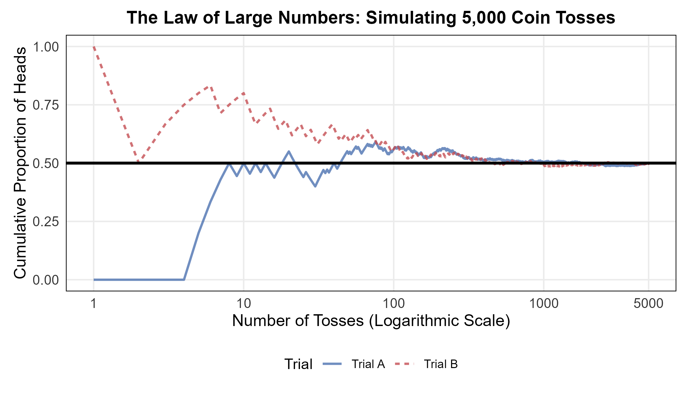
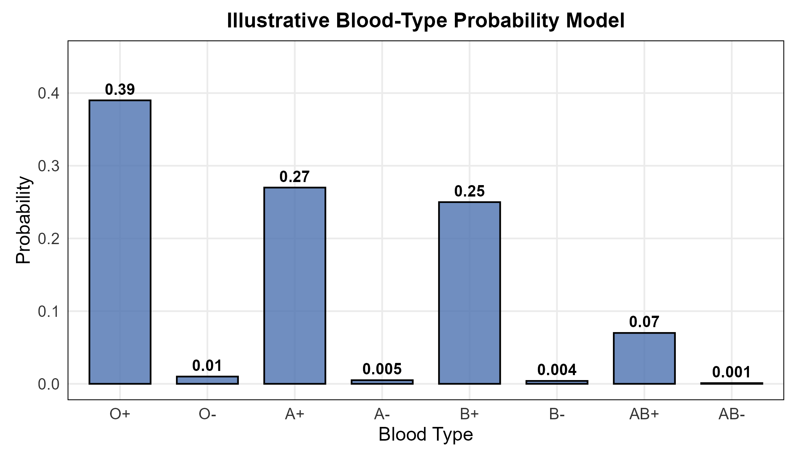
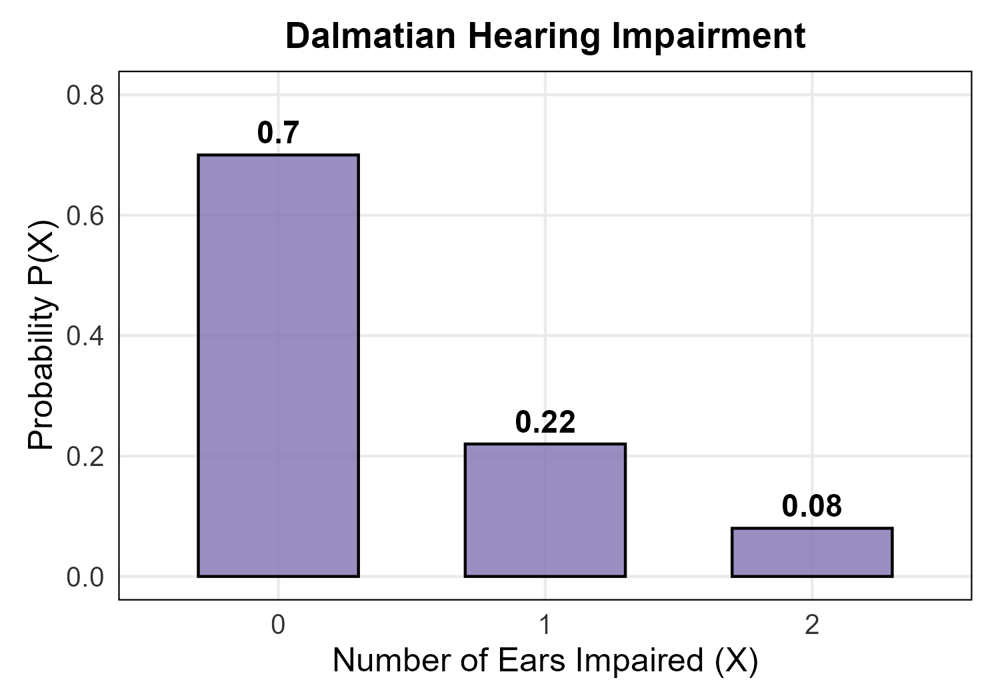
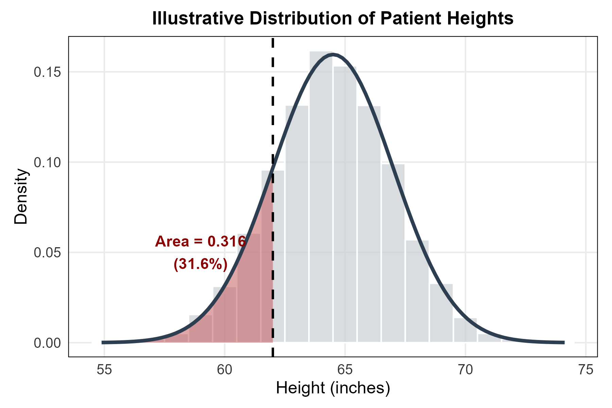
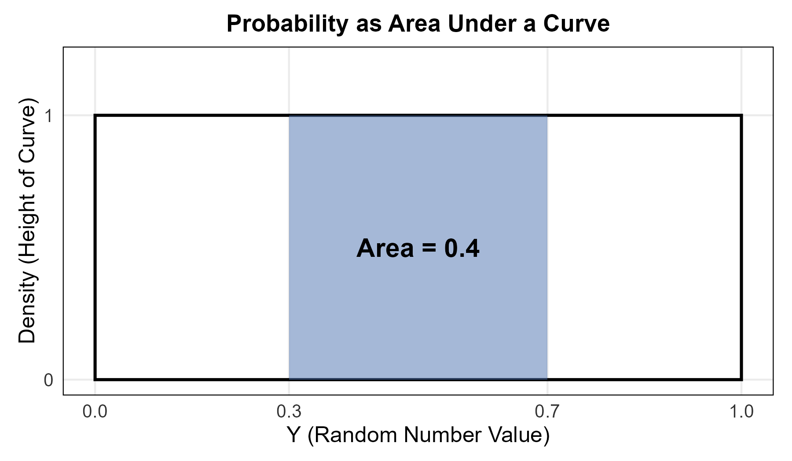

<style>
/* ============================================================
   CHAPTER 9 — PAGE + COLLAPSIBLE TABLE OF CONTENTS
   ============================================================ */

:root {
  --toc-width: 300px;
  --toc-collapsed-gutter: 72px;
  --chapter-width: 1100px;

  --ink: #23364a;
  --accent: #2c3e50;
  --line: #d8dee4;
  --soft: #f6f8fa;
  --toc-background: #f7f9fb;
}


/* ============================================================
   GENERAL PAGE
   ============================================================ */

html {
  scroll-behavior: smooth;
}

body {
  font-size: 17px;
  line-height: 1.65;
  color: var(--ink);
}

.main-container {
  max-width: var(--chapter-width) !important;
}


/* ============================================================
   HIDE DUMMY CHAPTER CONTENT
   ============================================================ */

/*
   Chapter 9 is used as the numbering root.

   Hide the visible "Chapter 9" H1 because the document title
   already says Chapter 9, but KEEP the section itself so that
   H2 headings are numbered 9.1, 9.2, 9.3, ...
*/
.section.chapter-root > h1 {
  display: none !important;
}


/* ============================================================
   HIDE CHAPTERS 1–8 FROM THE TABLE OF CONTENTS
   ============================================================ */

/*
   R Markdown/tocify does not reliably expose the chapter names
   through data-unique, so select them through their generated
   href values instead.
*/

#TOC li:has(a[href="#chapter-1-dummy"]),
#TOC li:has(a[href="#chapter-2-dummy"]),
#TOC li:has(a[href="#chapter-3-dummy"]),
#TOC li:has(a[href="#chapter-4-dummy"]),
#TOC li:has(a[href="#chapter-5-dummy"]),
#TOC li:has(a[href="#chapter-6-dummy"]),
#TOC li:has(a[href="#chapter-7-dummy"]),
#TOC li:has(a[href="#chapter-8-dummy"]) {
  display: none !important;
}


/*
   Also hide the Chapter 9 parent entry itself.

   Its children — 9.1, 9.2, 9.3, ... — remain visible.
*/
#TOC li:has(> a[href="#chapter-9"]) > a[href="#chapter-9"] {
  display: none !important;
}


/*
   tocify may place the Chapter 9 subsections inside the same
   list item. Remove spacing belonging to the hidden parent.
*/
#TOC li:has(> a[href="#chapter-9"]) {
  margin-top: 0 !important;
}


/* ============================================================
   ACCESSIBILITY
   ============================================================ */

.sr-only {
  position: absolute;
  width: 1px;
  height: 1px;
  padding: 0;
  margin: -1px;
  overflow: hidden;
  clip: rect(0, 0, 0, 0);
  white-space: nowrap;
  border: 0;
}


/* ============================================================
   SIDEBAR TOGGLE BUTTON
   ============================================================ */

#toc-toggle {
  position: fixed;

  top: 16px;
  left: calc(var(--toc-width) + 14px);

  width: 42px;
  height: 42px;

  display: flex;
  align-items: center;
  justify-content: center;

  padding: 0;

  border: 1px solid #c7d0d9;
  border-radius: 8px;

  background: #ffffff;
  color: var(--ink);

  box-shadow: 0 2px 8px rgba(24, 39, 55, 0.13);

  cursor: pointer;

  font-size: 24px;
  line-height: 1;

  z-index: 1200;

  transition:
    left 0.25s ease,
    background-color 0.2s ease,
    box-shadow 0.2s ease,
    transform 0.2s ease;
}

#toc-toggle:hover {
  background: #eef3f7;
  box-shadow: 0 3px 10px rgba(24, 39, 55, 0.18);
}

#toc-toggle:focus-visible {
  outline: 3px solid rgba(44, 62, 80, 0.28);
  outline-offset: 2px;
}


/* Open/close icons */

#toc-toggle .menu-icon {
  display: none;
}

#toc-toggle .close-icon {
  display: inline;
}


/* Button position when sidebar is collapsed */

body.toc-collapsed #toc-toggle {
  left: 14px;
}

body.toc-collapsed #toc-toggle .menu-icon {
  display: inline;
}

body.toc-collapsed #toc-toggle .close-icon {
  display: none;
}


/* ============================================================
   DESKTOP LAYOUT
   ============================================================ */

@media screen and (min-width: 992px) {

  /*
     Make room for fixed sidebar.
  */
  .main-container {
    width: 100% !important;
    max-width: none !important;

    padding-left: calc(var(--toc-width) + 30px) !important;
    padding-right: 35px !important;

    box-sizing: border-box !important;

    transition: padding-left 0.25s ease;
  }


  /*
     When sidebar is collapsed, reclaim almost all of the space.
  */
  body.toc-collapsed .main-container {
    padding-left: var(--toc-collapsed-gutter) !important;
  }


  /*
     Bootstrap normally reserves a column for the TOC.
     The TOC is fixed now, so remove that reserved column.
  */
  .main-container > .row-fluid > .col-xs-12.col-sm-4.col-md-3,
  .main-container > .row > .col-xs-12.col-sm-4.col-md-3 {
    width: 0 !important;
    min-height: 0 !important;
    padding: 0 !important;
    margin: 0 !important;
  }


  /* ----------------------------------------------------------
     FLOATING TOC
     ---------------------------------------------------------- */

  #TOC,
  #TOC.tocify {
    position: fixed !important;

    top: 0 !important;
    bottom: 0 !important;
    left: 0 !important;

    width: var(--toc-width) !important;
    max-height: 100vh !important;

    box-sizing: border-box !important;

    overflow-y: auto !important;
    overflow-x: hidden !important;

    margin: 0 !important;
    padding: 72px 16px 28px 18px !important;

    background: var(--toc-background) !important;

    border: 0 !important;
    border-right: 1px solid var(--line) !important;
    border-radius: 0 !important;

    box-shadow: none !important;

    z-index: 1100 !important;

    transform: translateX(0);

    transition: transform 0.25s ease;
  }


  /*
     Completely slide sidebar off screen when collapsed.
  */
  body.toc-collapsed #TOC,
  body.toc-collapsed #TOC.tocify {
    transform: translateX(calc(-1 * var(--toc-width)));
  }


  /*
     Allow long section headings to wrap rather than getting
     clipped.
  */
  #TOC a {
    white-space: normal !important;
    overflow-wrap: break-word !important;
    word-break: normal !important;
  }


  /* ----------------------------------------------------------
     TOC TYPOGRAPHY
     ---------------------------------------------------------- */

  #TOC .tocify-item {
    border-radius: 4px;
  }

  #TOC .tocify-item a {
    color: var(--ink);
    text-decoration: none;
  }

  #TOC .tocify-item:hover {
    background: #e9eef3;
  }

  #TOC .tocify-item.active {
    background: var(--accent) !important;
  }

  #TOC .tocify-item.active a {
    color: #ffffff !important;
  }


  /* ----------------------------------------------------------
     MAIN CHAPTER CONTENT
     ---------------------------------------------------------- */

  .toc-content,
  .toc-content.col-xs-12.col-sm-8.col-md-9 {
    width: 100% !important;
    max-width: var(--chapter-width) !important;

    float: none !important;

    margin-left: auto !important;
    margin-right: auto !important;

    padding-left: 15px !important;
    padding-right: 15px !important;

    box-sizing: border-box !important;
  }


  /*
     Fallback for Pandoc output that does not use Bootstrap's
     normal R Markdown container structure.
  */
  body.standalone-pandoc {
    width: calc(100% - var(--toc-width)) !important;
    max-width: none !important;

    box-sizing: border-box !important;

    margin: 0 0 0 var(--toc-width) !important;
    padding: 50px 45px !important;

    transition:
      width 0.25s ease,
      margin-left 0.25s ease,
      padding-left 0.25s ease;
  }

  body.standalone-pandoc.toc-collapsed {
    width: 100% !important;

    margin-left: 0 !important;
    padding-left: var(--toc-collapsed-gutter) !important;
  }

  body.standalone-pandoc > header,
  body.standalone-pandoc > section {
    max-width: var(--chapter-width);

    margin-left: auto;
    margin-right: auto;
  }
}


/* ============================================================
   MOBILE / TABLET
   ============================================================ */

@media screen and (max-width: 991px) {

  .main-container {
    width: auto !important;
    max-width: var(--chapter-width) !important;

    margin-left: auto !important;
    margin-right: auto !important;

    padding: 70px 18px 24px !important;

    box-sizing: border-box !important;
  }


  /*
     Toggle remains at upper-left on mobile.
  */
  #toc-toggle,
  body.toc-collapsed #toc-toggle {
    left: 12px;
  }


  /*
     Mobile starts with menu icon.
  */
  #toc-toggle .menu-icon,
  body.toc-collapsed #toc-toggle .menu-icon {
    display: inline;
  }

  #toc-toggle .close-icon,
  body.toc-collapsed #toc-toggle .close-icon {
    display: none;
  }


  /*
     Show X while the mobile TOC is open.
  */
  body.toc-mobile-open #toc-toggle .menu-icon {
    display: none;
  }

  body.toc-mobile-open #toc-toggle .close-icon {
    display: inline;
  }


  /* ----------------------------------------------------------
     MOBILE TOC DRAWER
     ---------------------------------------------------------- */

  #TOC,
  #TOC.tocify {
    position: fixed !important;

    top: 0 !important;
    bottom: 0 !important;
    left: 0 !important;

    width: min(84vw, 320px) !important;
    max-height: 100vh !important;

    box-sizing: border-box !important;

    overflow-y: auto !important;
    overflow-x: hidden !important;

    margin: 0 !important;
    padding: 72px 18px 28px !important;

    background: var(--toc-background) !important;

    border: 0 !important;
    border-right: 1px solid var(--line) !important;
    border-radius: 0 !important;

    z-index: 1100 !important;

    transform: translateX(-105%);

    transition: transform 0.25s ease;
  }

  body.toc-mobile-open #TOC,
  body.toc-mobile-open #TOC.tocify {
    transform: translateX(0);

    box-shadow: 6px 0 18px rgba(24, 39, 55, 0.16);
  }


  /*
     Prevent long headings from being clipped.
  */
  #TOC a {
    white-space: normal !important;
    overflow-wrap: break-word !important;
    word-break: normal !important;
  }


  body.standalone-pandoc {
    width: auto !important;
    max-width: var(--chapter-width) !important;

    margin: 0 auto !important;
    padding: 70px 18px 24px !important;

    box-sizing: border-box !important;
  }
}


/* ============================================================
   SECTION HEADINGS
   ============================================================ */

h1,
h2,
h3,
h4,
h5 {
  margin-top: 1.6em;
}

h2 {
  border-bottom: 3px solid var(--accent);
  padding-bottom: 0.25em;
}

h3 {
  border-bottom: 1px solid var(--line);
  padding-bottom: 0.2em;
}


/* ============================================================
   BLOCKQUOTES / DEFINITION BOXES
   ============================================================ */

blockquote {
  border-left: 4px solid var(--accent);

  background: #f7f9fa;

  padding: 0.7em 1em;
  margin-top: 1.2em;
  margin-bottom: 1.2em;
}


/* ============================================================
   TABLES
   ============================================================ */

table {
  width: 100%;

  margin: 1.35em auto;

  border-collapse: separate !important;
  border-spacing: 0;

  background: #ffffff;

  border: 1px solid #d6dde5;
  border-radius: 8px;

  overflow: hidden;

  box-shadow: 0 2px 8px rgba(24, 39, 55, 0.06);
}

table thead th {
  padding: 0.72em 0.9em !important;

  background: var(--accent);
  color: #ffffff;

  border: 0 !important;
  border-bottom: 1px solid #1e2d3b !important;

  font-weight: 700;

  vertical-align: middle !important;
}

table tbody td {
  padding: 0.65em 0.9em !important;

  border: 0 !important;
  border-bottom: 1px solid #e5e9ee !important;

  vertical-align: middle !important;
}

table tbody tr:nth-child(even) td {
  background: #f7f9fb;
}

table tbody tr:hover td {
  background: #eef4f8;
}

table tbody tr:last-child td {
  border-bottom: 0 !important;
}


/* ============================================================
   IMAGES
   ============================================================ */

img {
  display: block;

  max-width: 100%;
  height: auto;

  margin: 1.4em auto;

  border: 1px solid #e1e4e8;
  border-radius: 7px;
}


/* ============================================================
   MATHEMATICS
   ============================================================ */

.math.display {
  overflow-x: auto;
}


/* ============================================================
   HIDE R MARKDOWN CODE-FOLDING UI
   ============================================================ */

.btn-code,
.code-folding-btn,
div.btn-group.pull-right {
  display: none !important;
}
</style>

<button id="toc-toggle"
        type="button"
        aria-label="Toggle table of contents"
        aria-expanded="true">
  <span class="menu-icon" aria-hidden="true">&#9776;</span>
  <span class="close-icon" aria-hidden="true">&times;</span>
  <span class="sr-only">Toggle table of contents</span>
</button>

<script>
document.addEventListener("DOMContentLoaded", function () {
  const button = document.getElementById("toc-toggle");

  if (!button) return;

  button.addEventListener("click", function () {
    if (window.innerWidth <= 991) {
      document.body.classList.toggle("toc-mobile-open");

      const isOpen =
        document.body.classList.contains("toc-mobile-open");

      button.setAttribute("aria-expanded", isOpen);
    } else {
      document.body.classList.toggle("toc-collapsed");

      const isOpen =
        !document.body.classList.contains("toc-collapsed");

      button.setAttribute("aria-expanded", isOpen);
    }
  });
});
</script>

```{r setup, include=FALSE, echo=FALSE, warning=FALSE, message=FALSE}
knitr::opts_chunk$set(
  echo = FALSE,
  warning = FALSE,
  message = FALSE,
  error = FALSE
)

required_packages <- c("ggplot2")
missing_packages <- required_packages[
  !vapply(required_packages, requireNamespace, logical(1), quietly = TRUE)
]

if (length(missing_packages) > 0) {
  stop(
    "Install the following R packages before knitting: ",
    paste(missing_packages, collapse = ", ")
  )
}

suppressPackageStartupMessages({
  library(ggplot2)
})

set.seed(123) # Set seed for reproducible figures

# Shared publication-style theme and colour palette.
lecture_theme <- theme_minimal(base_size = 11) +
  theme(
    plot.title = element_text(size = 13, face = "bold", hjust = 0.5),
    axis.title = element_text(size = 12),
    axis.text = element_text(size = 10, colour = "#333333"),
    panel.grid.minor = element_blank(),
    plot.background = element_rect(fill = "white", colour = NA),
    panel.background = element_rect(fill = "white", colour = NA),
    plot.margin = margin(8, 10, 8, 10),
    panel.border = element_rect(colour = "black", fill = NA, size = 0.5)
  )

palette_main <- c("#4C72B0", "#55A868", "#C44E52", "#8172B2", "#CCB974")

save_plot <- function(filename, plot, width, height) {
  ggsave(
    filename = filename,
    plot = plot,
    width = width,
    height = height,
    units = "in",
    dpi = 300,
    bg = "white"
  )
}

# =============================================================
# 1. Law of Large Numbers: Coin Toss Simulation (Fig 9.1)
# =============================================================
set.seed(42) # For reproducible random tosses
n_tosses <- 5000

# Simulate Trial A and calculate cumulative proportion of heads
tosses_A <- sample(c(0, 1), n_tosses, replace = TRUE)
prop_A <- cumsum(tosses_A) / (1:n_tosses)

# Simulate Trial B and calculate cumulative proportion of heads
tosses_B <- sample(c(0, 1), n_tosses, replace = TRUE)
prop_B <- cumsum(tosses_B) / (1:n_tosses)

# Combine into a dataframe
coin_data <- data.frame(
  Toss = rep(1:n_tosses, 2),
  Proportion = c(prop_A, prop_B),
  Trial = factor(rep(c("Trial A", "Trial B"), each = n_tosses))
)

p_cointoss <- ggplot(coin_data, aes(x = Toss, y = Proportion, color = Trial, linetype = Trial)) +
  geom_line(alpha = 0.8, size = 0.8) +
  geom_hline(yintercept = 0.5, linetype = "solid", color = "black", size = 1) +
  # Use a log scale for the x-axis to stretch out the highly variable early tosses
  scale_x_log10(breaks = c(1, 10, 100, 1000, 5000), labels = c("1", "10", "100", "1000", "5000")) +
  coord_cartesian(ylim = c(0, 1)) +
  scale_color_manual(values = c("Trial A" = "#4C72B0", "Trial B" = "#C44E52")) +
  labs(
    title = "The Law of Large Numbers: Simulating 5,000 Coin Tosses",
    x = "Number of Tosses (Logarithmic Scale)",
    y = "Cumulative Proportion of Heads"
  ) +
  lecture_theme +
  theme(legend.position = "bottom")

save_plot("fig_ch9_cointoss.png", p_cointoss, width = 7, height = 4)

# =============================================================
# 2. Discrete Probability Model: Blood Types
# =============================================================
blood_data <- data.frame(
  Type = factor(c("O+", "O-", "A+", "A-", "B+", "B-", "AB+", "AB-"), 
                levels = c("O+", "O-", "A+", "A-", "B+", "B-", "AB+", "AB-")),
  Probability = c(0.39, 0.01, 0.27, 0.005, 0.25, 0.004, 0.07, 0.001)
)

p_blood <- ggplot(blood_data, aes(x = Type, y = Probability)) +
  geom_bar(stat = "identity", fill = "#4C72B0", alpha = 0.8, color = "black", width = 0.7) +
  geom_text(aes(label = Probability), vjust = -0.5, size = 3.5, fontface = "bold") +
  scale_y_continuous(limits = c(0, 0.45)) +
  labs(title = "Illustrative Blood-Type Probability Model",
       x = "Blood Type",
       y = "Probability") +
  lecture_theme

save_plot("fig_ch9_blood_types.png", p_blood, width = 7, height = 4)

# =============================================================
# 3. Continuous Probability Model: Random Number [0,1]
# =============================================================
p_uniform <- ggplot() +
  # Draw the uniform density block
  geom_rect(aes(xmin = 0, xmax = 1, ymin = 0, ymax = 1), fill = "#55A868", alpha = 0.5, color = "black", size = 0.8) +
  # Draw the zero-probability lines outside the [0,1] interval
  geom_segment(aes(x = -0.2, xend = 0, y = 0, yend = 0), size = 0.8) +
  geom_segment(aes(x = 1, xend = 1.2, y = 0, yend = 0), size = 0.8) +
  scale_x_continuous(breaks = c(0, 0.5, 1)) +
  scale_y_continuous(breaks = c(0, 1), limits = c(0, 1.2)) +
  labs(title = "Continuous Probability Model: Random Number (0 to 1)",
       x = "Y (Random Number Value)",
       y = "Density (Height of Curve)") +
  lecture_theme

save_plot("fig_ch9_continuous_uniform.png", p_uniform, width = 6, height = 4)

# =============================================================
# 4. Dalmatian Hearing Impairment (Discrete Bar Chart)
# =============================================================
dalmatian_data <- data.frame(
  Impaired_Ears = factor(c("0", "1", "2")),
  Probability = c(0.70, 0.22, 0.08)
)

p_dalmatian <- ggplot(dalmatian_data, aes(x = Impaired_Ears, y = Probability)) +
  geom_bar(stat = "identity", fill = "#8172B2", alpha = 0.8, color = "black", width = 0.6) +
  geom_text(aes(label = Probability), vjust = -0.5, size = 4, fontface = "bold") +
  scale_y_continuous(limits = c(0, 0.8)) +
  labs(title = "Dalmatian Hearing Impairment",
       x = "Number of Ears Impaired (X)",
       y = "Probability P(X)") +
  lecture_theme

save_plot("fig_ch9_dalmatian.png", p_dalmatian, width = 5, height = 3.5)


# =============================================================
# 5. Patient Heights: Histogram to Density Curve
# =============================================================
# Simulate a large sample of heights (mean = 64.5, sd = 2.5)
set.seed(123)
heights <- data.frame(Height = rnorm(10000, mean = 64.5, sd = 2.5))

p_heights <- ggplot(heights, aes(x = Height)) +
  # Draw histogram (scaled to density)
  geom_histogram(aes(y = ..density..), binwidth = 1, fill = "#caced3", color = "white", alpha = 0.7) +
  # Shade area <= 62
  stat_function(fun = dnorm, args = list(mean = 64.5, sd = 2.5),
                xlim = c(55, 62), geom = "area", fill = "#C44E52", alpha = 0.5) +
  # Draw full density curve
  stat_function(fun = dnorm, args = list(mean = 64.5, sd = 2.5), 
                color = "#2c3e50", size = 1.2) +
  geom_vline(xintercept = 62, linetype = "dashed", color = "black", size = 0.8) +
  annotate("text", x = 59, y = 0.05, label = "Area = 0.316\n(31.6%)", color = "#8b0000", fontface = "bold") +
  labs(title = "Illustrative Distribution of Patient Heights",
       x = "Height (inches)",
       y = "Density") +
  lecture_theme

save_plot("fig_ch9_heights.png", p_heights, width = 6, height = 4)


# =============================================================
# 6. Uniform Density (Random Numbers) - Shaded Areas
# =============================================================
p_uniform_shaded <- ggplot() +
  # Full uniform block outline
  geom_rect(aes(xmin = 0, xmax = 1, ymin = 0, ymax = 1), fill = NA, color = "black", size = 0.8) +
  # Shade 0.3 to 0.7
  geom_rect(aes(xmin = 0.3, xmax = 0.7, ymin = 0, ymax = 1), fill = "#4C72B0", alpha = 0.5) +
  annotate("text", x = 0.5, y = 0.5, label = "Area = 0.4", fontface = "bold", size = 5) +
  
  # Shade <= 0.5 or > 0.8 (we'll do this as a second plot or combine them. Let's do just the 0.3-0.7 for simplicity here)
  scale_x_continuous(breaks = c(0, 0.3, 0.7, 1)) +
  scale_y_continuous(breaks = c(0, 1), limits = c(0, 1.2)) +
  labs(title = "Probability as Area Under a Curve",
       x = "Y (Random Number Value)",
       y = "Density (Height of Curve)") +
  lecture_theme

save_plot("fig_ch9_uniform_shaded.png", p_uniform_shaded, width = 6, height = 3.5)


```

# Chapter 9 {.chapter-root .unlisted}

## Randomness and Probability

Probability gives us a mathematical language for describing uncertainty. The outcome of one trial may be impossible to predict, yet repeated trials often reveal a stable pattern.

> **RANDOM PHENOMENON**  
> A phenomenon is **random** when individual outcomes are uncertain but a regular and predictable distribution emerges over many repetitions.

Radioactive decay provides a useful example. We cannot identify the next atom that will decay, but a large collection of atoms follows a highly regular decay pattern. Probability describes that long-run regularity.

### Two Ways to Determine a Probability

Probabilities can come from a theoretical model or from observed data. The two approaches answer the same type of question, but their sources are different.

| Approach | Source of the probability | Illustration |
|:--|:--|:--|
| **Theoretical probability** | A mathematical, genetic or physical model | During one half-life, a model assigns probability $0.50$ that a tracer atom decays |
| **Empirical probability** | A proportion observed in data | If $498$ of $1000$ atoms decay, the estimated probability is $498/1000=0.498$ |

The hat in an empirical estimate reminds us that the value came from a particular dataset:

$$
\widehat{P}(A)=\frac{\text{number of observed occurrences of }A}{\text{number of trials}}
$$

Theoretical and empirical probabilities need not match exactly in a finite experiment. Random variation causes the empirical proportion to fluctuate around the model probability.

> **Important distinction:** A theoretical probability is a feature of a specified model. An empirical probability is an estimate calculated from observations.

### The Frequentist Interpretation

In the **frequentist interpretation**, the probability of an event is the proportion of times that event would occur in a very long sequence of repetitions performed under the same conditions.

Suppose $498$ of $1000$ tracer atoms decay during one half-life. The observed relative frequency is

$$
\frac{498}{1000}=0.498
$$

A new group of $1000$ atoms would probably produce a slightly different proportion. Across many large groups, however, the empirical proportions would tend to cluster near the theoretical value $0.50$.

This interpretation has two parts:

1. The outcome of one trial remains uncertain.
2. The relative frequency becomes increasingly stable over many independent repetitions.

### Coin Tosses and the Law of Large Numbers

For a fair coin, the theoretical probability of heads is $0.5$. After $n$ tosses, the cumulative proportion of heads is

$$
\widehat{P}_n(\text{heads})
=\frac{\text{number of heads among the first }n\text{ tosses}}{n}
$$



Early proportions can change sharply because each new toss represents a large fraction of the observations collected so far. After thousands of tosses, one additional result has very little effect on the cumulative proportion.

> **LAW OF LARGE NUMBERS**  
> As the number of independent repetitions increases, the observed relative frequency tends to approach the underlying probability.

The Law of Large Numbers does **not** say that:

- the first $10$ tosses must contain exactly $5$ heads
- a run of tails makes heads more likely on the next toss
- a cumulative proportion must move steadily toward $0.5$
- every long sequence will contain exactly equal counts

It describes a long-run tendency, not a short-run balancing mechanism.

The simulation can be reproduced with a few introductory R commands:

```{r coin-toss-r, echo=TRUE}
set.seed(42)
tosses <- sample(c("H", "T"), size = 5000, replace = TRUE)
mean(tosses == "H")
```

The result will generally be close to $0.5$, but it need not equal $0.5$ exactly.

### Randomness Naturally Produces Streaks

People often judge a mixed-looking sequence as more random than one containing clusters. Consider these two results from six fair-coin tosses:

$$
\text{Sequence A: H T H T T H}
$$

$$
\text{Sequence B: T T T H H H}
$$

Each is one specific sequence of six tosses, so each has probability

$$
\left(\frac{1}{2}\right)^6=\frac{1}{64}
$$

The second sequence may look less random, but it is not less probable. Random processes naturally generate runs and clusters.

The mistaken belief that a future outcome must compensate for a recent streak is called the **gambler's fallacy**. A fair coin has no memory; after five tails, the probability of heads on the next toss is still $0.5$.

### Probability Beyond Repeatable Experiments

Some uncertain events cannot literally be repeated under identical conditions. For example, we might ask about the probability that humans discover extraterrestrial life during this century. Such a probability reflects the available evidence, scientific models and informed judgement.

Regardless of how a probability is obtained, it must satisfy the mathematical rules introduced later in this chapter.

## Probability Models

To use probability formally, we must identify every possible outcome and specify how probability is assigned.

> **PROBABILITY-MODEL VOCABULARY**  
> The **sample space** $S$ is the set of all possible outcomes of a random phenomenon.  
> An **event** is one outcome or a collection of outcomes; mathematically, it is a subset of $S$.  
> A **probability model** consists of a sample space and a rule for assigning probabilities to events.

For one coin toss,

$$
S=\{\text{heads},\text{tails}\}
$$

The event “heads” contains one outcome. If two coins are tossed, the sample space changes:

$$
S=\{HH,HT,TH,TT\}
$$

The event “exactly one head” is now

$$
A=\{HT,TH\}
$$

The sample space depends on the random phenomenon being studied and on what information is recorded.

### Example 9.5: A Blood-Type Probability Model

A blood type combines an ABO group with a Rhesus factor. For the following illustrative population model, the sample space is

$$
S=\{O+,O-,A+,A-,B+,B-,AB+,AB-\}
$$

| Blood type | $O+$ | $O-$ | $A+$ | $A-$ | $B+$ | $B-$ | $AB+$ | $AB-$ |
|:--|--:|--:|--:|--:|--:|--:|--:|--:|
| Probability | $0.39$ | $0.01$ | $0.27$ | $0.005$ | $0.25$ | $0.004$ | $0.07$ | $0.001$ |



This model is valid because every probability lies between $0$ and $1$, and the probabilities sum to $1$:

$$
0.39+0.01+0.27+0.005+0.25+0.004+0.07+0.001=1
$$

The bar chart is appropriate because the blood types are separate categorical outcomes. Rare outcomes remain part of the sample space even when their probabilities are small.

### Changing the Scope of the Model

The Rhesus factor describes whether red blood cells carry the RhD antigen. A blood type is labelled Rh-positive when the antigen is present and Rh-negative when it is absent.

If we record only the Rh factor, the sample space becomes

$$
S=\{Rh+,Rh-\}
$$

We obtain the probability of $Rh+$ by combining the positive blood-type outcomes:

$$
P(Rh+)=0.39+0.27+0.25+0.07=0.98
$$

Similarly,

$$
P(Rh-)=0.01+0.005+0.004+0.001=0.02
$$

| Rh factor | $Rh+$ | $Rh-$ |
|:--|--:|--:|
| Probability | $0.98$ | $0.02$ |

This smaller model does not contradict the eight-outcome model. It answers a less detailed question by combining outcomes.

### Discrete and Continuous Sample Spaces

Probability models are divided into two broad types.

| Feature | Discrete sample space | Continuous sample space |
|:--|:--|:--|
| Possible outcomes | Finite or countably infinite | Every value in an interval |
| Probability of one value | May be positive | Equals $0$ |
| How probabilities are found | Add probabilities of listed outcomes | Calculate areas under a density curve |
| Example | Number of impaired ears | Exact body height |

A variable can be intrinsically continuous even when it is recorded in rounded units. Height does not become discrete merely because it is reported to the nearest centimetre.

## Fundamental Probability Rules

Every valid probability model, discrete or continuous, must follow the same basic rules.

### Rule 1: The Sample Space Has Probability One

Some outcome in the sample space must occur:

$$
P(S)=1
$$

### Rule 2: Probabilities Are Between Zero and One

For every event $A$,

$$
0\leq P(A)\leq 1
$$

A negative probability or a probability larger than $1$ is impossible.

### Rule 3: Addition for Disjoint Events

Two events are **disjoint**, or mutually exclusive, when they have no outcomes in common. They cannot occur on the same trial, so

$$
P(A\text{ and }B)=0
$$

For disjoint events,

$$
P(A\text{ or }B)=P(A)+P(B)
$$

For three pairwise-disjoint events,

$$
P(A\text{ or }B\text{ or }C)=P(A)+P(B)+P(C)
$$

The simple addition rule applies only when the events do not overlap. Chapter 10 develops the general rule for events that can occur together.

### Rule 4: The Complement Rule

The complement $A^c$ contains all outcomes in the sample space that are not in $A$:

$$
P(A^c)=1-P(A)
$$

The complement rule is especially useful for questions involving “not,” “none,” or later, “at least one.”

### Reading AND and OR Carefully

Probability gives these words precise meanings.

- **$A$ or $B$** means that at least one event occurs. Probability uses the inclusive meaning of “or,” so both may occur unless the events are disjoint.
- **$A$ and $B$** means that both events occur on the same trial.
- **not $A$** means the complement $A^c$.

In the blood-type model, the outcomes $O+$ and $A+$ are disjoint because one individual cannot have both blood types. Therefore, their probabilities can be added directly.

### Example 9.7: Positive and Negative Rhesus Factor

The four positive blood-type outcomes are disjoint, so

$$
\begin{aligned}
P(Rh+)
&=P(O+)+P(A+)+P(B+)+P(AB+)\\
&=0.39+0.27+0.25+0.07\\
&=0.98
\end{aligned}
$$

The complement of a positive Rhesus factor is a negative Rhesus factor:

$$
\begin{aligned}
P(Rh-)
&=1-P(Rh+)\\
&=1-0.98\\
&=0.02
\end{aligned}
$$

The complement method is shorter than adding the four negative blood-type probabilities, although both approaches give the same answer.

### Checking Whether a Discrete Model Is Valid

When a table claims to be a discrete probability model, check both conditions:

1. Every probability is between $0$ and $1$.
2. The probabilities sum to exactly $1$, apart from minor rounding.

For example, the values $0.20$, $0.35$, $0.15$ and $0.30$ form a valid model because all are nonnegative and

$$
0.20+0.35+0.15+0.30=1
$$

The values $0.20$, $0.35$, $-0.05$ and $0.50$ do not form a valid model, even though they sum to $1$, because probabilities cannot be negative.

## Random Variables

A random phenomenon may produce a numerical result. We use a random variable to assign a mathematical name to that result.

> **RANDOM VARIABLE**  
> A **random variable** is a variable whose numerical value is determined by the outcome of a random phenomenon. Random variables are usually represented by uppercase letters such as $X$ or $Y$.

The **probability distribution** of a random variable tells us:

- which values the random variable can take
- how probability is assigned to those values

For example:

- $X=$ number of impaired ears in a randomly selected Dalmatian, so $X\in\{0,1,2\}$
- $Y=$ a random number selected from $[0,1]$, so every real number in that interval is possible

### Discrete and Continuous Random Variables

A **discrete random variable** has a finite or countable set of possible values. Counts are usually discrete.

A **continuous random variable** can take any value in an interval. Measurements such as time, mass, temperature and height are usually modelled as continuous.

The distinction concerns the possible values of the underlying variable, not simply how the values happen to be written in a dataset.

## Discrete Probability Models

For a discrete random variable, each possible value is assigned a probability. The probability of an event is obtained by adding the probabilities of the values that belong to that event.

If $X$ takes values $x_1,x_2,\ldots$ with probabilities $p_1,p_2,\ldots$, then a valid model satisfies

$$
0\leq p_i\leq 1
$$

and

$$
\sum_i p_i=1
$$

### Example 9.8: Hearing Impairment in Dalmatians

A study of $5333$ Dalmatians recorded the number of ears with hearing impairment. Let $X$ be the number of impaired ears in a randomly selected dog.

| Number of impaired ears $x$ | $0$ | $1$ | $2$ |
|:--|--:|--:|--:|
| $P(X=x)$ | $0.70$ | $0.22$ | $0.08$ |



The model is valid because

$$
0.70+0.22+0.08=1
$$

The probability of at least one impaired ear is

$$
\begin{aligned}
P(X\geq 1)
&=P(X=1)+P(X=2)\\
&=0.22+0.08\\
&=0.30
\end{aligned}
$$

The same result follows from the complement rule:

$$
P(X\geq 1)=1-P(X=0)=1-0.70=0.30
$$

The phrase **at least one** includes both $1$ and $2$, whereas **more than one** includes only $2$:

$$
P(X>1)=P(X=2)=0.08
$$

This distinction matters in discrete models because an individual point may have positive probability.

The calculation can be checked with short R commands:

```{r dalmatian-probability-r, echo=TRUE}
x <- c(0, 1, 2)
p_x <- c(0.70, 0.22, 0.08)

sum(p_x)
sum(p_x[x >= 1])
```

## Continuous Probability Models

A continuous random variable can take infinitely many values across an interval. We cannot list a positive probability for every point. Instead, probabilities are represented by areas under a **density curve**.

> **DENSITY CURVE**  
> A density curve lies on or above the horizontal axis and has total area equal to $1$.

For a continuous random variable $Y$,

$$
P(a\leq Y\leq b)=\text{area under the density curve from }a\text{ to }b
$$

Probability is determined by **area**, not by the height of the curve at a single point. A tall curve over a narrow interval can contain less area than a shorter curve over a wide interval.

### Example 9.9--9.10: Patient Heights

A smooth density curve can summarize the overall distribution of a continuous measurement such as height.



The total area under the curve is $1$. If the shaded area to the left of $62$ inches is $0.316$, then

$$
P(Y\leq 62)=0.316
$$

This means that approximately $31.6\%$ of the population described by the model is at most $62$ inches tall. The value $0.316$ is an area under the curve; it is not the height of the curve at $62$.

### Example 9.11: The Uniform Distribution

Suppose $Y$ is selected uniformly from $0$ to $1$. “Uniformly” means intervals of equal width have equal probability. The density is a rectangle with height $1$ because its total area must be

$$
\text{width}\times\text{height}=(1-0)(1)=1
$$



The probability that $Y$ lies between $0.3$ and $0.7$ is the area of the shaded rectangle:

$$
\begin{aligned}
P(0.3\leq Y\leq 0.7)
&=\text{width}\times\text{height}\\
&=(0.7-0.3)(1)\\
&=0.4
\end{aligned}
$$

For a general uniform distribution on $[a,b]$, the rectangle must have height

$$
\frac{1}{b-a}
$$

Therefore, for an interval $[c,d]$ inside $[a,b]$,

$$
P(c\leq Y\leq d)=\frac{d-c}{b-a}
$$

This is the width of the requested interval divided by the total width.

### Adding Disjoint Continuous Intervals

For $Y$ uniformly distributed from $0$ to $1$, the events $Y\leq0.5$ and $Y>0.8$ are disjoint intervals. Therefore,

$$
\begin{aligned}
P(Y\leq0.5\text{ or }Y>0.8)
&=P(Y\leq0.5)+P(Y>0.8)\\
&=0.5+0.2\\
&=0.7
\end{aligned}
$$

Now suppose $X$ is uniformly distributed on $[2,10]$. The total width is

$$
10-2=8
$$

The intervals $X<4$ and $X\geq7$ are disjoint, so

$$
\begin{aligned}
P(X<4\text{ or }X\geq7)
&=\frac{4-2}{8}+\frac{10-7}{8}\\
&=\frac{2}{8}+\frac{3}{8}\\
&=\frac{5}{8}
\end{aligned}
$$

### Why Exact Values Have Probability Zero

For every continuous random variable and every exact value $c$,

$$
P(Y=c)=0
$$

A single point has zero width, so the area above it is zero. This does not mean that the value is impossible in an ordinary-language sense. It means that no exact point receives positive probability in an ideal continuous model.

Because the endpoint contributes zero probability,

$$
P(Y\leq0.8)=P(Y<0.8)
$$

This is different from a discrete model. For the Dalmatian variable, $P(X=1)=0.22$, so including or excluding $1$ changes the probability.

## Parameters of a Probability Distribution

Chapter 2 used the sample mean $\bar{x}$ and sample standard deviation $s$ to describe observed data. A probability distribution also has a centre and spread, but these are theoretical **parameters**.

| Quantity | Observed sample | Probability distribution |
|:--|:--:|:--:|
| Mean | $\bar{x}$ | $\mu$ |
| Standard deviation | $s$ | $\sigma$ |

The mean of a random variable is also called its **expected value**.

### Mean or Expected Value of a Discrete Random Variable

Suppose $X$ has possible values $x_1,\ldots,x_k$ with probabilities $p_1,\ldots,p_k$. Its expected value is

$$
\mu=E(X)=\sum_{i=1}^{k}x_i p_i
$$

The expected value is a probability-weighted average. Outcomes with larger probabilities contribute more heavily.

In a long series of independent repetitions, the average observed value tends toward $\mu$. The expected value does not have to be one of the possible individual outcomes.

### Variance and Standard Deviation

The variance of a discrete random variable is the probability-weighted average squared distance from the mean:

$$
\sigma^2=\sum_{i=1}^{k}(x_i-\mu)^2p_i
$$

The standard deviation is

$$
\sigma=\sqrt{\sigma^2}
$$

Variance is measured in squared units. Standard deviation is measured in the same units as the random variable, which makes it easier to interpret.

### Observed Data and a Probability Model

The sample and model formulas have the same goal but describe different objects.

| | Observed sample | Probability model |
|:--|:--:|:--:|
| Mean | $\displaystyle\bar{x}=\frac{1}{n}\sum_{j=1}^{n}x_j$ | $\displaystyle\mu=\sum_{i=1}^{k}x_i p_i$ |
| Standard deviation | $\displaystyle s=\sqrt{\frac{\sum_{j=1}^{n}(x_j-\bar{x})^2}{n-1}}$ | $\displaystyle\sigma=\sqrt{\sum_{i=1}^{k}(x_i-\mu)^2p_i}$ |

$\bar{x}$ and $s$ summarize values that were actually observed. $\mu$ and $\sigma$ describe the full probability model. With many independent observations from that model, the sample summaries tend to approach the distribution parameters.

### Example 9.13: Mean of the Dalmatian Distribution

For the Dalmatian model,

| $x$ | $P(X=x)$ | $xP(X=x)$ |
|--:|--:|--:|
| $0$ | $0.70$ | $0.00$ |
| $1$ | $0.22$ | $0.22$ |
| $2$ | $0.08$ | $0.16$ |
| **Total** | **$1.00$** | **$0.38$** |

Therefore,

$$
\begin{aligned}
\mu=E(X)
&=(0)(0.70)+(1)(0.22)+(2)(0.08)\\
&=0.38
\end{aligned}
$$

The long-run average is $0.38$ impaired ears per dog. A single dog cannot have $0.38$ impaired ears; the expected value describes the average across many dogs.

### Example 9.13: Variance and Standard Deviation

Using $\mu=0.38$, calculate each squared deviation and weight it by its probability.

| $x$ | $P(X=x)$ | $x-\mu$ | $(x-\mu)^2$ | $(x-\mu)^2P(X=x)$ |
|--:|--:|--:|--:|--:|
| $0$ | $0.70$ | $-0.38$ | $0.1444$ | $0.10108$ |
| $1$ | $0.22$ | $0.62$ | $0.3844$ | $0.084568$ |
| $2$ | $0.08$ | $1.62$ | $2.6244$ | $0.209952$ |

The variance is

$$
\begin{aligned}
\sigma^2
&=(0-0.38)^2(0.70)+(1-0.38)^2(0.22)+(2-0.38)^2(0.08)\\
&=0.10108+0.084568+0.209952\\
&=0.3956
\end{aligned}
$$

The standard deviation is

$$
\sigma=\sqrt{0.3956}=0.62897\approx0.63
$$

The calculations can be checked in R using vectorized arithmetic:

```{r dalmatian-mean-sd-r, echo=TRUE}
x <- c(0, 1, 2)
p_x <- c(0.70, 0.22, 0.08)

mu <- sum(x * p_x)
variance <- sum((x - mu)^2 * p_x)
sigma <- sqrt(variance)

c(mean = mu, variance = variance, standard_deviation = sigma)
```

## Probability, Risk and Odds

Probability, risk and odds describe the same uncertain event in different ways. They are related but are not numerically interchangeable.

### Risk

In health and life-science applications, **risk** usually means the probability of an undesirable event. If event $A$ occurs with probability $p$, then

$$
\operatorname{Risk}(A)=p
$$

Risk must lie between $0$ and $1$ and is often reported as a percentage.

### Odds

Odds compare the probability that an event occurs with the probability that it does not occur:

$$
\operatorname{Odds}(A)=\frac{p}{1-p}
$$

Odds may be reported as a decimal or as a ratio. Odds of $1:3$ mean one occurrence for every three non-occurrences in the long run.

### Example 9.14: Deep Vein Thrombosis

Among $1518$ patients receiving Fragmin, $42$ experienced deep vein thrombosis (DVT). The estimated risk is

$$
\begin{aligned}
p
&=\frac{42}{1518}\\
&\approx0.0277\\
&=2.77\%
\end{aligned}
$$

The number who did not experience DVT was

$$
1518-42=1476
$$

The odds of DVT are therefore

$$
42:1476
$$

Dividing both sides by $42$ gives

$$
42:1476\approx1:35
$$

This means that for approximately every one patient who experienced DVT, $35$ did not.

As a numerical ratio, the odds are

$$
\frac{42}{1476}\approx0.0285
$$

The risk $0.0277$ and odds $0.0285$ are close because DVT is rare in this group. When $p$ is small, $1-p$ is close to $1$, so $p/(1-p)$ is close to $p$.

### Example 9.15: Sickle-Cell Inheritance

If both parents have sickle-cell trait, a standard genetic model gives the following probabilities for each child:

| Outcome | Probability |
|:--|--:|
| Inherits neither sickle-cell gene | $0.25$ |
| Inherits one and has sickle-cell trait | $0.50$ |
| Inherits both and has sickle-cell disease | $0.25$ |

The risk of sickle-cell disease is

$$
p=0.25=25\%
$$

The odds are

$$
\begin{aligned}
\operatorname{Odds}
&=\frac{p}{1-p}\\
&=\frac{0.25}{0.75}\\
&=\frac{1}{3}\approx0.333
\end{aligned}
$$

The ratio form is $1:3$. The risk is $25\%$, while the numerical odds are approximately $0.333$. The difference is meaningful because the event is not extremely rare.

### Converting Odds Back to Probability

Let $o$ represent numerical odds. Starting with

$$
o=\frac{p}{1-p}
$$

solve for $p$:

$$
\begin{aligned}
o(1-p)&=p\\
o-op&=p\\
o&=p+op\\
o&=p(1+o)\\
p&=\frac{o}{1+o}
\end{aligned}
$$

For odds of $1/3$,

$$
\begin{aligned}
p
&=\frac{1/3}{1+1/3}\\
&=\frac{1/3}{4/3}\\
&=\frac{1}{4}=0.25
\end{aligned}
$$

For ratio odds $a:b$, the event occurs in $a$ of every $a+b$ long-run outcomes, so

$$
p=\frac{a}{a+b}
$$

For example, odds of $2:5$ correspond to probability

$$
\frac{2}{2+5}=\frac{2}{7}\approx0.286
$$

## Checking Chapter 9 Calculations in R

R is useful for checking arithmetic after the probability model has been constructed. It does not decide which outcomes belong to an event or whether a model is scientifically appropriate.

```{r chapter9-r-summary, echo=TRUE}
# Empirical probability
684 / 800

# Complement
1 - 0.855

# Probability from a discrete model
sum(c(0.22, 0.08))

# Risk to odds, then odds back to risk
p <- 0.25
odds <- p / (1 - p)
odds / (1 + odds)
```

The mathematical reasoning should come first: define the event, identify the appropriate model and select the probability rule. R then provides a quick numerical check.

## Chapter 9 Synthesis

The chapter connects several representations of uncertainty.

| Situation | Main idea | Calculation |
|:--|:--|:--|
| Repeated trials | Long-run relative frequency | Empirical proportion |
| Discrete event | Add probabilities of included outcomes | $P(A)=\sum_{x\in A}P(X=x)$ |
| Complement | Event does not occur | $P(A^c)=1-P(A)$ |
| Disjoint events | Events cannot occur together | $P(A\text{ or }B)=P(A)+P(B)$ |
| Continuous interval | Probability is area | Area under the density curve |
| Distribution centre | Long-run weighted average | $\mu=\sum x_i p_i$ |
| Distribution spread | Probability-weighted squared distance | $\sigma^2=\sum(x_i-\mu)^2p_i$ |
| Health risk | Probability of an undesirable event | $p$ |
| Odds | Occurrence compared with non-occurrence | $p/(1-p)$ |

### A Reliable Problem-Solving Process

1. Define the random phenomenon precisely.
2. Write the sample space or identify the possible values of the random variable.
3. Translate the wording into an event using phrases such as **or**, **and**, **not**, **at least**, or **more than**.
4. Decide whether the model is discrete or continuous.
5. Select the appropriate rule or area calculation.
6. Show the numerical work.
7. Interpret the result in the context and in the correct units.

### Common Errors to Avoid

- Treating a theoretical probability as though it must occur exactly in a small sample
- Believing a random process must compensate for a recent streak
- Forgetting that the simple addition rule requires disjoint events
- Confusing “at least one” with “more than one”
- Reading the height of a density curve as a probability
- Assigning positive probability to one exact value in a continuous model
- Interpreting an expected value as a required individual outcome
- Reporting odds as though they were probabilities

### Final Checklist

By the end of Chapter 9, you should be able to:

- explain probability as long-run regularity
- distinguish theoretical from empirical probability
- identify sample spaces, outcomes and events
- verify a discrete probability model
- use the disjoint addition and complement rules
- distinguish discrete and continuous random variables
- calculate probabilities from a discrete table or as areas under a density curve
- calculate and interpret $\mu$, $\sigma^2$ and $\sigma$ for a discrete random variable
- convert between probability, risk and odds
